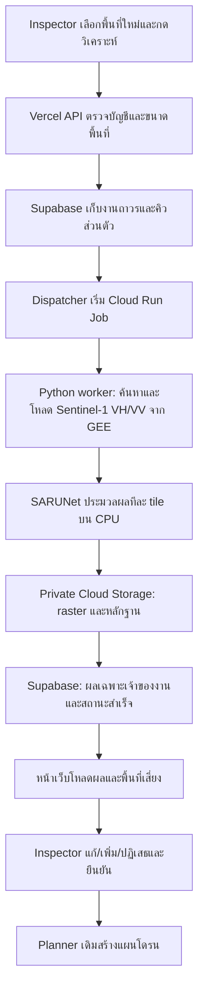

# XEDO — แผนให้ผู้ใช้เลือกพื้นที่ใหม่และวิเคราะห์ SAR บน cloud

## 1. หัวข้อ

- วันที่ตรวจข้อมูล: **29 ตุลาคม 2026**, Asia/Bangkok
- ขอบเขต: วางแผนบริการวิเคราะห์ใหม่ตามพื้นที่ที่ Inspector เลือก แล้วเชื่อมกลับเข้าเครื่องมือแก้พื้นที่/ยืนยัน/planner ที่เผยแพร่แล้ว
- ผู้ใช้ยืนยันปริมาณ: **1 คน, ประมาณ100งาน/เดือน, กรอบภาพที่ประมวลผลไม่เกิน200กม²/งาน**
- สถานะเอกสาร: ข้อเสนอทางวิศวกรรมและประมาณราคา ยังไม่สร้างบริการ cloud ไม่เปิด Billing ไม่ใช้เงิน ไม่แก้ source/SQL production และไม่ deploy
- ต้องแยกสามอย่าง: **ข้อเท็จจริงจากไฟล์เดิม / ข้อเท็จจริงจากเอกสารผู้ให้บริการ / สมมติฐานที่ต้อง benchmark**
- สถานะล่าสุด30ต.ค.: **แนวทางเริ่มต้นปัจจุบันเปลี่ยนเป็นCPUในเครื่อง** ตามLOCAL_CPU_AI_INTEGRATION_PLAN.md/§3.14เพื่อคงเงื่อนไขไม่มีBilling/subscription เอกสารcloudนี้เก็บข้อเสนออนาคตและcostscenarioเดิม ไม่ใช่บริการที่จะเปิดเดือนนี้ ผลCPU16รอบก่อนหน้าอยู่§3.13

## 2. สรุป

**หลักฐานใหม่จาก local benchmark30ต.ค.:** CPU4threads ใช้โมเดลซ้ำ processing median2.297s/รวม preview4.171s; native peak สูงสุด891.297MiB สำหรับ gridเดิม176.478กม² ทั้ง16รอบเทียบ baseline ตรงทุกพิกเซล สเปก cloud4vCPU/8GiB และต้นทุนด้านล่างยังเป็นข้อเสนอเดิมที่ไม่ได้ผ่าน cloud benchmark ไม่ลด/รับรอง cloud RAM จากการตั้ง threads ในเครื่องอย่างเดียว

**ข้อเสนอ cloud เดิมสำหรับอนาคต:** Google Cloud Run Jobs แบบCPUเปิดเฉพาะมีงาน เริ่ม4vCPU/8GiBและครั้งละ1งาน คงเว็บ/APIบนVercelและบัญชี/ภารกิจบนSupabase ใช้privateCloudStorageสำหรับraster/ผลใหญ่ แต่แนวทางที่ผู้ใช้ให้วางแผนล่าสุดคือCPUในเครื่องตามLOCAL_CPU_AI_INTEGRATION_PLAN.md ไม่เปิดCloudRun/GCS/Billingจากแผนปัจจุบัน

**คำชี้แจง30ต.ค.2026:** การเลือกCPUและตัวเลขต้นทุนเป็นข้อเสนอที่มีเงื่อนไข ยังไม่ใช่หลักฐานว่าcloudจะไม่crashหรือไม่มีค่าใช้จ่ายแน่นอน ยังไม่ได้benchmarkcloud/peakmemory/end-to-endจริง รูปแบบที่เสนอคือpay-as-you-goโดยไม่เลือกsubscription/committed-useรายเดือน แต่ต้องเปิดBillingและอาจมีค่าใช้จ่ายตามการใช้จริง โควตาฟรีไม่ใช่คำรับประกันค่าใช้จ่ายศูนย์

เหตุผล: checkpointSARUNetจริงมีขนาดประมาณ1.92MiB และผลเดิม9tilesประมวลผลบนCPUในช่วงที่summaryจับเวลา2.22238วินาที โมเดลนี้จึงไม่ได้มีหลักฐานว่าต้องใช้GPU สเปก4/8เป็นการเผื่อruntime/GDAL/temporaryfiles ต้องวัดcloudmemoryและเวลารวมก่อนรับประกัน;2vCPU/4GiBเป็นตัวเลือกให้benchmarkเพื่อลดทรัพยากรหลังได้baseline

ที่อัตราอ้างอิงus-central1 ค่าCPU+RAM4/8เท่ากับ$0.3168/ชั่วโมง หรือ **100งาน×10นาที = $5.28/เดือนก่อนโควตาฟรี** หากfreeallowanceของbillingaccountเหลือครบ ผลคำนวณเฉพาะcomputeเป็นประมาณ$0.06 ไม่ใช่รับประกันใบแจ้งหนี้ทั้งหมด เสนอสำรองงบcloudเพิ่มเติม$10–15/เดือนในpilotนี้ โดยยังต้องตรวจGEEregistration/usage,storage,egress,build/image/logและภาษี [Cloud Run pricing](https://cloud.google.com/run/pricing)

GPUสำรองที่เปรียบเทียบคือModalT4/L4แบบตามงาน มีเครดิตStarterตามเงื่อนไขปัจจุบัน แต่ยังไม่จำเป็นต้องเพิ่มอีกผู้ให้บริการตั้งแต่ต้น การใช้GPUจะพิจารณาหลังแยกเวลาGEE/download/inferenceแล้วพบว่าinferenceเป็นคอขวด [Modal pricing](https://modal.com/pricing)



## 3. รายละเอียด

### 3.1 ข้อเท็จจริงที่ตรวจจากโครงการ

| รายการ | สิ่งที่ตรวจพบ |
|---|---|
| โมเดล | SARUNet, base16, 488,561parametersจากการนับโครงสร้าง ไม่ได้โหลดรันโมเดลใหม่ |
| Checkpoint | sar_v26_fresh_best_export.pth, 2,017,845bytes หรือ1.92MiB, SHA256ตรงกับผลที่เว็บใช้อยู่ |
| Input | Sentinel-1สองbandsตามลำดับ[VH,VV], Sigma0dB,float32, normalization/NoDataตามrunner |
| วิธีประมวลผล |512×512pixelsต่อtile,batch1บนCPU อ่าน/เขียนrasterioทีละwindow ไม่ย่อภาพทั้งฉาก |
| ผลเดิม |1317×1340=1,764,780gridpixels,9tiles,CPU/PyTorch2.14.1+cpu |
| ขอบเขตกริดเดิม |176.478กม²ที่10m;validจริง106.183กม² ต้องคิดขนาดจากกรอบraster ไม่ใช่พื้นที่validเพียงอย่างเดียว |
| เวลาเดิม |เริ่ม13:05:18.654063UTC→เสร็จ13:05:20.876443UTCวันที่11ต.ค.2026 =2.22238วินาที |
| เว็บที่เผยแพร่แล้ว |โหลดresultIdคงที่จากpreparedcatalog,แสดง14candidates,Inspectoredit/confirm/privatehistory/plannerได้ |
| จุดที่ยังไม่มี |รับพื้นที่ใดๆ→สร้างงานใหม่→เรียกGEEอัตโนมัติ→รันPython→ลงทะเบียนผลเฉพาะเจ้าของ |

**เวลา2.22วินาทีเป็นหลักฐานเก่า ไม่ใช่benchmarkที่รันวันนี้ และไม่ใช่เวลาที่ผู้ใช้จะรอผลทั้งหมด** ตัวจับเวลาในrun_inferenceเริ่มหลังโหลดโมเดลและตรวจinput และไม่รวมค้นหา/export/downloadจากGEE,coldstart,preview,polygonization,uploadและการตอบเว็บ ยังไม่มีการวัดcloudRSSหรือP95

หลักฐานในเครื่อง:

- `outputs/SYSTEM_FIX_2026-10-11/real_gee_results/XEDO_SAR_20261011T130518Z_6152a5/summary.json`
- `outputs/XEDO_GEE_Colab_2026-10-11/gee_sar_inference.py` โดยเฉพาะrun_inferenceและrasterioWindow
- `outputs/XEDO_GEE_Colab_2026-10-11/VALIDATION_TH.md` ระบุรันผลจริงในเครื่อง ส่วนcloudColabขณะนั้นยังไม่ยืนยัน
- `src/planning-risk-editor.js`, `api/inspector.mjs`, `db/inspector-ai.sql`, `vercel.json` ในreleasecheckout

### 3.2 ควรให้ AI รันที่ไหน

| ทางเลือก | บทบาทในแผน | ข้อพิจารณา |
|---|---|---|
| **Cloud Run Jobs CPU4vCPU/8GiB** |ตัวเลือกเริ่มต้น|ทำงานจนจบแล้วปิด,เข้าถึงGEE/GCSด้วยserviceidentity,ใช้runnerเดิมได้;ต้องเปิดGoogleCloudBillingและตรวจสิทธิ์ |
| Cloud Run Jobs CPU2vCPU/4GiB |ตัวเลือกbenchmarkลดสเปก|ลดCPU/RAMครึ่งหนึ่ง แต่ยังไม่วัดความเร็ว/peakmemoryบนcloud |
| ModalT4/L4ตามงาน |ทางเลือกGPUหลังbenchmark|ต้องรวมCPU/RAM/startup/warmidleในราคา;GPUต้องมีpaymentmethodตามเงื่อนไข |
| Colabแบบเปิดmanual |เครื่องมือทดลองโมเดล|ยังต้องมีsession/การจัดสรรruntime ไม่เลือกเป็นbackendอัตโนมัติที่ผู้ใช้เว็บพึ่งพา |
| Browser/Vercelrequest/SupabaseDB |คงเป็นUI/API/metadata|ไม่ย้ายPythonSARทั้งpipelineมาแขวนไว้กับrequest30–60วินาทีของapplicationปัจจุบัน |

CloudRunJobsเหมาะกับงานที่จบเป็นครั้งๆ Vercelเริ่มjobผ่านAPIแล้วคืนjobIdทันที ผู้ใช้ปิดแท็บได้ งานไม่ผูกกับHTTPrequestเดิม งานCPUมีเพดานtimeoutของผู้ให้บริการยาวกว่าที่ต้องการมาก แต่pilotควรกำหนดเองที่30นาทีและมีheartbeat [Execute jobs](https://docs.cloud.google.com/run/docs/execute/jobs), [Job timeout](https://docs.cloud.google.com/run/docs/configuring/task-timeout)

สำหรับผู้ใช้คนเดียว ประเมิน100งาน×10นาทีรวม16.67ชั่วโมงworker/เดือน จึงไม่มีเหตุให้จองเครื่องหรือGPUทำงานตลอดเดือน ทั้งนี้เป็นcapacityscenarioตามเวลาสมมติ ไม่ใช่การวัดว่าทุกงานจบ10นาที

### 3.3 การคำนวณค่าใช้จ่าย

ใช้อัตราUSDของinstance-basedCloudRunJobsในus-central1ที่ตรวจวันที่29ต.ค.2026:CPU$0.000018/vCPU-second,RAM$0.000002/GiB-second คิดทั้งอายุcontainerและขั้นต่ำ60วินาที/instance อัตราภูมิภาคอื่นและbillingaccountต้องตรวจอีกครั้งก่อนสร้างจริง

```text
ราคา4vCPU/8GiBต่อวินาที
  = 4×0.000018 + 8×0.000002
  = $0.000088
ต่อชั่วโมง = 0.000088×3600 = $0.3168
ต่องานที่ใช้10นาที = 0.000088×600 = $0.0528
100งาน/เดือน = 0.0528×100 = $5.28
```

สมมติฐาน10นาทีคือ**billablecontainerlifetime**รวมstartupและการรอข้อมูลถ้ารออยู่ในcontainer ไม่ใช่เวลาmodel-only2.22วินาที และไม่ใช่SLA [Cloud Run pricing](https://cloud.google.com/run/pricing)

| จำนวนงาน/เดือน | เวลารันสมมติ/งาน | CPU+RAMก่อนfreeallowance | ถ้าfreeallowanceเหลือครบ* |
|---:|---:|---:|---:|
|30|10นาที|$1.584|$0.00|
|**100 — กรอบที่ยืนยัน**|**10นาที**|**$5.28**|**$0.06**|
|300|10นาที|$15.84|$10.62|

*CloudRunallowance240,000vCPU-secondsและ450,000GiB-seconds/เดือนรวมระดับbillingaccount:100งานใช้CPU240,000และRAM480,000 จึงเกินRAM30,000×$0.000002=$0.06 หากallowanceถูกงานอื่นใช้ไปแล้วต้องกลับไปดูคอลัมน์ก่อนfree ไม่รับประกันว่าจะได้โควตานี้เต็ม

Sensitivityสำหรับ100งาน:ถ้าเฉลี่ย5นาทีcomputeก่อนfree=$2.64;ถ้า30นาที=$15.84 จึงต้องวัดเวลารวมและจำกัดretriesด้วย ถ้าเปิดเครื่อง4/8ตลอด730ชั่วโมงตัวเลขเทียบตรงๆคือ$231.264ก่อนfree ซึ่งไม่ใช่รูปแบบที่เสนอ

GPUเปรียบเทียบโดยให้CPU/RAMประกอบใกล้เคียงกัน:Modal2physicalcores≈4vCPUและRAM8GiB ราคาCPU$0.0000131/core-secondและRAM$0.00000222/GiB-second รวมกับT4$0.000164/GPU-secondหรือL4$0.000222/GPU-second

| Configuration | ราคารวมต่อชั่วโมง |100งาน×10นาที ก่อนเครดิต|
|---|---:|---:|
|CloudRunCPU4/8|$0.3168|$5.28|
|ModalT4+2physicalcores+8GiB|$0.748656|$12.4776|
|ModalL4+2physicalcores+8GiB|$0.957456|$15.9576|

ตารางนี้ใช้เวลาคิดเงินเท่ากันเพื่อเทียบราคา ไม่ได้อ้างว่าCPU/GPUทำงานเร็วเท่ากัน GPUอาจคุ้มขึ้นถ้าinferenceหนักจริง แต่GPUไม่เร่งเวลาค้นหา/รอexportGEE ModalStarterระบุเครดิต$30/เดือนตามสิทธิ์บัญชี;ต้องตรวจเครดิตจริงและpaymentmethodก่อนใช้GPU และคิดstartup/idleตามการตั้งค่า ไม่เรียกใช้ฟรีไม่มีเงื่อนไข [Modal pricing](https://modal.com/pricing), [Resource billing](https://modal.com/docs/guide/resources), [GPU requirements](https://modal.com/docs/guide/gpu), [Cold starts](https://modal.com/docs/guide/cold-start)

**ยังไม่รวม:**GEEcommercialusageถ้ามี,GCSstorage/operations/egress,CloudBuild/ArtifactRegistry,logs/dispatcher/reconciliationและภาษี ราคาบริการVercel/Supabaseเดิมไม่ถือเป็นค่าเพิ่มจากการประมวลผลนี้โดยอัตโนมัติ ต้องตรวจquotaเดิมเมื่อลงมือ

งบสำรองเสนอ$10–15/เดือนสำหรับpilot100งาน/10นาที เป็นbudgetproposalไม่ใช่ใบเสนอราคาที่รับประกัน ถ้าจะแปลงเป็นบาทโดยสมมติ35บาท/USDเท่ากับ350–525บาท เป็นอัตราสมมติเพื่อจัดงบ ไม่ใช่อัตราแลกเปลี่ยนสด

### 3.4 ขนาดภาพและที่เก็บไฟล์

ที่10mมีประมาณ10,000gridpixels/กม² ขนาดuncompressedโดยประมาณ:VH/VVfloat32สองbands8bytes/pixel+validuint8อีก1;scorefloat32+candidateuint8อีก5bytes/pixel

| กรอบภาพ | พิกเซล | InputDATA+VALID | Outputscore+mask | รวมrasterขั้นต่ำ |
|---:|---:|---:|---:|---:|
|100กม²|1ล้าน|9MB|5MB|14MB|
|**200กม²**|**2ล้าน**|**18MB**|**10MB**|**28MB**|
|250กม²|2.5ล้าน|22.5MB|12.5MB|35MB|
|1,000กม²|10ล้าน|90MB|50MB|140MB|

ไม่รวมmetadata/previews/GeoJSON/containerimageและactivationmemory ขนาดGeoJSONอาจโตตามจำนวนจุดเสี่ยง ต้องจำกัด/แบ่งหน้าและไม่autosimplifyrawเพื่อผ่านplanner

100งานที่เพดาน200กม²เกิดrasterinput/outputประมาณ2.8GB/เดือน ถ้าเสนอเก็บraw/temp7วันแบบหมุนเวียนจะเฉลี่ยประมาณ0.65GBก่อนoverhead;ผลGeoJSON,source/modelhashและประวัติreviewเก็บตามภารกิจเดิม ไม่ตั้งลบภารกิจผู้ใช้จากนโยบายtemp การเลือกretentionจริงต้องใส่ในdeploymentconfigที่reviewก่อนใช้ ไม่ลบข้อมูลรอบวางแผน

ให้GCSprivatebucketอยู่regionเดียวกับworker เก็บraster/fileใหญ่ในobjectstorage ส่วนSupabaseเก็บjobstatus/metadata/refs/ownership ไม่อัดbinaryTIFFในPostgres หน้าเว็บรับเฉพาะpreviewและcandidateที่จำเป็นผ่านowner-authorizedAPIหรือshort-livedURL [Cloud Storage pricing](https://cloud.google.com/storage/pricing)

### 3.5 รับภาพใหม่จาก GEE โดยไม่ต้องส่ง Drive เอง

1. BackendเลือกSentinel-1ที่ครอบคลุมAOIและมีVH/VV/IW/10mตามcontractเดิม ผู้ใช้เลือกพื้นที่ใหม่หมายถึงวิเคราะห์จากภาพที่มีอยู่ล่าสุดตามเงื่อนไข ไม่รับประกันว่าดาวเทียมเพิ่งถ่ายตอนกดปุ่ม
2. FreezeassetID/acquisitiontime/CRS/transform/geometry/pixelgrid/unit/bandorder/NoDataก่อนเริ่ม ไม่ใช้ภาพสีSentinel-2ที่แสดงบนแผนที่เป็นinputให้SARUNet
3. สำหรับpilot≤2ล้านpixels ให้ทำboundedgetDownloadURLสำหรับDATAและVALIDแยกกัน พร้อมmetadataจากAPI แต่ต้องตรวจขนาดจริงต่อrequestและความยาวด้าน กรณีเกิน/ใช้batchให้exportไปprivateGCSและติดตามtaskstatus
4. getDownloadURLมีข้อจำกัด32MBต่อrequestและgridด้านละ10,000pixels;DATAสองbandfloat32ที่2ล้านpixels≈16MBจึงมีmargin แต่ต้องตรวจจริงและไม่ถือว่ากรอบareaอย่างเดียวกันทุกfailureได้ ตั้งinitialmaxdimension4096ต่อด้านและmaxgrid2ล้านpixelsร่วมกัน
5. หากขยายพื้นที่ในอนาคต ใช้batchExport.image.toCloudStorageและแบ่งtiles/เก็บสถานะ ไม่ย้อนกลับไปให้คนกดTasks/ดาวน์โหลดDriveแล้วuploadเอง

[GEE getDownloadURL limits](https://developers.google.com/earth-engine/apidocs/ee-image-getdownloadurl), [Export to Cloud Storage](https://developers.google.com/earth-engine/apidocs/export-image-tocloudstorage)

WorkerบนGoogleใช้attachedserviceaccount/ADC,projectต้องเปิดEarthEngineและมีสิทธิ์ที่เหมาะสม ไม่ต้องให้Inspectorล็อกอินGoogleจากหน้าXEDO ส่วนVerceldispatcherใช้serveridentityที่มีสิทธิ์เฉพาะเริ่มjobที่กำหนด หากส่งexecutionoverridesต้องตรวจrunWithOverridespermissionด้วย ไม่เพิ่มEditorroleกว้างโดยอัตโนมัติ [GEE service accounts/ADC](https://developers.google.com/earth-engine/guides/service_account), [Cloud Run job identity](https://docs.cloud.google.com/run/docs/configuring/jobs/service-identity)

### 3.6 API/ฐานข้อมูล/Worker ที่ต้องเพิ่ม

ชื่อด้านล่างเป็นข้อเสนอ ยังไม่ใช่endpoint/tableที่ใช้งานแล้ว

| ส่วน | ข้อเสนอ |
|---|---|
|สั่งวิเคราะห์|`POST /api/v1/inspector/analysis-jobs` รับmissionId,inputRevision,AOI,sceneSelectionหรือsearchpolicy,idempotencyKey;คืน202+jobId|
|อ่านสถานะ|`GET /api/v1/inspector/analysis-jobs/:jobId` owner-only;jobstate,stage,tilecount,timestamps,errorcode/resultId|
|ยกเลิก|`POST /api/v1/inspector/analysis-jobs/:jobId/cancel` แยกcancelrequestedจากcancelledจริง|
|ผล|เพิ่มownedanalysislookupให้APIเดิมและresultadapter;ผลlegacypreparedยังเปิดได้|
|คิว|`analysis_jobs` มีownerId,missionId,inputRevision,specHash,status,attempt,lease,heartbeat,executionRef,error,resultRefและestimatedcostreservation|
|ผลถาวร|`analysis_results` หรือprivatecatalogแบบมีownerIdที่immutable พร้อมsource/model/preprocess/threshold/grid/hashและGCSrefs|
|ทำงานเบื้องหลัง|DockerPythonrunner+PyTorchCPU+rasterio/GDAL+EEclient+vectorization;freezeversionหลังreproducebaseline|
|เริ่มงาน|dispatcher/outboxที่ทนกรณีDBcommitสำเร็จแต่การเรียกCloudRunสะดุดและมีreconciliation|

**Trustboundaryที่ต้องแก้จริง:** catalogปัจจุบันเป็นpreparedresultกลาง ห้ามนำผลprivateของพื้นที่ใหม่ใส่แล้วปล่อยให้ทุกInspectorอ่านได้เพราะเป็นauthenticatedเหมือนกัน ต้องมีownerfilter/RLS/serverlookupทั้งAPIและdirectRPC และconfirm_riskต้องตรวจownershipกับimmutableanalysisRefของผลใหม่เช่นเดียวกับmissionowner

Flowงาน:

1. ตรวจsession+Inspector+missionownership,AOI≤120จุดตามUIเดิม,กรอบgrid≤2ล้านpixels/ด้าน≤4096,usage100งานเดือนและqueuecapacity
2. สร้างjob+outboxในtransactionและdedupeจากowner/mission/AOI/scene/model/preprocess/threshold ไม่สร้างexecutionซ้ำจากdoubleclick หากresultเดิมใช้ซ้ำได้ให้คืนresultเดิมพร้อมacquisitiondate
3. Dispatcherจองglobalworkerleaseแล้วเริ่มexecution เก็บexecutionname กรณีtimeoutที่ไม่รู้ว่าผู้ให้บริการรับแล้วหรือยังให้reconcileก่อนretry ไม่ยิงซ้ำโดยเดา
4. Workerclaimงานด้วยlease/fencingtoken อัปเดตheartbeatและstage ลงโหลดภาพ รันทีละtile แล้วเขียนpreview/GeoTIFF/GeoJSONลงtemp
5. ตรวจinput/outputhash,georeference,valid/NoData,bandunits,thresholdและcandidategeometry เขียนartifactให้ครบก่อนpublishresult
6. ลงทะเบียนimmutableownedresultและปิดjobเป็นsucceededแบบatomic ผล0candidateเป็นสำเร็จได้ ไม่ปลอมเป็นข้อผิดพลาดหรือสร้างพื้นที่น้ำมันขึ้นมา
7. Browserpollทุก3–5วินาทีเฉพาะงานactive;ปิดแท็บแล้วเปิดMyMissionsกลับมาตามjobIdได้ ผลinputRevisionเก่าไม่ทับAOIใหม่
8. ใช้riskeditorเดิม→Inspectorแก้/ยืนยัน→planner;เปลี่ยนผลใหม่invalidateconfirmation/plan/exportเก่าตามเดิม

**Concurrency:**taskCount1/parallelism1ของCloudRunJobกำหนดเฉพาะภายในหนึ่งexecution ไม่กันสองexecutionsพร้อมกัน ต้องมีglobaldispatcher/DBleaseเพิ่มสำหรับpilotหนึ่งworker จำกัดpending2งานและ1activejob การกันซ้ำ/heartbeat/reconciliationต้องผ่านก่อนเปิดให้ใช้

Workerเขียนผลผ่านinternalendpointที่ยืนยันserviceidentityและผูกjob/attempt/ownerจากDB ห้ามเชื่อownerIdจากbody;tokenมีขอบเขตงาน ไม่ส่งSupabaseservice_role/GCPkeyให้browser ใช้SecretManagerหรือworkloadidentityสำหรับsecretที่จำเป็น โดยดูdeploymentจริงก่อนเลือกไม่ฝังkeyในcontainerimage

### 3.7 สถานะบนเว็บและการทำงานเมื่อผิดพลาด

สถานะที่Inspectorเห็น: **เข้าคิว → ค้นหาภาพ SAR → โหลดข้อมูล → วิเคราะห์ X/Y tiles → สร้างพื้นที่เสี่ยง → บันทึกผล → พร้อมตรวจ** ใช้spinnerและจำนวนtilesจริง ระหว่างGEEรอไม่มีlivepercentให้ใช้stage/เวลาที่ผ่าน ไม่สร้าง100%จนartifactและDBพร้อม

| กรณี | พฤติกรรมที่ต้องได้ |
|---|---|
|ไม่มีSARครอบคลุม/ไม่มีVH/VV|แจ้งให้ปรับช่วงวันที่/พื้นที่ ไม่ใช้ผล14พื้นที่เก่ามาแทน|
|GEEtimeout/429|retryแบบbackoffเฉพาะtransientพร้อมattemptlimit;เก็บร่าง|
|ไม่มีvalidpixels|แจ้งinputunavailable ไม่ตีความว่าปลอดน้ำมัน|
|ข้อมูลบางส่วน|แสดงcoverage/NoDataตามจริง จำกัดtargetในขอบเขตที่ตรวจได้|
|GPU/CPUworkerOOM|ล้มเหลวมีreason/keepdraft;ไม่เปิดGPUแพงขึ้นเอง|
|ผลตอบช้า/เปลี่ยนAOI|เก็บในประวัติแต่ไม่แทนหน้าปัจจุบัน|
|Signout/sessionหมดอายุ|APIผลส่วนตัวถูกกัน งานbackendที่ได้รับอนุญาตแล้วอยู่ในประวัติเจ้าของเดิม|
|ยกเลิก|บันทึกคำขอ หยุดexecution/งานย่อยที่ทำได้ ไม่แสดงcancelledจนยืนยันและนับค่าใช้จ่ายที่เกิดแล้ว|
|ผลมีรู/MultiPolygon/378+จุด|rawคงเดิม;InspectorวาดtargetPolygonเดียว≤120จุดตามplanner ไม่simplifyเงียบๆ|
|confidence/น้ำมัน|คงscoresemanticsเดิม ไม่สร้างcalibratedprobability/ความหนา/ปริมาณน้ำมันจากผลsegmentationอย่างเดียว|

คง3steps/4calculators ไม่เพิ่มป้ายPrototypeหรือบังคับให้คนใช้เปิดเครื่องมือพัฒนาภายนอก

### 3.8 สิทธิ์ GEE และการคุมงบ

ก่อนเปิดใช้จริงต้องตรวจว่าprojectGEEที่ผูกอยู่ลงทะเบียนnoncommercialที่ยืนยันแล้วหรือcommercialอะไร ข้อมูลปัจจุบันของGoogleกำหนดnoncommercialcomputequotaแยกตามtier;Community150EECU-hours/เดือนและtierอื่นตามเงื่อนไข EECU-hoursไม่ใช่ชั่วโมงCPUของCloudRun จึงเอา2.22วินาทีหรือ100×10นาทีไปยืนยันquotaGEEเพียงพอไม่ได้ ต้องวัดEarthEngineusageจริง และผู้ใช้หนึ่งคนไม่ได้ทำให้ทุกcloudserviceฟรีโดยอัตโนมัติ [Noncommercial tiers](https://developers.google.com/earth-engine/guides/noncommercial_tiers), [GEE access](https://developers.google.com/earth-engine/guides/access)

ข้อเสนอpilot:

- 1activeworker,2pending,100logicaljobs/เดือน,grid≤2ล้านpixelsและmaxdimension4096
- jobdeadline30นาที;platformretry0แล้วใช้applicationretryแบบboundedหนึ่งครั้งสำหรับtransient โดยนับattempts/timeเข้าบัญชีงบ ไม่ใช้modeltrain
- cacheตามAOI+scene+checkpoint+preprocess+threshold และowner ไม่กดซ้ำแล้วเสียเงินซ้ำ
- budgetalert50/80/100%และCloudRunspendcapถ้าบัญชีรองรับ;alert-onlyไม่ใช่hardcap แม้spendcapก็มีreportingdelayและบริการอื่นแยก
- applicationreservebillablesecondsก่อนเริ่ม,จำกัดรวมเช่น25worker-hours/เดือน≈$7.92ที่4/8ก่อนfree เป็นข้อเสนอเริ่มต้น;สรุปactualtimeคืนreservationที่ไม่ใช้ ปฏิเสธงานใหม่เมื่อไม่เหลืองบเผื่องานจบ
- บันทึกcostestimateกับjob;ไม่เปิดGPU/เพิ่มจำนวนworker/ขยายพื้นที่แบบอัตโนมัตินอกconfigurationที่review

[Cloud Billing budget types](https://docs.cloud.google.com/billing/docs/how-to/budgets), [Cloud Run supported spend caps](https://docs.cloud.google.com/billing/docs/how-to/budgets-spend-caps)

### 3.9 ลำดับลงมือและเกณฑ์ผ่าน

| ลำดับ | งาน | จบเมื่อ |
|---|---|---|
|1|ตรวจGCPproject/Billing/GEEregistration/serviceidentity/region และกำหนดงบที่ผู้ใช้ยอมรับ|รู้สิทธิ์และราคาที่จะใช้จริง;ยังไม่เปิดค่าใช้จ่ายโดยอาศัยคำสั่งวางแผนนี้|
|2|สร้างcontainerจากrunnerเดิมและbenchmarkCPU2/4กับ4/8|reproduceผลเดิม/checkpointhash;วัดcoldstart/model/GEE/download/inference/vectorization/uploadและpeakRSSแยกกัน|
|3|ทำownedjob/resultcontracts+queue/lease/outbox/dispatcher+privateGCS|ส่งงานหนึ่งงาน,ปิดหน้า,กลับมาอ่านสถานะได้;doubleclickไม่สร้างซ้ำ;auth/RPCownerผ่าน|
|4|ทำGEEbackendexport/downloadและผลใหม่อย่างน้อย3พื้นที่จริง|ไม่ต้องกดDrive/Tasksเอง;metadata/grid/NoData/ผล0candidateและpartialผ่าน|
|5|ต่อปุ่มAnalyzeกับprogress/resultadapterและriskeditorเดิม|พื้นที่ใหม่→ผลใหม่→Inspectoredit→confirm→planner→Save/historyครบ|
|6|เก็บกรณีผิดพลาด/งบ/บัญชี/mobileและทดสอบก่อนเผยแพร่|quota/retry/cancel/latejob/session/crossowner/workercrash/3steps4calculators/24h/visiblepixels/exportไม่ถอยหลัง|

Benchmarkขนาดกริดประมาณ10/100/200กม²,อย่างน้อย3coldและ5warmต่อขนาด;จับเวลารวมแยกองค์ประกอบและทำpeakmemorysample เป้าหมายเพื่อกำหนดconfigurationไม่ใช่สัญญาSLAจากตัวอย่างไม่กี่งาน ถ้าpeakRSSต่ำและCPU2/4ตรงเวลาให้ลดสเปก;หากinferenceเป็นส่วนน้อยให้แก้GEE/downloadก่อนซื้อGPU

พิจารณาGPUเมื่อวัดแล้วmodelcomputeครองเวลารวมและทำให้เกินเกณฑ์รอที่ยอมรับ ค่อยbenchmarkT4/L4ด้วยภาพ/precisionเดียวกัน ไม่คาดspeedupจากชื่อGPU การเพิ่มGPUไม่ยืนยันaccuracyดีขึ้น ต้องตรวจoutputparityและจุดใกล้threshold

### 3.10 สิ่งที่ต้องใช้จากผู้ใช้และสถานะรอบนี้

- **ตอบแล้ว:**หนึ่งผู้ใช้,100งาน/เดือน,กรอบภาพไม่เกิน200กม²ต่องาน ไม่ถือว่างบหรือการเปิดBillingได้รับอนุมัติจากการเลือกปริมาณ
- เมื่อลงมือ ต้องทราบGoogleCloudprojectที่มีสิทธิ์GEEและตรวจBilling/registrationจริงผ่านบัญชีที่เชื่อมอยู่ ไม่ให้ส่งprivatekey/passwordในแชท
- ต้องมีการอนุมัติลงมือ/เปิดค่าใช้จ่ายก่อนสร้างpaidresources รอบนี้เสนอกรอบ$10–15/เดือนและยังไม่ได้ทำรายการดังกล่าว
- รอบนี้อ่านsource/summary/checkpointและเอกสารทางการ คำนวณต้นทุนด้วยสคริปต์เลขคณิตในoutputs/ ไม่รันinference/training/benchmarkcloud/applicationtestsหรือbuild ไม่แก้source/SQL/บัญชี/config ไม่commit/push/deploy
- ผลคำนวณตรวจซ้ำได้ที่`outputs/XEDO_Cloud_AI_Plan_2026-10-29/costs.json`และ`calculate-costs.mjs` ไม่มีcredentialsหรือDriveIDsในartifactเหล่านี้

#### คำชี้แจงความมั่นใจ — 30ตุลาคม2026

ผู้ใช้ถามว่าสรุปได้หรือไม่ว่าจะไม่crashและไม่ติดsubscriptionแน่นอน คำตอบคือยืนยันได้เฉพาะ**รูปแบบที่แนะนำเป็นcloudCPUแบบตามงาน** ส่วนno-crash/no-chargeไม่เคยผ่านการพิสูจน์จากการคำนวณนี้ โมเดลเล็กและผลCPUเดิมเป็นหลักฐานสนับสนุนการเริ่มทดลอง ไม่ใช่ผลloadtestของcloud การใช้RAMเกินlimitทำให้CloudRunหยุดinstanceได้ และเครือข่าย/GEE/timeoutอาจทำให้งานไม่สำเร็จ จึงต้องวัดที่กรอบสูงสุดและออกแบบให้ความล้มเหลวแสดงเหตุผล เก็บร่าง/ประวัติ และไม่ทับผลที่ยืนยันแล้ว [Cloud Run job memory limits](https://docs.cloud.google.com/run/docs/configuring/jobs/memory-limits)

CloudRunมีpay-per-useโดยไม่ต้องเลือกcommittedsubscriptionตามแผน แต่Billingยังคิดค่าCPU/RAM/storage/transferและบริการอื่นที่ใช้จริงได้ $5.28คือ100งาน×10นาทีในscenarioเดิม ไม่ใช่ยอดสูงสุดหรือราคาคงที่ [Cloud Run pricing](https://cloud.google.com/run/pricing) Budgetalertอย่างเดียวไม่หยุดบิล ส่วนspendcapที่รองรับยังมีreportingdelayและงานที่กำลังทำอาจจบพร้อมค่าใช้จ่ายเพิ่ม จึงต้องใช้applicationquota/reservation/timeouts/retrylimitsร่วมด้วย ไม่รับรองว่าใบแจ้งหนี้จะไม่เกินแม้แต่เล็กน้อย [Spend-cap limitations](https://docs.cloud.google.com/billing/docs/how-to/budgets-spend-caps)

รอบ30ต.ค.ตรวจแผน/sourceสถานะและเอกสารผู้ให้บริการเพื่อชี้แจงเท่านั้น ไม่มีcloudbenchmark/modelrun/applicationtests/build/การสร้างทรัพยากร/เปิดBilling/แก้sourceหรือSQL/push/deploy และไม่ถือว่าคำถามยืนยันความเข้าใจเป็นการอนุมัติใช้เงินจริง

### 3.11 แหล่งอ้างอิงทางการที่ตรวจ

- [Cloud Run pricing](https://cloud.google.com/run/pricing) —CPU/RAM/minimum/freeallowance/regionและค่าอื่น
- [Cloud Run jobs execution](https://docs.cloud.google.com/run/docs/execute/jobs) —เริ่มงานเบื้องหลัง
- [Job timeout](https://docs.cloud.google.com/run/docs/configuring/task-timeout), [Job service identity](https://docs.cloud.google.com/run/docs/configuring/jobs/service-identity)
- [GEE download limits](https://developers.google.com/earth-engine/apidocs/ee-image-getdownloadurl), [GEE export to GCS](https://developers.google.com/earth-engine/apidocs/export-image-tocloudstorage), [GEE service identity](https://developers.google.com/earth-engine/guides/service_account)
- [GEE registration](https://developers.google.com/earth-engine/guides/access), [Noncommercial quota tiers](https://developers.google.com/earth-engine/guides/noncommercial_tiers)
- [Modal pricing](https://modal.com/pricing), [GPU payment requirement](https://modal.com/docs/guide/gpu), [Resources](https://modal.com/docs/guide/resources), [Cold starts](https://modal.com/docs/guide/cold-start)
- [Budget alerts](https://docs.cloud.google.com/billing/docs/how-to/budgets), [Spend caps](https://docs.cloud.google.com/billing/docs/how-to/budgets-spend-caps)

### 3.12 Readiness และข้อจำกัดงบเดือนนี้ — ผลตรวจ30ตุลาคม2026

ผู้ใช้อนุญาตให้ตรวจGoogleCloud/GEEและเตรียมCPUtest พร้อมแจ้งว่าไม่สามารถสมัครsubscriptionเดือนนี้ จึงไม่เปิดBilling/แพ็กเกจ/paidresourceหรือใช้freecreditโดยอนุมานสิทธิ์ใช้เงิน

ผลจริงของtest-01-494520: GEEconfigGET200/REGISTERED_NOT_COMMERCIALLY/APIENABLED และconsoleเป็นCommunityTier,eligibilityexpireFeb10,2028,ใช้monthlyEECU0.87% ณเวลาตรวจ Billingconsoleแสดงprojectไม่เชื่อมBilling;Run/Build/RegistryAPIDISABLED StorageAPIENABLEDแต่ไม่สร้างbucket Project/BillingGET403SERVICE_DISABLEDจึงใช้consoleยืนยัน ไม่enableAPIและไม่ตีความ403เป็นbillingfalseโดยลำพัง

CloudRunJobsต้องมีBillingแม้จะใช้ฟรีtier จึงไม่เริ่มcloudexecutionในขอบเขตงบรอบนี้ [Cloud Run setup prerequisite](https://docs.cloud.google.com/run/docs/quickstarts/jobs/build-create-python) ไม่จำเป็นต้องสมัครsubscriptionเพื่อเตรียมlocalCPUtest เพราะvenv/runner/checkpoint/ภาพจริงเดิมมีครบแล้ว

ชุดpreparationในoutputs/XEDO_CPU_Readiness_2026-10-30มีrunbook/harness/fixturemanifestและdefaultdry-run Rootตรวจ6filehashesและdependenciesพร้อมreadyForExplicitLocalRun:true/inferenceExecuted:false ไม่มีcloudresourcecreated เตรียมthreads2/4/batch1/cold-warm/peakRSS/timeouts/outputhashes ส่วนactualinferenceและcloudbenchmarkยังไม่ทำ ภาพเดิม176.478กม²ไม่ใช่case200กม²ใหม่

ดูREADINESS_REPORT.mdและevidenceในโฟลเดอร์เดียวกันสำหรับAPI/console/localenvironment NoBillinglink/APIenable/subscription/IAMchange/modelrun/build/deployเกิดขึ้น รอบนี้อัปเดตเอกสารและคิวเท่านั้นนอกชุดhelperในoutputs ค่าใช้จ่าย$5.28ก่อนfreeในแผนเก่าเป็นscenario ไม่ใช่ยอดที่เกิดจากการตรวจนี้ ไม่มีคำถามผู้ใช้ค้างและไม่ขอให้เปิดBillingสวนเงื่อนไขเดือนนี้

### 3.13 ผล local CPU benchmark ที่อนุญาตภายหลัง — 30 ตุลาคม 2026

ผู้ใช้อนุญาตให้รันในเครื่องกับภาพเดิมแล้ว โดยยังห้ามBilling/subscription/paidcloud ผล8processes/16inferencepassesสำเร็จทั้งหมด ทั้งthreads2/4 เทียบผลbaselineแบบpixel/grid/NoDataและTIFFhashตรงทุกชุด ไม่ปรับโมเดล/threshold/ภาพเพื่อให้ผ่าน ดูรายงานoutputs/XEDO_CPU_Benchmark_2026-10-30/CPU_BENCHMARK_REPORT.md และข้อมูลดิบmetrics-summary.json/measurements.csv/comparison-report.json

| Local CPU metric | 2 threads | 4 threads |
|---|---:|---:|
| Fresh process เต็มงาน median3รอบ รวมimports/load/preview/hash (s) |12.430|12.242|
| Fresh process runner processing median (s) |2.991|2.350|
| ใช้โมเดลซ้ำ processing medianรอบ2–5, n4 (s) |3.183|2.297|
| ใช้โมเดลซ้ำรวมpreview/return files median (s) |4.991|4.171|
| Cold RAM nativepeak สูงสุด3processes (MiB) |670.699|671.844|
| Warm RAM nativepeak ของworker5passes (MiB) |875.977|891.297|

ใช้gridเดิม176.478กม² (valid106.183กม²),9tiles512²,CPUfloat32,batch1,threshold0.3บนRyzen7 8845HS/Windows/Python3.11.9/torch2.14.1+cpu Coldไม่ล้างOSfilecache Warmreuseไม่นับfirstpass PeaknativeRAMรวมimports/model/previewทั้งworker ไม่ใช่RAMรายpass ตัวเลขwarmสูงกว่าcoldไม่พอสรุปmemoryleak/ไม่มีleakจาก5passes ตรวจinputhash6ไฟล์หลังรันไม่เปลี่ยน

ผลสนับสนุนให้ใช้CPUและ4threadsเป็นbaselinelocalต่อ ไม่มีเหตุให้เปิดGPUสำหรับภาพนี้ RAM512MiBต่ำกว่าที่พบและ1GiBheadroomน้อย การทดลองsingleworker2GiBเป็นข้อเสนอทดสอบในอนาคต ไม่ถือว่าcloud2GiBqualifiedหรือเปลี่ยนcostscenario4/8เดิมให้เป็นราคาวัดจริง การใช้threads2/4ไม่จำลองvCPU/RAMlimitของcloud

ยังไม่ใช่case200กม²ใหม่,100jobsเดือน,concurrency/longsoak หรือfullendtoend:ไม่ได้วัดGEE/export/download/network/cloudstartup/vectorization/upload/DB/UI ไม่มีการเปิดcloud/ซื้อsubscription/แก้website/SQL/push/deploy จึงยังไม่ต่อon-demandผ่านเว็บ ต้องทำqueue/ownedresults/automaticGEE/worker/UIตามแผนเมื่อได้รับอนุญาตขอบเขตนั้น ส่วนcloudยังไม่เริ่มตามข้อจำกัดงบเดือนนี้

### 3.14 แนวทางปัจจุบัน: เชื่อม CPU ในเครื่อง — แผน30ตุลาคม2026

ผู้ใช้ขอแผนwebsiteเลือกพื้นที่ใหม่→localCPUโดยไม่เปิดBilling/subscriptionแล้ว ให้ใช้LOCAL_CPU_AI_INTEGRATION_PLAN.mdเป็นแผนลงมือหลัก:localworkerดึงownedjobsจากSupabaseผ่านHTTPSRPC,automaticGEEgetDownloadURL,CPU/packagerเดิม,ownedreviewcatalog/privatepreviewและInspector/planner ไม่สร้างCloudRun/GCSbucket/paidtunnel/cron คงrawTIFFในเครื่องและผลเล็กในระบบเดิม

Costscenario/CloudRun4vCPU8GiBในเอกสารนี้เป็นทางเลือกอนาคตที่ยังไม่อนุมัติ ไม่ใช่ทรัพยากรที่จะเปิดตามlocalplan งานcloudcontainerbenchmark/paidexecutionพักไว้ ส่วนlocalqueue/worker/UIยังเป็นแผนไม่implement ผู้ใช้ต้องเปิดเครื่องและโปรแกรมระหว่างรับงาน มีoffline/recovery/lease/fence/quotacapsและacceptanceตามไฟล์ใหม่

รอบเปลี่ยนแนวทางนี้ตรวจsource/package metadata/officialdocsและบันทึกMD/queueเท่านั้น ไม่รันinference/GEEpixelrequest/benchmark/applicationtests/build/liveDB ไม่สร้างmachineaccount/bucket/บริการ/SQL/Billing/subscriptionหรือpush/deploy

### 3.15 Localpipelineที่ใช้ได้แล้ว — 30 ตุลาคม 2026

LOCAL_CPU_AI_INTEGRATION_PLANขั้น1–2ได้รับอนุมัติและimplement/testedในเครื่องแล้ว ดูWEBSITE_DETAILS§3.44 ใช้GEEcomputePixelsกับprojectnoncommercialเดิมโดยไม่เพิ่มIAM ไม่ใช้getDownloadURLที่ติดthumbnails.create Nativegrid≤2Mpx/200กม²และCPUเดิมให้ผลbaselineตรงทุกpixel/hash;ทดสอบพื้นที่ใหม่5.0172/197.5274กม²จริงและ13Pythonchecksผ่าน ยังไม่เปิดcloudworker/CloudRun/GCS/Billing/subscriptionหรือpush/deploy งานขั้น3–7รวมhostedqueue/workeridentity/UIยังต้องทำต่อโดยคงข้อจำกัดงบเดิม


สถานะล่าสุดต่อจากขั้น1–2 — 30ต.ค.: localCPUขั้น3–5เชื่อมและทดสอบในเครื่องแล้วตามLOCAL_CPU_AI_INTEGRATION_PLAN§3.15/WEBSITE_DETAILS§3.45: Analyze→ownedqueue→GEE/CPUจริง→ownedcatalog→Inspectoredit/confirm→planner/Save/history เว็บ606/Python30tests/3buildsผ่าน ยังไม่applyhostedSQL/Authหรือเผยแพร่ TIFF/previewอยู่local ไม่สร้างStoragebucket งานขั้น6qualification/7releaseยังเหลือ ไม่มีBilling/subscription/IAM/push/deploy Cloudworkerยังเป็นfutureoptionไม่ได้เลือกใช้ รายงานoutputs/XEDO_Local_AI_Web_2026-10-30/REPORT.md


ขั้น6รับอนุญาตเชื่อมSupabaseจริง30ต.ค.แล้ว: SQLqueue/statusติดตั้งและRLS/ACL/PostgRESTตรวจผ่าน ทีมสร้างInspectorTest+machineและผูกownerสำเร็จ สองAuthroleผ่าน7checks เหลือprimarypassword/reconnectเพื่อfullqueue-CPU-Inspectorqualification ดูLOCAL_CPU_AI_INTEGRATION_PLAN§3.16/WEBSITE_DETAILS§3.46/รายงานoutputs/XEDO_Local_AI_Phase6_2026-10-30 ไม่มีBilling/subscription/push/deploy
