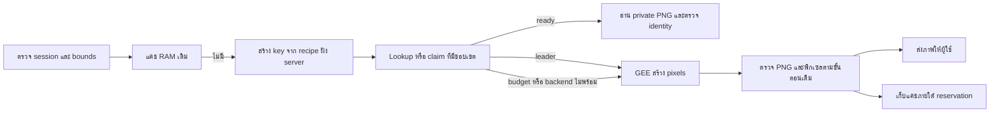

# XEDO — แบบแคชภาพแผนที่และหลักฐานข้อ 1–2

## 1. หัวข้อ

- วันที่: 30 ตุลาคม 2026, Asia/Bangkok
- Contract: `gee-map-cache-v1`, ออกแบบจาก [แผน v1.1](GEE_MAP_CACHE_PERFORMANCE_PLAN.md) ข้อ 1–2
- สถานะ: **ข้อ 3 implement และทดสอบกับ Supabase จริงแล้วในเครื่อง; ยังไม่ push/deploy เว็บ** ดู §3.10 สำหรับผลและข้อจำกัดการตรวจ
- แชทหลักแก้ source; แชท `02-chat ขนาน project หลัก` ตรวจ source/contract คู่ขนาน ผลรันจริงแยกจากกรณีที่ยังไม่รัน
- รอบข้อ 1–2 เปลี่ยนเฉพาะ diagnostics; รอบข้อ 3 เพิ่ม private cache/index/RPC และ adapter ในเครื่องตามคำสั่งผู้ใช้ ไม่เปลี่ยนบัญชี/สิทธิ์ Inspector หรือ CPU และไม่เผยแพร่ source ขึ้นเว็บออนไลน์

## 2. สรุป

เลือกใช้ server-derived recipe ของภาพจริงร่วมกับ private Storage และ index ที่ browser เข้าถึงโดยตรงไม่ได้ เริ่มที่ **200,000,000 bytes** รวม bytes ที่ยังลบหรือยกเลิกผู้เขียนไม่แน่นอน ห้ามใช้ session token หรือ z/x/y อย่างเดียวเป็นรหัสภาพ

ใช้ clip bbox เดิมเป็นส่วนหนึ่งของ identity ก่อน เพื่อรักษาความถูกต้อง การรวมภาพข้าม viewport หรือรวม `maps` กับ `computePixels` เป็น key เดียวกันยังไม่อยู่ใน contract เริ่มต้น ถ้าต้องเพิ่ม hit rate ในภายหลัง ต้องพิสูจน์พิกเซลเท่ากันก่อนเปลี่ยนเวอร์ชัน

แคชเป็นส่วนเสริม เมื่อ cache backend ไม่พร้อมหรือไม่มีพื้นที่ ระบบยังขอภาพผ่าน GEE ภายใต้การจำกัดคำขอเดิมได้ การอ่านแคชไม่ทำให้ภาพใหม่ขึ้น ไม่ทำให้ review เก่าหรือ flight readiness กลับมาถูกต้องเอง

## 3. รายละเอียด

### 3.1 หลักฐาน baseline รอบนี้

เก็บใน `C:/mega/codex/iENA/outputs/XEDO_GEE_Performance_Parallel_2026-10-30/primary/`:

| สิ่งที่ตรวจ | ผล | ข้อจำกัด |
|---|---|---|
| Source ก่อนแก้ | HEAD `a5612696a80470733da4155bd953d01d7b553bd4` พร้อม per-file hashes/dirty manifest | HEAD ไม่รวมงานในเครื่อง ต้องใช้ candidate hashes เพิ่ม |
| Production identity | `dpl_EG7VyQiMMZpdXuSxmeSLep3KcsGm`, READY, alias `xedo-eight.vercel.app`, main/a561269 | เป็นการตรวจรุ่นเดิม ไม่เผยแพร่รอบนี้ |
| HTML GET สำเร็จหนึ่งรอบ | 6,207,852 bytes หลังถอด gzip, 3,772,548 bytes ที่รับแบบ gzip; first byte 410.47 ms, รับครบ 65,570.74 ms | เวลา curl จากเครื่องนี้ ไม่ใช่ FCP/LCP/เวลาหน้าจอพร้อม และไม่ใช่ pure GEE compute; รอบแรก deadline 40 s ได้ไฟล์ไม่ครบจึงไม่ใช้เป็นผลสำเร็จ |
| Basemap manifest | 844.14 ms ครั้งแรกที่สังเกต, 861.51 ms เรียกซ้ำ | ไม่พิสูจน์ cold process/cache miss จริง |
| Basemap 4 ช่องพร้อมกัน | รวม 1,528.96 ms; แต่ละช่อง 891.20–1,424.97 ms | 4 ช่อง × 256 px, พื้นที่ทดสอบระยอง; ไม่ใช่ P95 หรือเวลาทั้งหน้า |
| ภาพที่รับสำเร็จ | 7 ไฟล์ PNG ถอดรหัส/CRC/ขนาด/alpha ผ่านและมีพิกเซลแสดงได้ | รวมช่องที่เรียกซ้ำ ไม่ใช่ 7 พื้นที่อิสระ; opaque black ไม่ถือเป็น NoData |
| Local working-tree API กับ GEE จริง | metadata upstream 870.02 ms, auth 461.07 ms; tile pixels upstream 861.65 ms; อ่าน tile เดิมจาก RAM wall 2.41 ms | เป็น cache ใน RAM ที่มีอยู่แล้ว ไม่ใช่ Supabase benchmark; PNG first/hit hash ตรงกัน |
| Supabase read-only SQL 13:25:39 UTC | 0 buckets / 0 objects / 0 Storage bytes; physical database 12,457,651 bytes | ไม่ใช่ dashboard organisation billing/egress; ไม่เอา DB physical bytes ไปหักโควต้าที่ใช้ metric คนละแบบ |
| Supabase Usage UI ที่อ่านรอบนี้ | megaphijak/All projects/Free, Storage 0/1 GB, DB summary 0.028/0.5 GB, xedo detail 26.45 MB, Egress 0.004/5 GB, Cached Egress 0/5 GB | UI ระบุอาจ refresh ช้า/ปัดเศษ; SQL กับ UI ให้แยก metric/เวลาที่เห็น ไม่ได้เปิดหน้า Billing หรือเปลี่ยนแผน |

`phase1-production-timings.json`, `local-timing-receipt.json`, `quota-readonly-receipt.json`, `usage-ui-receipt.json`, `baseline-source-manifest.json` และ candidate manifest เป็นหลักฐานในเครื่อง บางไฟล์มี opaque imagery sessions จึงไม่ใส่ raw response หรือ credentials ลง Git/public docs

Browser เห็นหน้า Production และข้อมูล GEE ได้ แต่ browser tool ในรอบนี้ไม่เปิด `performance` ให้ read-only evaluate จึงไม่วัด FCP/LCP/Resource Timing ผ่านวิธีนั้น ไม่ใช้ข้อจำกัดเครื่องมือเป็น product failure และไม่ใช้ API timings แทน browser metrics

### 3.2 Diagnostics ที่เพิ่มในเครื่อง

`Server-Timing` ใช้ชื่อคงที่และตัวเลขจำกัดเท่านั้น:

| ชื่อ | สิ่งที่วัด |
|---|---|
| `xedo_core` | ตั้งแต่เข้า core imagery API จนได้ Response รวม validation/session/cache/service work; ไม่รวม browser download หรือ decode |
| `gee_auth` | เวลาขอ/อ่าน access token ของคำขอ upstream นั้น รวม cache-token lookup |
| `gee_metadata` | metadata upstream request จนอ่าน body/parse/ตรวจ response จบ |
| `gee_pixels` | computePixels upstream request จนอ่าน PNG body/ตรวจ header จบ |
| `gee_map`, `gee_tiles` | upstream map creation หรือ map-tile transport ตามเส้นทางจริง |
| `gee_upstream` | ช่วง inclusive ของ authenticated operation รวม auth และ request/read ข้างต้น |

เวลาข้างต้น **ซ้อนกัน** ห้ามบวกทุก metric แล้วเรียกว่า total และ `gee_pixels` ไม่ใช่เวลา computation ภายใน GEE ล้วน เพราะรวม network/transfer/validation ส่วน backend ที่วัดได้ RAM hit ไม่มี upstream spans เป็นพฤติกรรมปกติ คำขอที่ join shared pending work อาจมีเฉพาะ `xedo_core`; ไม่ตีความการไม่มี upstream span ว่าเป็น cache hit โดยอัตโนมัติ

Hosted adapter อนุญาตเฉพาะ timing names และ `X-XEDO-Cache: hit|miss|outside-aoi` ที่ตรวจแล้ว header นี้ยังหมายถึง cache เดิมในหน่วยความจำ/นอกขอบเท่านั้น ไม่ใช่ Supabase status ไม่ส่ง session IDs, bbox, source URLs, error strings หรือ secrets ใน diagnostics

Storage read/write timing และ client pixel-decode timing ยังไม่มี runtime ของแคชให้วัด ต้องเพิ่มเมื่อทำข้อ 3/5 ไม่ใส่ค่า 0 แทนงานที่ยังไม่ได้เกิด ต้องรายงาน null/not_run

### 3.3 Pixel recipe และ key

สร้าง recipe จากค่าที่ backend ตรวจแล้วหลังถอดรหัส session เท่านั้น Browser ส่งได้เฉพาะ request geometry/scene หรือ session+zxy ภายใต้ API เดิม ห้ามรับ recipe/Storage path/URL/expression จาก browser มาใช้โดยตรง

Recipe ต้องมี:

1. `schemaVersion`, `purpose` (`basemap` หรือ `scene`), collection คงที่และ backend provider namespace รวม `sourceEpoch` ตามนโยบาย UTC-day + manual invalidation version
2. ordered full asset IDs ที่ใช้เรนเดอร์จริง **คงลำดับ**; basemap sort oldest→newest และ tie-break แบบเดียวกับ source, last image wins
3. `renderPipelineVersion` แยก computePixels กับ maps/map tiles; ชื่อ/เวอร์ชันอัลกอริทึม mosaic และ clip
4. bands `B4,B3,B2`, visualization range `0..3000`, gamma `1.2`, PNG format และสิ่งใดที่มีผลต่อ resampling/mask
5. `clipBBox` ที่ใช้จริงและ semantics; ช่วงแรกไม่ตัด bbox ออกจาก key เพื่อเพิ่ม hit rate
6. privacy/cache namespace ที่ backend กำหนด ห้ามใส่ user-provided owner; ไม่เก็บ mission IDs, history หรือ private geometry ลง shared/public response
7. Tile identity: z/x/y, dimensions 256×256, CRS `EPSG:3857`, affine grid จากสูตร server เวอร์ชันเดียวกัน

Serialize ด้วย recursive sorted object keys, preserve array order, JSON finite numbers, normalize -0, ไม่ round พิกัดโดยปริยาย จากนั้น SHA-256 ของ namespace + canonical recipe + canonical tile descriptor เป็น logical key ต้องมี fixtures cross-session/same key และ changed-assets/order/pipeline/clip/grid/different key

**ไม่รวม** random session token, session expiry, เวลาขอแคช หรือ access token ใน pixel identity แต่ตรวจ session/ขอบเขต/expiry ตามเดิม **ก่อน** lookup ทุกครั้ง ภาพที่คงเดิมใช้ซ้ำข้าม session ได้เมื่อ recipe ตรงเท่านั้น

Full asset IDs ยังไม่ใช่หลักฐานว่าผู้ให้บริการจะไม่ reprocess ข้อมูลภายใต้ ID เดิม ช่วงเริ่มต้นจึงกำหนด reuse ภายใน `sourceEpoch` ของวัน UTC เดียวกันและไม่เกิน 24 ชั่วโมง พร้อม manual epoch bump เมื่อพบ source/render revision ที่ทราบ ให้บันทึก generatedAt/PNG hash และ acquisition provenance ชัดเจน นโยบายนี้จำกัดอายุการใช้ซ้ำ ไม่ใช่คำรับรองว่าจะตรวจพบการเปลี่ยน pixels ภายในวันทุกครั้ง ถ้ามี provider content-version ที่ตรวจได้จริง ให้ใส่ใน recipe แทนการสันนิษฐาน immutable ตลอดไป

ขอบเขต sourceEpoch นี้ใช้กับ persistent lookup/write ส่วน RAM cache เดิมยังผูกกับ authenticated imagery session และ TTL ไม่เกิน 5 นาที/ไม่เกิน session expiry จึงอาจมี RAM grace ข้ามเที่ยงคืน UTC ตาม session ที่ยังใช้ได้ ไม่อ้างว่า RAM ทุกชั้น flush พร้อม epoch และไม่เปลี่ยน acquisition/review/readiness ให้สดใหม่เอง

### 3.4 รูปแบบอ่านและสร้างภาพ

- รักษา tile concurrency เดิม 4 ช่อง, backend single-flight/busy limits และ retry ที่มีขอบเขต ไม่เพิ่มคำขอคู่ขนานเพียงเพราะเพิ่มแคช
- RPC `lookup_or_claim` ที่เสนอคืน `hit`, `leader`, `follower` หรือ `bypass` ใน transaction สั้น ใช้ key index ตรง ไม่ list ทั้ง bucket หรือวน query ทีละช่องแบบ serial ผู้ขอแต่ละ tile ทำงานขนานภายใต้ขอบเขตเดิม
- **นโยบาย cold lookup ปัจจุบัน:** lookup-first ไม่เริ่ม GEE แบบ speculative ขณะที่ยังรอ DB ตั้ง application lookup deadline **1,200 ms** แล้วเลือก bypass ถ้า backend ไม่ตอบทัน ปรับจาก 600 ms หลัง fresh-process test พบ false bypass/timeout สองรอบ รายละเอียดและ failed receipt อยู่ §3.10 ไม่ใช่ SLA; ต้องรายงาน overhead ของ cache miss ก่อนเผยแพร่จริง ถ้า RPC อาจ claim ไปแล้วแต่คำตอบหาย ห้ามเริ่ม PUT โดยไม่มี generation/fence ที่ยืนยัน และต้อง reconcile/หมดอายุ reserved-building ตามกติกาที่ปลอดภัย การ abort HTTP ไม่ยืนยันว่า DB หยุดแล้ว
- Hit อ่านเฉพาะ ready generation ที่ recipe/hash/size ถูกต้อง ไม่เรียก GEE pixels ถ้าไฟล์หาย/เสียเปลี่ยนเป็น recoverable miss และไม่เผย error ภายใน
- **Actual-renderer fallback:** ถ้าเริ่มด้วย map pipeline แต่ต้อง fallback เป็น computePixels ให้สร้าง pixels recipe/key ใหม่ตาม pipeline ที่ผลิตภาพจริง แล้วทำ bounded lookup/claim ของ key ใหม่นั้นหรือส่งภาพแบบ bypass ห้าม publish ภาพ pixels ใต้ map key หรือย้าย reservation ข้าม logical key โดยไม่ทำ atomic authorized transition ปิด/คืน claim เก่าได้เฉพาะเมื่อ fenced และยืนยันว่าไม่มี write เริ่มหรือค้างอยู่ บันทึก actual pipeline ใน cache receipt ทุกครั้ง
- Follower รอ shared result อย่างมี deadline แล้ว fallback ตาม service limits ไม่ถือว่าไฟล์พร้อมจาก lease อย่างเดียว
- เมื่อ budget เต็มหรือ backend เสีย `bypass` ทำงานได้ตาม GEE limits เดิม การ dedup ข้าม instance ที่ขึ้นกับ DB ใช้ไม่ได้ในช่วง bypass; ไม่รับรอง compute-once ทั้งระบบในสถานการณ์นั้น
- การใช้ imagery เก่าร่วมกับ Inspector/3D ต้องผ่าน image/geometry/coverage validation ของแต่ละขั้น ห้ามตั้ง Image ready เพราะอ่าน Storage ได้อย่างเดียว

### 3.5 ข้อมูลที่เสนอและ atomic budget

ชื่อเหล่านี้เป็น **ร่าง ไม่ใช่ schema ที่ติดตั้งแล้ว**:

| Record | ข้อมูลสำคัญ |
|---|---|
| `gee_cache_recipes` | recipe hash/version, canonical recipe, source dates, immutable ordered assets, effective clip, namespace |
| `gee_cache_entries` | logical tile key, recipe hash, zxy/grid, state, generation/fence, unique object path, PNG hash/bytes, reservation, lease/write status, timestamps |
| `gee_cache_budget` | namespace singleton, cap=200000000, charged bytes, reserved bytes, version; lock ใน transaction เดียวกับ claim/transition |

Invariant ที่ต้องทดสอบจริงในข้อ 3:

`charged_ready + charged_deleting + charged_uncertain_or_quarantined + reserved_not_yet_materialized <= 200000000`

นับแต่ละ generation ครั้งเดียว แทน reservation ด้วย stored charge ใน transaction เดียว ไม่บวกซ้ำกับยอดเดิมและไม่ปล่อยช่วงว่างให้ claim อื่นแทรก ค่าประมาณ tile count ไม่ใช้ตัดสิน admission

- Leader ก่อน compute จองสูงสุด 1,048,576 bytes ตาม MAX_PNG ของ service ปัจจุบัน; ถ้าไม่พอให้ bypass ห้ามจองแบบไม่จำกัด ภาพเกินเพดาน/PNG invalid ไม่อัปโหลด
- เมื่อทราบขนาดจริงแล้วปรับ reservation เป็น exact bytes ผ่าน fencing transaction ก่อนเริ่ม PUT; body เป็น buffer ที่ตรวจขนาดแล้ว ห้ามอัปโหลด stream ที่โตเกินค่าจอง
- Object path แยก recipe/key/**generation** และไม่ upsert ทับ generation เก่า การเขียนซ้ำต้องใช้ idempotent generation/known hash ไม่สร้างไฟล์ใหม่ที่ไม่ได้จอง
- การ claim ซ้ำ key เดียวกันคืน follower; ไม่มีผู้เขียนใหม่ของ key นั้นขณะ generation เดิมอาจเขียนไฟล์ได้ ผล compute อาจ dedup ใน process ก่อนถึง DB แต่ไม่ใช้ memory lock เป็น global cap
- Admin/upload นอก gateway เป็นภัยต่อสมมติฐาน accountant ต้องจำกัด writers และตรวจ reconciliation; ระบบบัญชีของแคชไม่ใช่ hard limit ของ Storage ทั้งองค์กรหรือ billing cap

### 3.6 State transitions และ timeout ที่ปลอดภัย

| State | Charge | วิธีออกจากสถานะ |
|---|---|---|
| `reserved/building` | ขนาดสูงสุดหรือ exact bytes ที่จอง | begin_write ต้องตรวจ generation/fence/lease ใน DB ก่อนส่ง PUT; หมด lease ก่อนเริ่ม write สามารถคืน reservation แบบ fenced ได้ |
| `uploading` | exact bytes เต็มจำนวน | finalize เมื่อ upload/metadata/hash ถูกต้องและ fence ยังใช้ได้; timeout/crash/lease expired เปลี่ยนเป็น uncertain |
| `ready` | bytes จริง | อ่านได้; cleanup ต้อง claim state เป็น deleting ก่อนและยังคง charge |
| `uncertain/quarantined` | จำนวนที่อาจยังสร้างไฟล์ได้เต็มจำนวน | ไม่อ่านเป็น ready ไม่เริ่ม writer ใหม่ของ key นั้น ไม่คืน bytes เพียงเพราะ TTL หมด |
| `deleting` | bytes ที่ยังยืนยันการลบไม่จบ | ลบผ่าน Storage API ให้สำเร็จ แล้ว finalize release; DB update fail ให้ retry แบบ idempotent โดยยัง charge |
| `released` | 0 | ทุก writer จบหรือไม่สามารถสร้างไฟล์เพิ่มได้ และไม่มี object ที่ยังถูกนับอยู่ |

Fencing ป้องกัน late publish ใน DB แต่ **หยุด Storage PUT ที่ส่งไปแล้วไม่ได้** ดังนั้น reservation ของ uploading/uncertain ต้องคงอยู่แม้ lease หมด อาจลดพื้นที่แคชชั่วคราวและเลือก bypass แทน ไม่ปล่อย bytes อัตโนมัติเพื่อให้ยอดดูว่าง

Reconciliation ตรวจเฉพาะ generation ที่รู้จักและ objects ที่ไม่มี index พร้อม bounded batches การพบ 404 ครั้งเดียวขณะ writer ยังอาจ commit ได้ **ไม่พิสูจน์ว่า reclaim ปลอดภัย** หากพิสูจน์ writer จบไม่ได้ ให้ถือ charge ไว้และแสดงสถานะตรวจสอบ ห้ามสร้าง replacement PUT โดยไม่จอง bytes เพิ่ม/ปิด generation เดิมอย่างถูกต้อง

### 3.7 การเก็บหลังตอบกลับและการยกเลิก

- ระหว่างข้อ 3 ให้เลือกใช้ lifecycle ที่ runtime รับรอง เช่น `waitUntil` ที่ Vercel ระบุไว้ใน [Functions API](https://vercel.com/docs/functions/functions-api-reference/vercel-functions-package#waituntil) พร้อม persistent write intent ที่บันทึกก่อนเริ่มงาน ไม่ปล่อย bare promise แล้วอ้างว่าเก็บสำเร็จ
- Current hosted gateway ยังไม่ได้เพิ่ม `@vercel/functions`/cache lifecycle; ต้อง verify integration ใน runtime เดิมก่อนเปิด cache admission ถ้าทำไม่ได้ให้ cache-disabled/GEE fallback ไปก่อน ไม่เปิด queue/cloud/subscription ใหม่ทดแทนอัตโนมัติ
- waitUntil ไม่แทน transaction/receipt และไม่รับประกันว่าทำจบเมื่อ process ถูกตัด ต้องคง unknown charge และกู้คืนได้ตาม §3.6 งานอยู่ใน maxDuration เดิมและ runtime quota ที่ต้องวัด ห้ามอ้างว่าไม่มีการใช้โควตาเพิ่ม
- ก่อนเปิด writer ต้องมี request deadline ที่เชื่อถือได้และเหลืออย่างน้อย 5 วินาทีตามค่าเริ่มต้นที่เสนอ มิฉะนั้น skip cache admission; ต้องวัดจริงและทดสอบ deadline cutoffs ห้ามเปลี่ยน maxDuration/plan โดยอัตโนมัติ
- การยกเลิก browser ต้องหยุดงานที่ยกเลิกได้เมื่อไม่มีผู้ใช้ผลร่วมกันแล้ว ไม่ยกเลิก shared producer เพียงเพราะผู้ใช้คนแรกเลื่อนออก
- แยก consumer cancellation ออกจาก writer lease ถ้า PUT เริ่มแล้ว ให้ finalize/uncertain ตามผลจริง ไม่คืน reservation จาก browser abort
- ทุกเส้นทางมี generation guards กัน late response ทับ viewport ใหม่ การส่ง signal ถึง upstream เป็นงานข้อ 3 ไม่ได้แก้ในรอบ diagnostics นี้

### 3.8 สิทธิ์และ gateway

- Private bucket, PNG 256×256 และขนาดสูงสุดตาม service; ไม่มี public object listing/direct browser writes
- Guest อ่าน background ผ่าน gateway เดิมได้ และภาพ public Sentinel-2 ไม่ต้องอาศัย owner ของ private mission
- Private mission/AI/review/history อยู่ภายใต้สิทธิ์ Inspector เดิม ไม่ย้ายข้อมูลเหล่านี้ลงแคช ไม่ใช้ `user_metadata` เป็น authorization
- Backend ใช้ credential สำหรับ server เท่านั้น ช่วงนี้ยังไม่สร้าง key/เพิ่ม env/เพิ่มสิทธิ์ให้ Inspector หรือ CPU worker ปัจจุบัน hosted GEE allowlist มีเฉพาะ GEE credentials; การเพิ่ม Supabase runtime config ต้องเป็น allowlist แคชเฉพาะชื่อเมื่อทำข้อ 3 ไม่มีการส่ง secrets จาก browser
- Proposed index/RPC: เปิด RLS และ deny direct anon/authenticated access; backend-only atomic functions ใช้ SECURITY INVOKER พร้อม explicit EXECUTE grants เฉพาะ server role ที่ตรวจแล้ว ไม่ใช้ public SECURITY DEFINER แก้ permission error และไม่เปิด private schema สู่ Data API เพื่อความสะดวก
- **เลือก transport:** backend เรียก Supabase Data API RPC ใน schema `public` ที่ใช้กับระบบเดิม ผ่าน server client/credential format ที่ตรวจแล้ว ไม่เปิด direct Postgres/pooler ใหม่ RPC wrappers ที่เสนอชื่อ `public.xedo_cache_*_v1` เป็น SECURITY INVOKER และอ้าง internal tables ใน schema `xedo_map_cache` ซึ่ง **ไม่เพิ่มเข้า exposed schemas**
- **Privilege matrix ที่ต้องติดตั้ง/ตรวจในข้อ 3:** server role ที่ใช้ต้องมี USAGE บน public และ xedo_map_cache, SELECT/INSERT/UPDATE/DELETE เฉพาะ internal cache tables และ EXECUTE เฉพาะ RPC cache ที่ต้องเรียก; revoke PUBLIC/anon/authenticated access ต่อ private schema/tables และ EXECUTE ของ RPC ใหม่อย่างชัดเจน การ grant ให้ server ไม่ได้ revoke PUBLIC อัตโนมัติ ใช้ UUID/generation จาก backend จึงไม่ต้องมี sequence grant; ถ้า implementation เปลี่ยนให้มี sequence ต้องระบุสิทธิ์ใหม่ก่อนใช้ RLS ไม่แทน SQL grants แม้เป็น service role
- ตรวจ keys/claims ที่ gateway ยืนยันแล้วทุกครั้ง ไม่รับ client bucket/path/owner/raw recipe/arbitrary EE expression ไปสั่ง privileged backend
- การใช้ privileged service credential ฝั่ง server ไม่ทำให้ public endpoint ปลอดภัยเอง ต้องทดสอบ route/scene/grid/budget/secret-redaction boundaries แยกกัน

อ้างอิงที่ตรวจรอบนี้: [Storage access control](https://supabase.com/docs/guides/storage/security/access-control), [Delete objects ผ่าน Storage API](https://supabase.com/docs/guides/storage/management/delete-objects), [explicit grants สำหรับตารางใหม่](https://supabase.com/changelog/45329-breaking-change-tables-not-exposed-to-data-and-graphql-api-automatically), [GEE computePixels](https://developers.google.com/earth-engine/reference/rest/v1/projects.image/computePixels) Supabase changelog มีประกาศ TLS เก่าเริ่มเปลี่ยนเร็วสุด 10 พ.ย. ไม่ใช่เหตุให้เปลี่ยนสิทธิ์หรือ Billing ในงานนี้ ดู [ประกาศทางการ](https://supabase.com/changelog/cbc-tls-ciphers-deprecated)

### 3.9 เกณฑ์ผ่านข้อ 2 และงานข้อ 3 ถัดไป

ข้อ 2 จบเมื่อกำหนด key/pipeline/clip/namespace, state/budget/fencing, permission boundary, failure fallback และชุดกรณีตรวจรับครบ พร้อมรับข้อทวนจากผู้ช่วยที่ตรง source ล่าสุด การที่แบบครบ **ไม่ใช่ผลยืนยันว่า transaction หรือ RLS ในฐานข้อมูลจริงผ่านแล้ว**

ข้อ 3 ต้อง implement และทดสอบ live/local transaction, concurrent reservations, duplicate claims, unknown PUT, late writers, cleanup/read race, malformed PNG, stale sessions, guest/private separation และ Storage outage บน input/build เดียวกัน รายการทดสอบที่ยังไม่ได้รันคงสถานะ `designed_not_run` ไม่มีการสร้าง bucket/table/RPC, การอัปโหลด/ลบ Storage หรือทดสอบ Supabase persistent cache ในข้อ 1–2 นี้

### 3.10 ผล implementation ข้อ 3 — 30 ตุลาคม 2026

**ติดตั้งจริง:** private schema `xedo_map_cache` มี budget/entries และ public RPC `xedo_cache_v1(text,jsonb)` SECURITY INVOKER ที่ grant เฉพาะ service_role; bucket `xedo-gee-map-cache-v1` private, PNG สูงสุด 1 MiB ต่อไฟล์ มี RLS/explicit privilege checks จริง คุม Storage admission ที่ 200,000,000 bytes พร้อมเพดาน metadata 4,096 entries/recipe 16 KiB เพื่อไม่ให้ภาพเล็กจำนวนมากกิน DB โดยไม่มีขอบเขต

`db/gee-map-cache.sql` ผ่าน PGlite/role tests ก่อนติดตั้ง เครื่องมือ apply_migration หมดเวลายืนยันสองรอบโดยไม่สร้าง object จึงใช้ SQL Editor ของ project xedo รัน transaction เดียวหลังเทียบ normalized token stream กับไฟล์ (SHA-256 `941e6b24566d541c18e8d481d6905b956a30d5fa0884a390c098aea5fb436d37`) UI แสดง Success แล้วตรวจ catalogs/grants/actual RPC กลับ การติดตั้งผ่าน Dashboard นี้ **ไม่ได้เพิ่ม Supabase migration-history entry** ห้าม apply foundation script นี้ซ้ำโดยไม่ตรวจ schema/version ปัจจุบัน

**พฤติกรรมที่เพิ่ม:** immutable actual-pipeline/clip/grid/epoch key, bounded lookup/follower polling, asynchronous persistence ที่ลง durable write intent ก่อน PUT, size/hash/CRC/decompressed visible pixels/readback validation, no-upsert generation paths, stale-writer fencing, global allocator, expired-building sweep และ Storage-API cleanup ที่ไม่คืน charge ของ unknown PUT

หลัง `begin_write` ต้องตรวจ headroom ซ้ำ ถ้ายังไม่ dispatch PUT และเวลาไม่พอ ใช้ `cancel_unstarted` ของ sole generation เพื่อคืน allocation ได้ โดยห้ามเรียกวิธีนี้กับ PUT ที่เริ่ม/ไม่รู้ผลแล้ว HTTP5xx/timeout ไม่ถือเป็น write-settled อัตโนมัติ Shared producers นับ consumers และ retired tasks; caller ใหม่ไม่ join producer ที่ abort ไปแล้ว และ signal ไม่ยกเลิกงานที่ยังมีผู้ใช้ผลอยู่

**หลักฐานจริง:**

- `scripts/check-map-cache-live.mjs`: local hosted adapter → GEE จริง → Supabase จริง; miss เก็บ PNG 147,321 bytes; fresh Node process อีกครั้งได้ persistent=hit / GEE pixel calls=0 / SHA-256 ตรง miss (`eeb216d48bdd6a8f3b9049285a1f05a3872e2cfae7b1062a3518f52456046420`)
- outage case เป็นการ inject ให้ cache-client ล้มเหลว โดย GEE ยังจริง ผล bypass/pixels1 และ PNG ตรงเดิม ไม่ใช่ Supabase outage ที่เกิดเอง
- `scripts/check-map-cache-control-live.mjs`: 192 distinct QA claims/8 concurrent HTTP clients, leader190/bypass2, peak charge199,376,761<=200,000,000; คืน generation ของ QA ครบ แล้ว Storage cleanup ของภาพ QA ทำให้ entries/objects/bytes กลับ0 ตรวจ SQL inventory อิสระหลังลบตรงกัน ไม่อัปโหลดภาพ190MiBเพื่อทำ capacity test
- anonymous RPC401; public/authenticated Storage route ที่ใช้ **anon/publishable headers** ทั้งคู่400 ไม่ใช่การใช้ Inspector JWT จริง; catalogs ยืนยัน authenticated ไม่มี EXECUTE และไม่มี private-schema USAGE ไม่เปลี่ยน grants ของบัญชี Inspector เดิม
- UI ที่ `http://127.0.0.1:5180/` โหลดภาพ Sentinel-2 จริงและแสดง ready ใน Guest flow เก็บ screenshot หลัง build/source ล่าสุด; ไม่มี mission/AI write จากการตรวจเว็บนี้
- Full suite ล่าสุด **626 passed / 0 failed / 0 skipped**, syntax/hosted build ผ่าน รวม regression สำหรับ actual-pipeline fallback, unknown PUT/HTTP504 late commit, headroom, cap, corrupt hit, no-lifecycle single-call fallback, shared cancellation, retired producer และ malformed follower path

**การปรับจากผลจริง:** 600ms lookup ทำให้ fresh hit กลายเป็น bypass/pixels1 สองรอบ เก็บ failed observation `hit-timeout-600ms.json` ไว้ ปรับเป็น1,200msแล้ว fresh hit/pixels0ผ่าน ไม่ใช้ผลก่อน–หลังคนละสภาพนี้อ้าง P95/เปอร์เซ็นต์ความเร็ว ค่า `gee_cache_read` ในรุ่นนี้วัดถึง response headers; body download อยู่ใน `xedo_core` และ write timing อาจจบหลัง headersถูกส่งแล้ว ต้องดู write/ledger/physical receipts ไม่อนุมาน cache completion จาก Server-Timing อย่างเดียว

**เปิดใช้/ความลับ:** `GEE_CACHE_ENABLED=1`, fixed `GEE_CACHE_URL=https://tstmjnlhwidwtzetqxbu.supabase.co` และ server-only `GEE_CACHE_SERVER_KEY` ตัว adapter ไม่มี credential หรือไม่มี trusted request lifetime จะ bypass อย่างปลอดภัย Local runtime อ่าน DPAPI จาก `data/gee-cache-server.dpapi` บน Windows user เดิมได้; key ไม่อยู่ใน bundle/Git/output/แชท Linux/Vercel ต้องใช้ server secret environment ที่ตั้งในรอบเผยแพร่ภายหลัง ไม่อัปโหลด DPAPI file

ติดตั้ง `@vercel/functions` แบบล็อก3.10.5 สำหรับ waitUntil/getDeadline และ pin override ของ @vercel/cli-config→zod4.6.7 หลัง audit พบ high advisory ใน dependency ใหม่ แก้ high ที่เพิ่มมาครบ เหลือ moderate ของ dev tooling เดิม ไม่ force-downgrade toolchain งานพื้นหลังในเครื่องใช้ tracked promises/deadline ส่วนการยืนยัน lifecycle บน Vercel จริงยังอยู่หลัง deploy ที่ผู้ใช้ยังไม่อนุญาตในรอบนี้

หลักฐานอยู่ `C:/mega/codex/iENA/outputs/XEDO_GEE_Cache_Phase3_2026-10-30/primary/` และชุดทวนผู้ช่วย `../support/HANDOFF.md` ไม่มี Billing/subscription/push/deploy ไม่เปลี่ยน AI model/worker/บัญชี/ภารกิจ การลดขนาด hosted assets ข้อ4และ matched performance qualification ข้อ5ยังเป็นงานถัดไป
