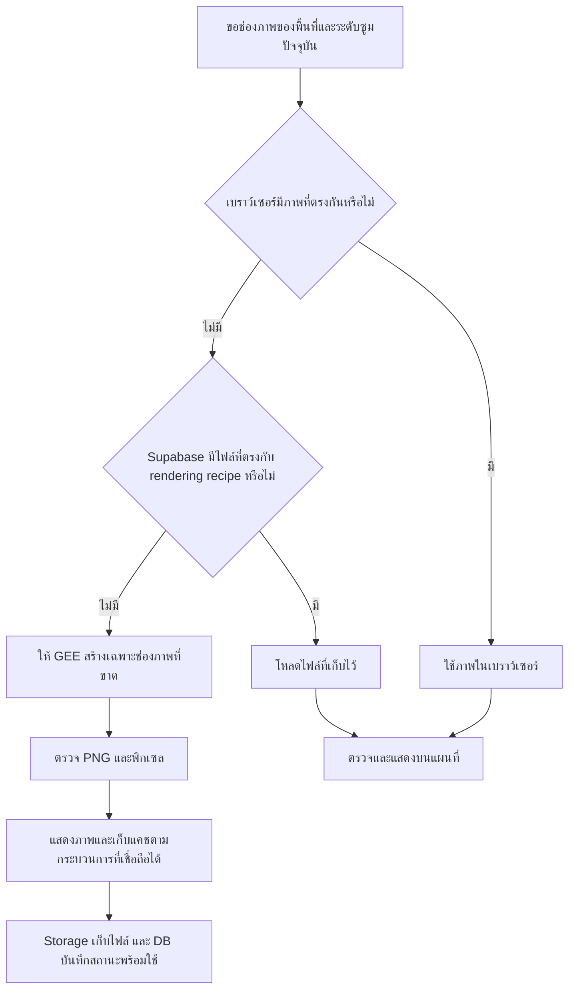

# XEDO — แผนปรับความเร็วแผนที่ GEE และเก็บแคชด้วย Supabase

- เวอร์ชัน: **1.1 — เพิ่มแผนแบ่งงานกับแชทผู้ช่วยเดิม วันที่ 30 ตุลาคม 2026**
- เวลาอ้างอิง: Asia/Bangkok
- เว็บไซต์: https://xedo-eight.vercel.app/
- สถานะ: **ข้อ 1–4 เสร็จในเครื่องพร้อมแคช Supabase จริง: hosted HTML23.5KB/staticgzip355KB; ยังไม่เผยแพร่ ข้อ5–6ยังไม่เริ่ม**
- ขอบเขตคำสั่งรอบจัดทำเอกสาร: รวบรวมแผนเป็นไฟล์ Markdown การสร้างไฟล์นี้ไม่ใช่การอนุมัติแก้เว็บไซต์ สร้าง bucket/ตาราง เปลี่ยนสิทธิ์ เปิดบริการเสียเงิน หรือ deploy
- บันทึกสถานะและประวัติหลัก: [XEDO_WORK_LOG.md](XEDO_WORK_LOG.md)
- รายละเอียดสถาปัตยกรรม: [WEBSITE_DETAILS.md](WEBSITE_DETAILS.md) ส่วน 3.51–3.59
- คิวงาน: [implementation-queue.json](implementation-queue.json) → `geeMapLatencyAudit.persistentCacheFollowup`
- การทำงาน: **แชทหลักแก้เว็บไซต์เพียงแชทเดียว + แชทผู้ช่วยเดิมตรวจ source/ออกแบบกรณีทดสอบ/ตรวจหลักฐานคู่ขนาน** ใช้การตั้งค่าที่มีอยู่ ไม่กำหนดว่าต้องเปิด Ultra จึงจะเริ่มได้
- ขอบเขตล่าสุด: ผู้ใช้อนุมัติข้อ4ลดhostedassets/ทดสอบและใช้ผู้ช่วยตรวจแล้ว ผลข้อ1–2อยู่ข้อ15/ข้อ3อยู่ข้อ16/ข้อ4อยู่ข้อ17 ไม่อนุมัติBilling/subscription/push/deploy

## 1. สรุปแผนล่าสุด

เพิ่มแคชภาพแผนที่ที่คงอยู่ข้ามการรีเฟรชเว็บและการเปลี่ยนตัวเซิร์ฟเวอร์ โดยใช้ **Supabase Storage เก็บไฟล์ PNG** และ **Supabase Database เก็บข้อมูลกำกับภาพและควบคุมพื้นที่**

ลำดับการหาภาพที่เสนอคือ **แคชในเบราว์เซอร์ → แคช Supabase → ให้ GEE สร้างเฉพาะช่องภาพที่ยังไม่มี**

เริ่มต้นด้วยเพดานไฟล์แคช **200 MB หรือ 200,000,000 bytes** คาดสำหรับวางแผนประมาณ **1,300–2,000 ช่องภาพ** ขนาด 256×256 พิกเซล ถ้าภาพมีค่าเฉลี่ยเท่าตัวอย่างเดิมจะอยู่ที่ประมาณ 3,000 ช่อง แต่ยังไม่ใช้จำนวนนี้เป็นคำรับประกัน

ตั้งให้กลับมาเปิดภาพชุดเดิมได้โดยไม่คำนวณพิกเซลซ้ำ พร้อมตรวจชุดภาพ วันที่ ระดับซูม และขอบเขตให้ถูกต้อง การขยายเป็น **500 MB เป็นทางเลือกภายหลัง** เมื่อเห็นอัตราใช้แคชและพื้นที่จริง ไม่ขยายอัตโนมัติ

งานลดขนาดหน้าเว็บเริ่มต้นต้องทำแยกควบคู่กัน เพราะการเก็บช่องภาพใน Supabase ไม่ได้ลดขนาด HTML เริ่มต้นประมาณ 6.2 MB ของเว็บปัจจุบัน

## 2. ปัญหาและการทำงานปัจจุบัน

### 2.1 แผนที่พื้นหลังในขั้น Select an area

1. เว็บส่งขอบเขตหน้าจอแผนที่ไปยัง API บน Vercel
2. GEE ค้นภาพ `COPERNICUS/S2_SR_HARMONIZED` ย้อนหลัง 30 วัน UTC ภายใต้เงื่อนไขพื้นที่และ cloud metadata ไม่เกิน 80%
3. ระบบเลือกได้สูงสุด 31 ภาพ เรียงเก่าไปใหม่แล้วประกอบเป็นภาพพื้นหลัง โดยภาพใหม่อยู่ด้านบน
4. เซิร์ฟเวอร์คืน session และ URL สำหรับช่องภาพ
5. เว็บขอช่องภาพขนาด 256×256 พิกเซล โดยโหลดพร้อมกันได้ครั้งละ 4 ช่อง
6. ช่องภาพที่ไม่มีในแคชถูกสร้างผ่าน GEE `image:computePixels` แล้วเว็บตรวจพิกเซลก่อนแสดง

ภาพพื้นหลังประกอบจากหลายวัน เป็นบริบทสำหรับเลือกพื้นที่ แยกจากภาพหนึ่ง acquisition ที่ผู้ใช้เลือกตรวจในขั้น Satellite survey

### 2.2 แคชที่มีอยู่แล้วและข้อจำกัด

- ระบบเดิม **ไม่ได้คำนวณใหม่ทุกครั้งเสมอไป** มีทั้งแคชในเบราว์เซอร์และหน่วยความจำฝั่งเซิร์ฟเวอร์
- ฝั่งเว็บใช้ blob cache ได้ใน session เดิม สูงสุด 128 ช่องหรือ 8 MiB แต่ไม่ส่งต่อแคชชุดเดิมเมื่อ session เปลี่ยน
- ฝั่งเซิร์ฟเวอร์เก็บแคชในหน่วยความจำของแต่ละ process จึงไม่ใช่แคชที่ใช้ร่วมกันและอยู่ต่อได้ทุก instance
- การโหลดช่องภาพใช้ `cache: no-store` จึงไม่ใช้แคช HTTP ปกติของเบราว์เซอร์ แม้จะมี blob cache ของแอปเอง
- ตัวระบุแคชฝั่งเซิร์ฟเวอร์รวม session token ที่มีค่าสุ่ม ภาพเดิมใน session ใหม่จึงอาจใช้แคชเดิมไม่ได้
- viewport มีพื้นที่เผื่อประมาณ 10% ต่อด้าน เมื่อเลื่อนพ้นขอบที่เผื่อไว้ อาจเริ่มขอชุดภาพ/session ใหม่
- เมื่อเบราว์เซอร์ยกเลิกคำขอจากการเลื่อนแผนที่ สัญญาณยกเลิกยังไม่ถึง imagery service ฝั่ง upstream ทุกขั้นตอน งาน GEE เดิมจึงอาจทำต่อ

### 2.3 งานภาพอื่นที่แยกจากแผนที่พื้นหลัง

- ภาพสำหรับ Satellite survey ทำงานตามลำดับ search → map → tiles → pixel validation
- ข้อมูล planning context เช่น DEM, land cover และคุณภาพภาพ เป็นอีกเส้นทางหนึ่ง
- ภาพพื้นใน 3D โหลด texture atlas แยกจากแคชของแผนที่ขั้นแรก
- การยืนยันพื้นที่ Inspector มีการตรวจช่องภาพเพิ่มเติมตามเป้าหมายที่แก้ไข
- การกด Analyze area ใช้ภาพ Sentinel-1 และ CPU worker ในเครื่อง เป็นคนละเส้นทางกับการสร้างแผนที่พื้นหลัง Sentinel-2

## 3. หลักฐานที่ตรวจแล้ว

ตัวเลขในส่วนนี้เป็นผลตรวจจากรอบก่อนในวันที่ 30 ตุลาคม 2026 ไม่ใช่ผลวัดใหม่ตอนจัดทำไฟล์นี้

### 3.1 เวลาโหลดผ่านเว็บ Production

| รายการ | ครั้งแรกในชุดตรวจ | เรียกซ้ำทันที |
|---|---:|---:|
| ค้นชุดภาพพื้นหลัง | 0.887 วินาที | 0.336 วินาที |
| ช่องภาพพื้นหลังเดิมหนึ่งช่อง | 3.257 วินาที | 0.732 วินาที |
| ค้นภาพสำหรับ Satellite survey | 1.393 วินาที | 0.330 วินาที |
| เตรียมข้อมูลเปิดภาพที่เลือก | 0.598 วินาที | 0.331 วินาที |
| ช่องภาพของภาพที่เลือกหนึ่งช่อง | 1.162 วินาที | 0.826 วินาที |

โหลดช่องภาพพื้นหลังต่างกัน 8 ช่อง แบบ 2 ชุด ชุดละ 4 ช่อง ใช้เวลารวม **5.019 วินาที** แต่ละช่องใช้ประมาณ **0.851–3.257 วินาที** คำขอ imagery ทั้ง 17 ครั้งสำเร็จ HTTP 200

ข้อจำกัดของหลักฐาน:

- ตัวอย่างที่จับเวลาใช้ภาพต้นทาง 12 ภาพ ส่วน viewport เริ่มต้นในเบราว์เซอร์ที่ตรวจใช้ 20 ภาพ
- เวลารวมเครือข่าย Vercel และ GEE ยังแยกเวลาคำนวณ GEE โดยตรงไม่ได้
- ครั้งแรกในชุดตรวจไม่ใช่หลักฐานยืนยัน cold start
- เวลา 5.019 วินาทีไม่ใช่เวลาตั้งแต่เปิดเว็บจนทั้งหน้าจอโหลดเสร็จ
- ตัวเลขเรียกซ้ำที่เร็วขึ้นเป็นผลของระบบเดิม ยังไม่ใช่ผลทดสอบแคช Supabase
- ไม่มีหลักฐานเพียงพอสำหรับรับรอง P95, SLA หรือเปอร์เซ็นต์ความเร็วที่จะดีขึ้น

### 3.2 พื้นที่ Supabase ที่ตรวจจริง

ตรวจหน้า Usage และข้อมูล Storage ของโปรเจกต์ XEDO ประมาณ **19:14–19:17 น. วันที่ 30 ตุลาคม 2026** พบแพ็กเกจ Free:

| ส่วน | ใช้ไปตามหน้า Usage | โควต้า | เหลือโดยประมาณ |
|---|---:|---:|---:|
| Storage | 0 GB | 1 GB | 1 GB |
| Database | 0.028 GB | 0.5 GB | 0.472 GB |
| Egress ทั่วไป | 0.003 GB | 5 GB ต่อรอบ | 4.997 GB |
| Cached egress | 0 GB | 5 GB ต่อรอบ | 5 GB |

- SQL อ่านอย่างเดียวยืนยัน XEDO มี 0 buckets, 0 objects และไฟล์รวม 0 bytes ณ เวลาตรวจ
- หน้ารายโปรเจกต์แสดง Database 26.41 MB ซึ่งสอดคล้องกับขนาดรวมฐานข้อมูลใน cluster ประมาณ 27.69 MB แบบ decimal หรือ 26.41 MiB การคำนวณยอดเหลือในตารางใช้ summary หน่วย GB เดียวกัน
- Storage และ Database เป็นคนละโควต้า จึงไม่รวมเป็นพื้นที่ไฟล์ 1.5 GB
- Egress และ cached egress เป็นคนละ pool ไม่ใช่โควต้า 10 GB ที่ใช้แทนกันได้
- รอบ Usage ที่ตรวจคือ 21 ตุลาคม–21 พฤศจิกายน 2026 ตัวเลขอาจอัปเดตช้าประมาณหนึ่งชั่วโมง และบางกราฟรายวันอาจช้ากว่านั้น
- ต้องตรวจยอดปัจจุบันอีกครั้งก่อนติดตั้งจริง ไม่ถือ snapshot นี้เป็นยอดคงเหลือตลอดไป

### 3.3 ขนาดหน้าเว็บเริ่มต้น

HTML รุ่นที่ตรวจมีขนาด **6,207,852 bytes ก่อนบีบอัด** รุ่นเว็บยังใช้กระบวนการสร้างไฟล์ portable ซึ่งฝัง JS, CSS และภาพลงในหน้าเดียว

ตรวจพบข้อมูลภาพแบบ base64 รวมประมาณ 4.62 MB ของข้อความในไฟล์ โดยบางภาพอยู่ภายใน JS/CSS จึงห้ามนำตัวเลขเหล่านี้มาบวกซ้ำกับขนาด HTML ทั้งหมด การดาวน์โหลด HTML เต็มผ่านเส้นทางเครือข่ายของเครื่องในรอบตรวจไม่สำเร็จภายใน 40 วินาที ทั้งนี้ไม่ใช่หลักฐานว่าเบราว์เซอร์ทุกคนใช้เวลา 40 วินาที

## 4. สถาปัตยกรรมแคชที่เสนอ

### 4.1 หน้าที่ของแต่ละส่วน

| ส่วน | หน้าที่ |
|---|---|
| Browser cache | ใช้ภาพที่มีอยู่ก่อน ลดการส่งคำขอและดาวน์โหลดซ้ำ |
| Vercel gateway | ตรวจคำขอ/session/ขอบเขต ประสานการหาแคชและ GEE และคืนผลที่ปลอดภัย |
| Supabase Storage | เก็บไฟล์ช่องภาพ PNG ที่สร้างและตรวจแล้ว |
| Supabase Database | เก็บตัวระบุภาพ แหล่งภาพ ตำแหน่งไฟล์ ขนาด สถานะ และควบคุมเพดานพื้นที่ |
| GEE | ค้นชุดภาพตามนโยบายความสด และสร้างพิกเซลเมื่อยังไม่มีไฟล์ที่ใช้ได้ |

### 4.2 การกลับไปดูพื้นที่เดิม

เมื่อเปิดพื้นที่ A ครั้งแรก ระบบสร้างเฉพาะช่องภาพที่ขาดและเก็บไว้ จากนั้นเลื่อนไป B แล้วกลับ A ระบบค้นและใช้ rendering recipe/ช่องภาพเดิมที่ยังตรงกับบริบทได้ แม้ session ที่ใช้ส่งคำขอจะเปลี่ยนไป

ต้องเก็บข้อมูลขอบเขตของ recipe ที่สร้างไว้ และพิจารณานำ recipe ที่ครอบคลุม viewport กลับมาใช้ก่อนสร้างใหม่ ไม่ค้นภาพจากชื่อไฟล์ที่ผูกกับ session แบบสุ่ม

## 5. ตัวระบุภาพ ความสด และขอบเขต

### 5.1 ตัวระบุแคชต้องคงที่

สร้างตัวระบุจากข้อมูลที่มีผลต่อพิกเซล ได้แก่:

- collection และรายการ asset IDs ต้นทาง
- ลำดับภาพใน mosaic เพราะภาพท้ายรายการมีผลต่อภาพที่แสดง
- เวอร์ชันสูตรแสดงผล เช่น bands, range, gamma และวิธีประกอบภาพ
- projection, grid, ระดับซูม และพิกัดช่องภาพ `z/x/y`
- ขอบเขตการ clip หรือขอบเขต canonical region ที่เลือกใช้

ไม่ใช้ random session token เป็นตัวระบุถาวร และไม่ใช้เพียง `z/x/y` เพราะภาพที่ตำแหน่งเดียวกันอาจเป็นคนละวันหรือคนละสูตรแสดงผล

### 5.2 ต้องแก้ปัญหาภาพถูกตัดตาม viewport

โค้ดปัจจุบันเลือกชุดภาพและ clip ตาม `session.bbox` ช่องภาพตำแหน่งเดียวกันจากคนละ viewport จึงอาจมีขอบโปร่งใสหรือใช้ภาพต้นทางต่างกัน

แนวทางเริ่มต้นที่รักษาความถูกต้องคือเก็บขอบเขต clip ไว้ใน recipe และใช้ recipe เดิมเมื่อครอบคลุมพื้นที่ที่ต้องแสดงได้ หากภายหลังจะเพิ่มการใช้ภาพร่วมกันข้าม viewport ให้ปรับเป็น bounded canonical regions หรือการสร้างเต็มช่องภาพที่มีขอบเขตแน่นอน แล้วทดสอบเทียบพิกเซลก่อนนำมาใช้

ห้ามตัด bbox ออกจาก key เพื่อเพิ่ม cache hit โดยไม่แก้ความหมายของภาพ เพราะอาจใช้ไฟล์ที่ขอบหรือชุดภาพไม่ตรงกัน

### 5.3 แยกอายุไฟล์จากความสดของข้อมูล

- PNG ที่ใช้ asset IDs และสูตรเดิมสามารถเก็บเป็นไฟล์ immutable ได้
- การตรวจว่ามีภาพดาวเทียมใหม่หรือไม่เป็นอีกขั้นตอนหนึ่ง อาจยังต้องเรียก GEE metadata ตามนโยบาย
- เมื่อชุดภาพหรือสูตรเปลี่ยน ให้สร้าง recipe/เวอร์ชันใหม่ แทนการเขียนทับไฟล์เดิมโดยไม่บอกที่มา
- การหมดอายุ session ไม่จำเป็นต้องทำลาย PNG ที่ยังถูกต้อง แต่คำขอใหม่ต้องผ่าน session/ขอบเขต/ความสดที่ตรวจแล้ว
- ภาพที่แคชไว้ต้องคง acquisition และแหล่งที่มาเดิม ไม่แสดงเหมือนเป็นภาพล่าสุดหากยังไม่ได้ตรวจ
- ภาพที่เปิดได้จากแคชไม่ทำให้ mission readiness หรือ confirmation เก่ากลับมาถูกต้องโดยอัตโนมัติ
- แบบเริ่มต้นใน [GEE_MAP_CACHE_CONTRACT.md](GEE_MAP_CACHE_CONTRACT.md) กำหนด sourceEpoch ตามวัน UTC/manual invalidation และ reuse ไม่เกิน 24 ชั่วโมง เพราะ full asset ID อย่างเดียวไม่ยืนยันว่า provider จะไม่ reprocess ข้อมูลใต้ ID เดิม

## 6. การจัดเก็บและเพดาน 200 MB

### 6.1 ข้อมูลที่ควรเก็บ

**Storage:** ไฟล์ PNG ของแต่ละช่องภาพ ใช้เส้นทางที่ระบุ recipe และ tile ได้แน่นอน

**Database:** ข้อมูลกำกับที่จำเป็น เช่น recipe hash/version, asset IDs และลำดับ, bounds, `z/x/y`, object path, ขนาดไฟล์, hash, สถานะการสร้าง, เวลาเก็บ/ใช้งานล่าสุด และข้อมูล reservation สำหรับควบคุมงานพร้อมกัน

โครงสร้างตารางและชื่อ bucket ยังไม่ได้สร้าง การออกแบบ schema/RLS ต้องตรวจของเดิมก่อนลงมือ

### 6.2 จำนวนภาพโดยประมาณ

คำนวณโดยใช้ MB/KB แบบ decimal:

| ขนาดเฉลี่ยต่อช่องภาพ | จำนวนใน 200,000,000 bytes |
|---|---:|
| 50 KB | 4,000 |
| 67,149 bytes — ค่าเฉลี่ยตัวอย่างเดิม | 2,978 |
| 100 KB | 2,000 |
| 150 KB | 1,333 |
| 200 KB | 1,000 |

ตัวอย่างเดิมมีเพียง 8 ช่อง รวม 537,195 bytes ขนาดต่ำสุด 6,231 และสูงสุด 164,156 bytes จึงใช้ **1,300–2,000 ช่องเป็นช่วงสำหรับวางแผน** ภาพจริงอาจใหญ่กว่าสมมติฐานได้

หนึ่งช่องหมายถึงภาพ 256×256 พิกเซล ไม่ใช่ภาพดาวเทียมเต็ม scene หรือหนึ่งหน้าจอแผนที่ แต่ละระดับซูมและแต่ละชุดภาพใช้ไฟล์แยกกัน จำนวนนี้ไม่ใช่คำรับรองพื้นที่กี่ตารางกิโลเมตร

### 6.3 ควบคุมพื้นที่และลบแคชเก่า

- เพดานเริ่มต้นของไฟล์แคชคือ **200,000,000 bytes** ไม่ใช้จำนวนไฟล์แทนการนับ bytes
- นับพื้นที่ที่เก็บแล้วรวมกับ reservation ของงานที่กำลังอัปโหลด เพื่อไม่ให้คำขอพร้อมกันผ่านเพดานโดยไม่ตั้งใจ
- ป้องกันการสร้าง/อัปโหลดซ้ำสำหรับ key เดียวกัน
- เมื่อพื้นที่ไม่พอ ให้เลือกไฟล์แคชที่เก่าและไม่ได้ใช้งานก่อน ตามนโยบายที่ตรวจแล้ว ลบผ่าน Storage API และปรับ index ให้สอดคล้องกัน
- หากมีไฟล์ค้างจากอัปโหลดสำเร็จแต่บันทึก DB ไม่สำเร็จ ต้องตรวจและจัดการ orphan objects ได้
- ห้ามลบไฟล์ผล AI ภารกิจ ประวัติ หรือข้อมูลผู้ใช้เพื่อคืนพื้นที่ให้แคช
- snapshot เดิมมี Storage ว่างประมาณ 1 GB หากเริ่ม 200 MB จะเผื่อไว้ประมาณ 800 MB แต่ต้องตรวจยอดจริงก่อนติดตั้ง
- ทางเลือก 500 MB ต้องประเมินจาก cache hit, พื้นที่, egress และความต้องการใช้งานก่อน ไม่ตั้งเป็นการขยายอัตโนมัติ

## 7. สิทธิ์และความเป็นส่วนตัว

- แนวทางเริ่มต้นคือ private bucket ผ่าน gateway เดิม โดยให้ guest ยังดูแผนที่พื้นหลังได้ตามพฤติกรรมปัจจุบัน ผ่านคำขอที่ระบบตรวจแล้ว ไม่บังคับให้ Sign in เพียงเพื่อดูพื้นหลัง
- จำกัดช่องทางสร้างไฟล์ให้ backend ที่ได้รับสิทธิ์กับแคช ห้ามให้ผู้ใช้ส่ง URL, asset expression หรือ path ใด ๆ เพื่อให้เซิร์ฟเวอร์ไปดึง/เขียนตามอำเภอใจ
- ไม่ส่ง service role/secret key ไปยังเบราว์เซอร์ และไม่เพิ่มสิทธิ์ Inspector หรือ CPU worker เดิมเพียงเพื่อให้เขียนแคชได้
- ภาพดาวเทียมสาธารณะไม่ได้ทำให้ private mission polygons, owner, history, confirmation หรือประวัติการเปิดพื้นที่กลายเป็นข้อมูลสาธารณะ
- หากจะใช้ public bucket/CDN ร่วมกันภายหลัง ต้องแยก canonical raster สาธารณะออกจากข้อมูลส่วนตัวอย่างชัดเจนก่อน ไม่ถือเป็นค่าเริ่มต้นที่อนุมัติแล้ว
- ไม่ตั้ง cache headers แบบ public ให้ private Inspector API หรือข้อมูลภารกิจ
- ไม่ต้องพึ่ง Smart CDN หรือ Image Transformations ที่ไม่รวมใน Free เพื่อให้แผนขั้นแรกทำงานได้

## 8. วิธีเก็บไฟล์โดยไม่สร้างเวลารอและสถานะผิด

- เมื่อ cache hit ให้ค้นด้วย key/index โดยตรง ไม่ไล่รายการไฟล์ทั้ง bucket และไม่เพิ่ม DB queries ทีละช่องแบบเรียงลำดับ
- cache miss ต้องตรวจ PNG/ขนาด/พิกเซลก่อนแสดงหรือบันทึกว่าใช้งานได้ ห้ามเก็บ error page หรือไฟล์ไม่สมบูรณ์เป็นภาพ
- อย่าเพิ่มเงื่อนไขให้ผู้ใช้รอ upload ทุกครั้งก่อนเห็นภาพ โดยไม่จำเป็น แต่การเก็บเบื้องหลังต้องใช้กระบวนการที่ runtime รับรองว่าจะทำจบได้ หรือมีการกู้คืนงานอย่างชัดเจน
- ห้ามปล่อย promise ที่ไม่ await แล้วถือว่าเซิร์ฟเวอร์จะทำงานต่อหลังตอบกลับเสมอ
- บันทึกสถานะพร้อมใช้หลังเก็บไฟล์สำเร็จจริง การเก็บแคชล้มเหลวต้องไม่ถูกนับเป็น cache hit
- เมื่อ Supabase ไม่พร้อม ให้มีทางกลับไปใช้ GEE ตามสิทธิ์และขอบเขตเดิม โดยไม่วน retry ไม่สิ้นสุด
- คำขอภาพเดียวกันพร้อมกันต้องมีผู้สร้างหลักและการรอ/คืนผลที่มีขอบเขต ไม่คำนวณและอัปโหลดซ้ำทุกคำขอ
- ส่งการยกเลิกจาก browser ให้ถึงงาน upstream ที่ยกเลิกได้ และป้องกันผลคำขอเก่าทับพื้นที่ใหม่

## 9. งานปรับความเร็วส่วนอื่นในแผนนี้

### 9.1 ลดขนาดการเปิดเว็บครั้งแรก

แยกกระบวนการสร้างเว็บ hosted ออกจากไฟล์ HTML portable โดยรักษาไฟล์ portable ให้ใช้งานตามหน้าที่เดิม:

- ใช้ภาพขนาดเหมาะกับหน้าจอ และโหลดเป็นไฟล์แยกที่ใช้แคชได้
- ลดการฝังโลโก้/ภาพเดิมซ้ำหลายตำแหน่งใน HTML
- โหลดโค้ดหรือทรัพยากร 3D เมื่อจำเป็น หากแยก bundle ได้โดยไม่ทำลาย flow เดิม
- วัดขนาดที่ส่งจริงหลังบีบอัดและเวลาเริ่มใช้งานหน้าเว็บ ไม่ใช้เฉพาะขนาดไฟล์ก่อนบีบอัด

### 9.2 ใช้ภาพร่วมกันในจุดที่ความหมายตรงกัน

พิจารณาใช้ช่องภาพ/ผลตรวจพิกเซลที่ถูกต้องแล้วร่วมกับการตรวจเป้าหมาย Inspector หรือ 3D เพื่อลดการโหลดซ้ำ ต้องรักษา scene/recipe/geometry identity และเงื่อนไข validation ของแต่ละขั้นตอน ไม่ตั้ง Image ready เพียงเพราะพบไฟล์ใน Storage

### 9.3 ทดลองเส้นทางแสดงภาพของ GEE เมื่อจำเป็น

เปรียบเทียบ `maps.create` และ map tiles กับ `computePixels` ด้วยภาพ ขอบเขต และระดับซูมเดียวกัน หากจะใช้งานต้องตรวจ permission ที่จำเป็นอย่างแคบก่อน ไม่เพิ่ม IAM role หรือเปิดบริการเสียเงินโดยอัตโนมัติ

การสร้าง map ID ไม่ใช่การ pre-render ทุกช่องให้เสร็จล่วงหน้า จึงไม่รับประกันว่าการเปลี่ยน endpoint อย่างเดียวจะเร็วขึ้น และไม่แนะนำให้เปลี่ยนเป็น high-volume endpoint โดยถือว่าเร็วกว่าเสมอ

## 10. ลำดับลงมือที่เสนอ

| ระยะ | แชทหลักทำ | แชทผู้ช่วยทำคู่ขนาน | สิ่งที่ต้องได้ก่อนผ่านระยะ |
|---|---|---|---|
| 1 | ตรวจ checkout/dirty files, baseline และ quota จริงเมื่อเริ่ม implementation; กำหนดขอบเขตและจุดวัดเวลา | อ่าน source และหลักฐานเดิม ตรวจเส้นทางค้นภาพ→สร้างภาพ→แสดงผล ระบุงานซ้ำและข้อมูลที่ยังวัดไม่ได้ | baseline manifest และรายการคอขวดแยก measured / source finding / hypothesis พร้อม input ที่จะใช้เทียบ |
| 2 | ออกแบบและตัดสิน contract ของ recipe/key, ขอบเขต, index, สิทธิ์ และเพดาน 200 MB | ตรวจทานวันภาพ/zoom/clip/session/owner และกรณีคำขอซ้ำหรือ cleanup พร้อมกัน ส่งกรณีที่ทำให้ key หรือ budget ผิด | จุดรับผล A: แชทหลักตรวจข้อเสนอก่อนนำไปใช้ ไม่มีปัญหาสำคัญเรื่องภาพผิดชุดหรือสิทธิ์ที่ยังไม่แก้; ยังไม่เปลี่ยนระบบจริงจากเอกสารอย่างเดียว |
| 3 | แก้โค้ด cache/gateway, fallback, cancellation และ cleanup; เป็นผู้เขียน source/tests/schema ที่จำเป็น | เตรียม TEST_MATRIX และแบบบันทึกผลแยก miss/browser hit/Supabase hit รวม failure, quota และ stale response; อ่าน diff ตรวจจุดตกหล่น | first miss เก็บได้จริง; revisit hit ไม่สร้าง pixels ซ้ำ; failure กู้คืนได้ ผลตรวจจาก source ไม่ใช้แทน runtime |
| 4 | ปรับ hosted build และการใช้ภาพซ้ำ โดยรักษา portable/สามขั้นตอน/สี่ตัวคำนวณ | ตรวจรายการไฟล์และขนาด อ่าน diff ตรวจ URL/asset paths และออกแบบ smoke cases ของ Inspector/3D | จุดรับผล B: ส่งชุด candidate ที่หยุดแก้ชั่วคราวพร้อม hashes ให้ผู้ช่วยตรวจ; หน้าเริ่มต้นเบาลงตามผลวัดจริงและไม่มีภาพผิด identity |
| 5 | รัน app tests/build/browser/API และ benchmark ที่จำเป็นบน candidate เดียวกัน; แก้ปัญหาที่พบ | ตรวจความครบของหลักฐานและเงื่อนไขก่อน–หลัง คำนวณจาก receipts ที่มีจริง และแยกกรณีที่ยังไม่รัน | จุดรับผล C: หลักฐานความถูกต้อง ขนาด สิทธิ์ และเวลาแยก hit/miss; ผลไม่ตรง candidate ต้องตรวจใหม่ |
| 6 | รวมผล อัปเดต canonical docs/queue เตรียม release และเผยแพร่เมื่อคำสั่งผู้ใช้ครอบคลุม | ตรวจสรุปว่าตรง receipts และไม่มีการอ้าง planned case ว่าผ่านจริง ส่งงานที่ยังค้าง | ยืนยัน commit/CI/deployment/ผลหลังเผยแพร่เมื่อมีการเผยแพร่จริง รอบวางแผนนี้ยังไม่อนุมัติขั้นนั้น |

ตารางนี้เป็นแผนการแบ่งงาน ผลรอบจัดทำเอกสารเดิมยังไม่มี implementation; หลังคำสั่งผู้ใช้ให้เริ่มข้อ 1–2 มีผล baseline/diagnostics/contract ตามข้อ 15 ส่วน persistent cache ข้อ 3–6 ยังไม่ดำเนินการ

### 10.1 แชทที่ใช้และหน้าที่

- **แชทหลัก:** แชทนี้ เป็นผู้แก้เว็บไซต์/API/config/package/ชุดทดสอบของเว็บ และดำเนินการกับฐานข้อมูลหรือเผยแพร่ภายในคำสั่งที่อนุญาต เป็นผู้ตัดสินใจนำข้อเสนอจากผู้ช่วยมาใช้และรับผิดชอบผลรวม
- **แชทผู้ช่วยเดิม:** `02-chat ขนาน project หลัก` — thread `01a17cf8-a060-7fd0-bed4-d7920a297d20`, host `local` ตรวจพบจากรายการแชทและอ่านขอบเขตเดิมแล้วในรอบ v1.1 ไม่สร้างแชทใหม่และไม่แทนที่ด้วยแชทที่ทำรายงาน GEE โดยไม่ตรวจตัวตน
- ผู้ช่วยอ่าน source/diff/แผน/หลักฐานได้ เขียนข้อค้นพบ กรณีทดสอบ และตัวช่วยตรวจเอกสารหรือคำนวณจากไฟล์หลักฐานในโฟลเดอร์ output ของตนเองได้ การตรวจโครงสร้างไฟล์หรือเลขคณิตไม่ถือเป็นการทดสอบเว็บ
- ผู้ช่วยไม่แก้ source/API/database/schema/config/packages/tests ของเว็บไซต์ ไม่ติดตั้งแพ็กเกจใน checkout ไม่ใช้ Git เขียน/commit/push/deploy ไม่เปลี่ยนบัญชี/สิทธิ์ ไม่สร้าง Storage bucket และไม่รัน AI job/GEE benchmark/live mutations ซ้ำกับแชทหลัก
- ไม่ต้องเปิด Ultra หรือเปลี่ยน model/config เพื่อใช้วิธีนี้ ผู้ใช้รายงานว่า Ultra ใช้ไม่ได้ในช่วงนี้ แต่รอบนี้ไม่ได้ตรวจสาเหตุหรือรับรองว่าเป็นภาวะเร่งด่วน การแบ่งงานช่วยให้ตรวจรายละเอียดควบคู่กันได้ ไม่ใช่หลักฐานว่าจะได้คุณภาพเท่า Ultra หรือเร็วขึ้นเป็นตัวคูณแน่นอน

### 10.2 งานผู้ช่วยแบ่งเป็น 3 ชุด

| ชุด | ผู้ช่วยส่งอะไร | หลักฐานขั้นต่ำ | แชทหลักใช้เมื่อไร |
|---|---|---|---|
| A — ตรวจสถาปัตยกรรมและ contract | แผนผัง request, รายการงานซ้ำ, ข้อเสนอ recipe/key/clip/freshness/สิทธิ์/200 MB และประเด็นที่ต้องแก้ | file:line, source hash ที่อ่าน, เหตุผลและกรณีที่เกิดปัญหา ระบุสิ่งที่เป็น hypothesis | ก่อนสรุป contract และเริ่ม cache/storage integration; ส่งข้อพบสำคัญก่อน ไม่รอรายงานเต็ม |
| B — ออกแบบทดสอบและตรวจ diff | กรณีทดสอบตาม §11 แยก first load, revisit, refresh, zoom/date/recipe changes, abort, damaged file, duplicate upload, cap/cleanup และ guest/private mission | input/actions/expected/assertions/evidence required ของแต่ละกรณี; สถานะเริ่ม `designed_not_run` และ actual เป็น null | ระหว่างแชทหลักเขียน cache/hosted build; แชทหลักเป็นผู้นำกรณีที่เหมาะสมเข้าชุดทดสอบและรันจริง |
| C — ตรวจผลและความครบของ release | ตรวจว่า receipts ตรง candidate หรือไม่ สรุป hit/miss/เวลา/ขนาด/คำขอ GEE และรายการที่ไม่ผ่านหรือยังไม่รัน | command/run identity, actual receipts, input/network/cache conditions และข้อจำกัด; ไม่มี receipt ให้ระบุ not_run | หลัง candidate หยุดเปลี่ยน และก่อนแชทหลักสรุปผลหรือเผยแพร่ภายใต้คำสั่งถัดไป |

จุดรับผล A/B/C เป็นการตรวจร่วมระหว่างแชท ไม่ใช่การเพิ่มขั้นขออนุมัติผู้ใช้ทุกช่วง งานอิสระ เช่นวัดขนาด build และเตรียม diagnostics ทำต่อได้ระหว่างรอผู้ช่วย แต่ถ้า contract ของภาพ/สิทธิ์ยังมีปัญหา ให้หยุดเฉพาะส่วน integration ที่พึ่งพา contract นั้นจนแก้ชัดเจน

### 10.3 การส่งมอบและหลักฐานที่ใช้ร่วมกัน

โฟลเดอร์ส่งมอบที่เสนอสำหรับรอบ GEE นี้:

`C:\mega\codex\iENA\outputs\XEDO_GEE_Performance_Parallel_2026-10-30\support\`

ตอนวางแผนยังไม่สร้างโฟลเดอร์เหล่านี้ หลังเริ่มข้อ 1–2 ผู้ช่วยทำชุด A ในโฟลเดอร์ดังกล่าวแล้ว ส่วนชุด B/C จะทำตามช่วงงานและขอบเขตที่ได้รับ:

- `HANDOFF.md`: หัวข้อ / สรุป / รายละเอียด พร้อมสิ่งที่พร้อมใช้ ปัญหาสำคัญ งานที่ติด และ absolute paths
- `SOURCE_REVIEW.md`: ข้อค้นพบ A และข้อสังเกตจาก diff; แยกสิ่งที่เห็นใน source ออกจากผลวัดจริง
- `TEST_MATRIX.md`: กรณี B พร้อมสถานะ ไม่กรอกผลว่า pass ก่อนรัน
- `SOURCE_MANIFEST.json`: checkout, HEAD, working-tree file hashes, รายการไฟล์ที่อ่าน และเวลาที่ตรวจ; HEAD อย่างเดียวไม่พอเพราะ checkout มี dirty files จากงาน CPU launcher
- `EVIDENCE_REVIEW.md`: ผล C อ้าง receipt/run ที่ตรวจจริง และรายการ `not_run`/ต้องตรวจซ้ำ

Baseline และ candidate ต้องบันทึก source/build identity, อุปกรณ์/browser/viewport, AOI, source-image recipe, zoom, cache state และเงื่อนไข network ที่ใช้ ผู้ช่วยอ่าน source ที่เปลี่ยนระหว่างตรวจต้องติดป้ายว่าผลใดต้องทวนบน candidate ใหม่ ไม่ใช้ findings จาก hash เก่าเป็นผลรับรองรุ่นสุดท้าย แชทหลักตรวจข้อเสนอและ hash ก่อนนำผลมารวมเสมอ

### 10.4 กติกาไฟล์ร่วมและการประสานแชท

- แชทหลักดูแลภาพรวมของ `XEDO_WORK_LOG.md`, `WEBSITE_DETAILS.md`, แผนฉบับนี้ และ `implementation-queue.json` ผู้ช่วยไม่เปลี่ยนภาพรวมหรือสถานะคิว
- ยังคง AGENTS ที่ให้แต่ละ XEDO work turn บันทึกสอง canonical MD ผู้ช่วยทำได้เฉพาะ append รายการสั้นที่มี marker ของตนและลิงก์รายงาน หลังอ่านไฟล์ล่าสุดและประสานช่วงส่งมอบให้แชทหลักหยุดเขียนสองไฟล์นั้นชั่วคราว จากนั้นแชทหลักอ่านและรวมต่อ ห้ามใช้ไฟล์สำเนาเก่าเขียนทับหรือเขียนสองแชทพร้อมกัน
- เมื่อลงมือภายใต้คำสั่งผู้ใช้ที่ครอบคลุม แชทหลักส่ง brief ไปยังแชทเดิมพร้อมขอบเขต A/B/C, input, hashes และทางส่งมอบ แล้วอ่าน output ของผู้ช่วยโดยตรง ผู้ใช้ไม่ต้องคัดลอกคำตอบไปมาทุกครั้ง การอนุญาตใช้แชทผู้ช่วยรอบนี้ไม่เท่ากับสั่งเริ่ม implementation
- หากแชทผู้ช่วยเรียกไม่ขึ้นหรือใช้เครื่องมือไม่ได้ ให้รายงานข้อจำกัดและทำงานอิสระของแชทหลักต่อ ใช้ไฟล์ HANDOFF เป็นทางส่งมอบได้ ไม่สร้างแชทใหม่ เปลี่ยน model หรือสมัครบริการแทนโดยอัตโนมัติ

### 10.5 จังหวะทำงานเพื่อลดเวลารอ

1. ตอนเริ่มงานจริง แชทหลักส่งขอบเขตและ manifest พร้อมเริ่ม baseline/diagnostics ผู้ช่วยตรวจ source ชุด A ทันที ตั้งเป้าข้อค้นพบสำคัญชุดแรกประมาณ 20–30 นาทีหลังเริ่ม ไม่ใช่เวลารับประกัน
2. เมื่อได้ contract ที่แก้ประเด็นสำคัญแล้ว แชทหลักทำ cache ส่วนผู้ช่วยทำชุด B ไม่รอให้แชทหลักเขียนเสร็จทั้งหมดจึงออกแบบทดสอบ
3. แชทหลักปรับ hosted build ระหว่างผู้ช่วยทวน diff ที่ส่งไว้เป็นช่วง ๆ; ใช้จุดรับผล B ก่อนตรึง candidate
4. ช่วงรันจริงให้แชทหลักเป็นผู้ควบคุม browser/API/benchmark เพื่อไม่แย่ง session หรือเพิ่ม GEE requests ซ้ำ ผู้ช่วยตรวจ receipts ที่ทยอยเสร็จและสรุปชุด C
5. ถ้าแก้ source หลังพบปัญหา ให้ทดสอบเฉพาะส่วนที่กระทบพร้อม regression ที่จำเป็น แล้วให้ผู้ช่วยทวนหลักฐานที่เปลี่ยนก่อนปิดผล ไม่รันทั้งชุดซ้ำเพียงเพราะมีสองแชท

ยังไม่กำหนดเวลาจบรวม/เปอร์เซ็นต์ความเร็วเพิ่ม เพราะยังไม่ได้ implement หรือ benchmark แผนนี้ การทำงานสองแชทไม่เพิ่มโควตา GEE/Storage และไม่ทำให้งานประมวลผลถูกแจกไปอีกแชทเอง

## 11. เกณฑ์ตรวจรับ

### 11.1 ความถูกต้องและพฤติกรรม

- พื้นที่ใหม่/แคชว่าง: ได้ภาพ GEE จริง ตรวจพิกเซล และเก็บไฟล์ตรง recipe
- แคชมีอยู่: hash/พิกเซล/แหล่งภาพตรงกับไฟล์ที่สร้างจาก recipe เดิม ไม่เรียก `computePixels` สำหรับ tile ที่ hit
- A → B → A, รีเฟรชเว็บ และเปลี่ยน server instance: ใช้ไฟล์ที่เก็บไว้ได้เมื่อ identity และความสดตรงกัน
- เปลี่ยน zoom/วัน/สูตรแสดงผล/ขอบ clip: ไม่ใช้ไฟล์ผิดชุด
- ไฟล์เสีย/ไม่ครบ/404/อัปโหลดล้มเหลว: สถานะตรงจริงและมีทางกู้คืนที่ไม่ทำลายภารกิจ
- pan/zoom เร็วและยกเลิกคำขอ: ไม่ใช้ผลเก่าทับพื้นที่ใหม่ และไม่สะสมงาน GEE โดยไม่จำเป็น
- ภาพที่แคชไว้ไม่ข้าม expiry/review/readiness ที่ต้องตรวจใหม่

### 11.2 ขนาดและสิทธิ์

- ทดสอบการเข้าใกล้ 200 MB รวมกรณี concurrent upload, duplicate requests และ cleanup
- bytes ใน index/reservation สอดคล้องกับไฟล์จริง และแก้ orphan objects ได้
- ไม่มีการลบหรือเปิดเผยข้อมูลภารกิจส่วนตัวเพื่อจัดการแคช
- guest ดู background ได้ตามเดิม ขณะที่ private mission/AI/history ยังตรวจ owner ตามเดิม
- browser bundle ไม่มี credential สำหรับเขียน Storage หรือ secret key

### 11.3 ความเร็ว

จับเวลาจาก input เดียวกัน แยก cache miss, browser hit และ Supabase hit พร้อมระบุจำนวนรอบ:

- เวลาตั้งแต่เปิดเว็บจนเริ่มใช้งานได้
- เวลาช่องภาพแรกปรากฏ และเวลาช่องภาพที่จำเป็นต่อบริเวณนั้นครบ
- A → B → A และการเปิดเว็บใหม่กลับพื้นที่เดิม
- เวลา metadata, GEE pixels, Storage read/write, download และ pixel validation
- จำนวน GEE pixel computations, cache hits/misses, bytes และ egress ที่เกี่ยวข้อง

ให้รายงานเวลาที่ลดได้จากผลทดสอบจริงเท่านั้น หาก cache hit ยังช้าหรือเกิดคอขวดใหม่ ให้แก้ก่อนสรุปว่าระบบดีขึ้น ไม่ใช้ผลเก่าของ GEE เป็นผล benchmark ของ Supabase และไม่อ้าง P95/SLA จากตัวอย่างน้อย

## 12. สิ่งที่ต้องรักษาและขอบเขตที่ไม่ขยาย

- คง flow สามขั้นตอนและสี่ตัวคำนวณของ XEDO
- คงพื้นที่ต้นฉบับ การแก้/ยืนยัน Inspector, version/revision และ private Save/History
- ไม่ทำให้ภาพดาวเทียมเป็นการยืนยันน้ำมัน ความหนา ปริมาณน้ำมัน หรืออนุญาตบิน
- ไม่เพิ่มการสั่ง flight controller, ควบคุมโดรน/แคปซูล หรือบังคับต่อ Pi เพื่อใช้ planner
- ไม่ย้าย AI ไปประมวลผลบน Vercel และไม่เปิด GPU/Cloud Run/Billing/subscription จากแผนแคชนี้
- ไม่รวมงาน Pi/telemetry หรือรายงานผลทดลองที่พักไว้เข้ามาโดยอัตโนมัติ
- ไม่เปลี่ยนงาน CPU worker/launcher จากแชทอื่นเพื่อทำแคชแผนที่

## 13. ไฟล์ที่เกี่ยวข้องและหลักฐานอ้างอิง

| หัวข้อ | ไฟล์ที่เกี่ยวข้อง |
|---|---|
| GEE gateway | `api/gee.mjs`, `src/gee-imagery-api.js` |
| ค้นภาพ/สร้างภาพ/แคชเซิร์ฟเวอร์ | `src/gee-imagery.js` |
| Background map/viewport | `src/planning-basemap.js`, `src/planning-basemap-view.js` |
| Satellite review/target validation | `src/planning-trial-client.js`, `src/planning-satellite.js` |
| 3D ground | `src/planning-3d-satellite.js`, `src/planning-3d-ground-controller.js` |
| Planning context | `src/gee-mission-context.js`, `src/planning-geospatial-ui.js` |
| Hosted/portable build | `scripts/build.mjs`, `scripts/build-planning-file.mjs` |

หลักฐานในเครื่องที่ใช้รวบรวมเอกสาร:

- `output/gee-latency-audit-2026-10-30/production-timings.json`
- `output/gee-latency-audit-2026-10-30/audit-summary.json`
- `output/supabase-usage-2026-10-30/usage-receipt.json`
- `output/supabase-usage-2026-10-30/connector-receipts.json`
- `docs/XEDO_WORK_LOG.md` และ `docs/WEBSITE_DETAILS.md` ส่วน 3.51, 3.54–3.57 และ 3.59

ไฟล์หลักฐานใน `output` เป็นไฟล์ในเครื่องที่ถูก ignore ไม่รับประกันว่าจะติดไปกับ Git checkout เอกสารฉบับนี้จึงสรุปตัวเลขและข้อจำกัดที่ต้องใช้ตัดสินใจไว้แล้ว ห้ามแนบ credentials หรือข้อมูล session ไปกับการส่งต่อแผน

เอกสารผู้ให้บริการที่ตรวจในรอบสนทนาก่อนหน้า:

- [GEE computePixels](https://developers.google.com/earth-engine/reference/rest/v1/projects.image/computePixels)
- [GEE maps.create](https://developers.google.com/earth-engine/reference/rest/v1/projects.maps/create)
- [GEE deferred execution](https://developers.google.com/earth-engine/guides/deferred_execution)
- [GEE processing environments](https://developers.google.com/earth-engine/guides/processing_environments)
- [Supabase Storage CDN](https://supabase.com/docs/guides/storage/cdn/fundamentals)
- [Supabase Storage optimizations](https://supabase.com/docs/guides/storage/production/scaling)
- [Supabase Storage usage](https://supabase.com/docs/guides/platform/manage-your-usage/storage-size)
- [Supabase Egress usage](https://supabase.com/docs/guides/platform/manage-your-usage/egress)
- [Vercel Cache-Control](https://vercel.com/docs/caching/cache-control-headers)

## 14. ประวัติสถานะตอนจัดทำแผนก่อนเริ่มข้อ 1–2

- รวบรวมแผนล่าสุดและตัวเลขจากหลักฐานเดิมลงไฟล์ Markdown แล้ว
- v1.1 เพิ่มเจ้าของงาน ตารางหกระยะที่มีงานคู่ขนาน ผู้ช่วย A/B/C การส่งมอบ source/build hashes และกติกาเอกสารร่วม ตรวจพบแชทเดิม `02-chat ขนาน project หลัก` แล้ว แต่รอบนี้ยังไม่ส่งคำสั่งหรือเริ่มงานผู้ช่วย
- แคชเริ่มต้นที่เสนอ: **200 MB**; ขยาย 500 MB เป็นทางเลือกที่ยังไม่ได้เริ่ม
- **ยังไม่มีการสร้าง bucket/schema/แคชจริงหรือ benchmark เปรียบเทียบ Supabase กับระบบเดิม**
- ไม่ได้รัน GEE, AI inference, application tests/build หรืออ่านยอด Usage สดซ้ำในรอบจัดทำเอกสาร
- ไม่ได้ commit/push/deploy หรือเปิด Billing/subscription
- ไม่มีคำถามผู้ใช้ที่ค้างจากการรวบรวมแผนนี้ รายการรอ Sign in ที่เคยปรากฏในประวัติปิดแล้วตามคิวปัจจุบัน ไม่ต้องขอซ้ำเพื่ออ่านแผน
- การลงมือ implementation และการเผยแพร่ต้องยึดคำสั่งผู้ใช้ในรอบถัดไป การมีแผนและคิวไม่ใช่คำสั่งให้เริ่มเอง

## 15. ผลข้อ 1–2 หลังผู้ใช้สั่งเริ่ม — 30 ตุลาคม 2026

- ส่งงานจริงให้แชทเดิม `02-chat ขนาน project หลัก` ทำ source/contract review ชุด A; แชทหลักอ่านผลและเติม actual-renderer fallback และ backend RPC/privilege matrix ตามข้อทวน ผู้ช่วยไม่ได้แก้เว็บไซต์หรือรัน production benchmark
- ข้อ 1: มี baseline-source manifest, ยืนยัน production identity, HTTP timings ใหม่, ถอดรหัส PNG 7 ไฟล์ และตรวจ Supabase SQL/Usage UI แบบอ่านอย่างเดียว; HTML 6,207,852 bytes/gzip 3,772,548 bytes, transfer 65.57 s จากเครื่องนี้, 4 basemap tiles พร้อมกัน 1.529 s ไม่อ้างเป็น browser FCP/P95
- เพิ่ม fixed-name Server-Timing และ allowlisted cache header ใน source รุ่นในเครื่อง มี upstream GEE จริง metadata/pixels/RAM hit แยกกัน PNG ตัวอย่างจาก Production/local-first/local-RAM hash ตรงกัน HTML ที่ build ในเครื่องมี hash ตรง Production
- ข้อ 2: [แบบแคช gee-map-cache-v1](GEE_MAP_CACHE_CONTRACT.md) ระบุ ordered assets/grid/clip/pipeline/sourceEpoch, lookup-first deadline600ms, 200MB atomic reservations, uncertain bytes, generation fencing, cleanup, backend-only RPC/สิทธิ์ และ runtime lifecycle ตัวเลข deadline เป็น initial policy สำหรับวัดตอน implement ไม่ใช่ SLA
- ชุดทดสอบแอป `npm test -- --test-concurrency=4`: **615 ผ่าน / 0 ล้มเหลว / 0 ข้าม**; syntax และ hosted build ผ่านในรอบนี้ กรณีแคชจริงใน TEST_MATRIX ของผู้ช่วยยังเป็น designed_not_run ไม่มีการติดตั้ง Storage/RPC เพื่อรันกรณีเหล่านั้น
- หลักฐาน primary: `C:/mega/codex/iENA/outputs/XEDO_GEE_Performance_Parallel_2026-10-30/primary/`; support: `C:/mega/codex/iENA/outputs/XEDO_GEE_Performance_Parallel_2026-10-30/support/HANDOFF.md`
- ยังไม่สร้าง bucket/table/RPC หรือเปลี่ยนสิทธิ์/บัญชี ไม่มี AI job ใหม่ ไม่มี commit/push/deploy/Billing/subscription การลดขนาด hosted build อยู่ข้อ 4 ยังไม่ทำในรอบนี้

## 16. ผลข้อ 3: Supabase cache 200 MB — 30 ตุลาคม 2026

ดำเนิน implementation และติดตั้ง namespace/cache bucket จริงแล้วตามคำสั่งผู้ใช้ แชทหลักเป็นผู้แก้ source/SQL/tests และดำเนินบริการจริง ผู้ช่วยเดิมปิดชุด B หลังตรวจ source/contract และอ่าน receipts รายละเอียดพฤติกรรม/การซ่อมอยู่ [GEE_MAP_CACHE_CONTRACT.md](GEE_MAP_CACHE_CONTRACT.md) §3.10 และ [WEBSITE_DETAILS.md](WEBSITE_DETAILS.md) §3.66

- เก็บ PNG ใน private bucket และคุม budget ด้วย backend-only RPC/transaction/reservation/generation fencing; cap 200,000,000 bytes รวม unknown uploads และมี metadata limit 4,096 entries
- รัน GEE/Supabase จริง: Node process ใหม่อ่าน persistent hit ได้ PNG hash เดิม/GEE pixels0 แม้ metadataยังตรวจใหม่; cache-client failureที่จำลอง fallback GEEจริงได้
- ทดสอบ192 QA reservationsผ่าน8 concurrentclients รับ190/ปฏิเสธ2 peak199,376,761bytes คืนQAครบและลบภาพQAผ่านStorageAPIแล้วledger/physical0 ต่อมาเปิดGuestwebสร้างภาพใหม่12ภาพ/1,177,006bytesตรงinventory ณ14:51:17UTC
- lookup600msเคยทำให้hitจริงbypass เก็บfailedreceiptไว้ ปรับ1,200msแล้วhitผ่าน ยังไม่ใช่matchedbenchmark/P95หรือคำรับประกันว่าSupabaseเร็วกว่าGEEทุกครั้ง
- SQLติดตั้งผ่านDashboardtransactionที่เทียบsourceแล้ว หลังconnectorยืนยันหมดเวลาสองรอบ ไม่มีmigration-historyentry ต้องตรวจschemaก่อนmigrationถัดไป ไม่applyfoundationซ้ำ
- ชุดทดสอบล่าสุด626ผ่าน/0fail/0cancelled/0skip syntax/buildผ่าน UIในเครื่องโหลดSentinel-2จริง; 21faultdesignsของsupportยังdesigned_not_run ไม่อ้างว่ารันทุกcaseแล้ว
- primaryหลักฐาน `C:/mega/codex/iENA/outputs/XEDO_GEE_Cache_Phase3_2026-10-30/primary/REPORT.md`; support `C:/mega/codex/iENA/outputs/XEDO_GEE_Cache_Phase3_2026-10-30/support/HANDOFF.md`
- serverkeyผู้ใช้กรอกในlocalhostและเก็บDPAPIของWindowsuserเดิม ไม่อยู่ในGit/clientbundle/output การเผยแพร่ภายหลังต้องตั้งserverenvแยกและตรวจVercelrequestlifecycleจริง ยังไม่เปลี่ยนproductionenv/code

ลำดับถัดไปยังเป็นข้อ4ลดhostedassets/HTML, ข้อ5matchedperformanceและextendedqualification, ข้อ6publish/postdeployเมื่อผู้ใช้สั่ง ไม่เริ่มเองในรอบนี้ ไม่มีคำถามผู้ใช้ค้าง ไม่มีcommit/push/deploy/Billing/subscription

## 17. ผลข้อ 4: ลด hosted HTML และไฟล์เริ่มต้น — 30 ตุลาคม 2026

แยก hosted build ออกจาก portable สำเร็จ esbuild ESM splitting/content-hash assets/modulepreloads เฉพาะ static graph คง browser calculators และ Inspector/AI flagsเดิม เพิ่ม Loading/Reload และ await module evaluationก่อนปลดล็อกหน้า รายละเอียดสถาปัตยกรรม/ซ่อมต่ออยู่ [WEBSITE_DETAILS.md](WEBSITE_DETAILS.md) §3.67 และประวัติผลรัน [XEDO_WORK_LOG.md](XEDO_WORK_LOG.md) §3.67

| ตัวชี้วัด | ก่อน | หลัง |
|---|---:|---:|
| HTML raw bytes | 6,207,852 | 23,516 |
| HTML bodyผ่านlocalgzip | 3,732,249 | 5,799 |
| เอกสาร+JS/CSS/โลโก้/faviconที่browserขอช่วงcold | 3,732,249 | 355,284 |
| Warm static requests | — | 0 (HTML304/body0) |

Static byte reduction90.4807%จากsame local gzip server/freshorigin ไม่รวมheaders/API/GEE ไม่ใช่90%เร็วขึ้นหรือผลP95/FCP/LCP ภาพตัวอย่าง679573bytes/compiledcalculator/3Dถูกขอเมื่อใช้จริง ภาพSentinelเดิมไม่ถูกresize โลโก้web384px80465bytes/favicon96px10150bytesแยกแคช ต้นฉบับทั้งหมดคงเดิม

Mainทดสอบfullsuite633ผ่าน/focused7/syntax/hosted/file/workspacebuildผ่าน Guest GEEจริง/3ขั้นตอน/4ผลคำนวณ/3Dnormal และfailure main404+Reload, lateinitializationthrow, lazy3D503+กลับ2Dผ่าน Desktop/mobileไม่ล้น ผู้ช่วยเดิมปิดC-F01(cachematcher)/C-F02(readinessหลังpartialinit)แล้ว Mainเป็นผู้รันapp/browser/provider ไม่รวมHdesigned_not_runเป็นผลรัน หลักฐาน `C:/mega/codex/iENA/outputs/XEDO_Hosted_Assets_Phase4_2026-10-30/primary/REPORT.md` และ support/HANDOFF.md

ไม่เปลี่ยนschema/account/permissions/AIworkerหรือเปิดpaidservices ยังไม่commit/push/deploy ข้อ5matchedperformance/extendedqualificationและข้อ6release/postdeployยังไม่เริ่ม การยืนยันVercelroutecompiler/CDN/assetretentionจริงอยู่ตอนเผยแพร่ portableรอบนี้ตรวจbuild ไม่ใช่freshofflinefile://acceptance ไม่มีคำถามผู้ใช้ค้าง

## 18. ผลข้อ 5: matched performance และ bounded resilience — 30 ตุลาคม 2026

แชทหลักรันและแชทผู้ช่วยเดิมตรวจวิธีวัด/source/evidenceแล้ว ข้อ5จบเฉพาะกรณีที่รันในเครื่อง ไม่อ้างครบทุกextendedqualification ดูWORK_LOG/WEBSITE_DETAILS§3.68และoutputs/XEDO_Performance_Phase5_2026-10-30/primary/REPORT.md, support/HANDOFF.md

- ไม่มีproductsourcefixเพิ่ม20frozenfiles/HEADตรงphase4 Fullsuiteใหม่633ผ่าน/0fail/cancel/skip,syntaxและhosted/workspace/portablebuildผ่าน
- PublicGEE/Supabasefresh-process13receipts:5paired off/onสลับลำดับ medianfulltilewall1012.37→891.31ms แต่hitช้ากว่าoff3/5คู่/medianpairedsaving−44.50msไม่อ้างuniversal speedup Hit5/5pixels0/PNGhashตรง RAMn13median2.10ms A/Bclip→returnidentityถูก expiryจำลองclock+31min410/pixels0ไม่ใช่รอจริง ทุกreceiptbudget≤200MBไม่ใช่near-capstressใหม่
- Localcontrolledstartupn3ต่อvariant/commonprecompression/instrumentation/recordedrealimagery: UIreadymedian388.3→228.3ms(−41.205%เฉพาะlocal) แต่FCP140→204ms(+64ms)ต้องเปิดเผย ภาพreadyเป็นapplicationstatusไม่ใช่paint/AOIcompleteness B1incompleteเก็บnull/B1Rreplacementoriginเดิม/no-storeมีcaveat Browserprocess/OSไม่fresh จึงไม่ใช่productionP95/SLA
- Liveforeground695.002s/Settings32คู่/2D–3D20รอบ/presetreset10รอบ+GeoJSONA→B→Aarea24131→15444→24131/route1.86→1.19→1.86km pageexceptions0/terminalRAF0/Blob0/canvas2 แยกproxy44AbortErrorที่recordระหว่างcontextsไม่ยกเป็นpageerrorและไม่อ้างตามrootcauseครบ Framegapsmax66.7ms/4over50/0over100ไม่ใช่ทุกเฟรม60FPS Approxheapไม่พิสูจน์leakfree
- Shared/retiredproducerabortผ่านrealbackend+controlledlocalhold; cache-clientfailureinjectionfallbackGEEจริง200/hashตรง ไม่ทำprovideroutage/corruptobjectsจริง SupportP01–P32designsคงdesigned_not_runเมื่อไม่ครบassertionsจริง
- ไม่มีAIjob/CPUinference/privateacceptanceใหม่/physicalmobile/trackpad/OSreboot/SITL/flightหรือhours-longtestรอบนี้ QAproxyปิด/viewportคืนแล้ว Source/config/VercelCDN/lifecycle/assetretentionproductionยังไม่qualified

ข้อ6publish/postdeployยังไม่เริ่ม ต้องได้รับคำสั่งผู้ใช้ก่อน และต้องตรวจserver-onlycacheconfiguration/Vercelrouting-MIME-CDN-lifecycle-backgroundwrite/CI+deploymentidentity+alias+privateInspector/AI/localCPUflow ไม่มีcommit/push/deploy/productionconfig/Billing/subscription/schema/accountchangeในข้อ5 ไม่มีคำถามรอคำตอบ
