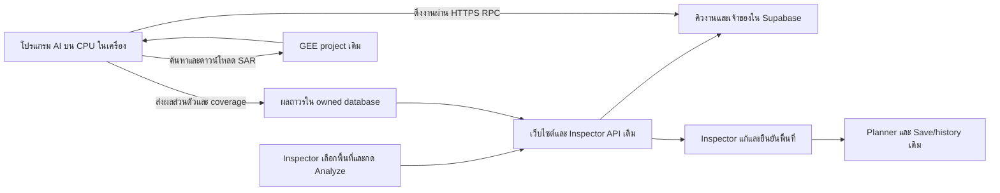

# XEDO — แผนเชื่อม AI บน CPU ในเครื่องกับเว็บไซต์

## 1. หัวข้อ

- วันที่วางแผน: **30 ตุลาคม 2026**, Asia/Bangkok
- คำสั่งรอบนี้: วางแผนให้ Inspector เลือกพื้นที่ใหม่บนเว็บไซต์ แล้ววิเคราะห์ด้วย CPU ในเครื่อง โดยไม่เปิด Billing หรือสมัคร subscription และบันทึกงานกับรายละเอียดเว็บไซต์
- สถานะล่าสุด30ต.ค.: **ขั้น1–5ผ่านlocalacceptance;ขั้น6กำลังเชื่อมSupabaseจริงตาม§3.16** ติดตั้งSQLv1/statusv2และตรวจRLS/ACL/PostgRESTแล้ว InspectorTest/CPUAuthจริงเชื่อมและแยกสิทธิ์ผ่าน เหลือprimaryInspectorที่ผู้ใช้ลืมรหัสและเลือกลองChromePasswordManagerก่อน จึงยังไม่completeขั้น6หรือเผยแพร่ ไม่มีBilling/subscription
- Checkout: `C:\mega\codex\iENA\github-publish\XEDO-hardware-release`; HEAD `09b5e4911675afb9c2889e71bc447588e3474e14`
- เลขคิว: **ข้อปัจจุบัน6 / ข้อเดิม9** เปลี่ยนแนวทางเริ่มต้นจาก cloud worker เป็น local CPU worker; prepared AI/editor ข้อปัจจุบัน3/เดิม6 ยังคงเป็นงานที่เผยแพร่แล้ว
- ผู้ใช้ช่วงทดลอง: 1 Inspector, ประมาณ100งาน/เดือน, กรอบ raster ไม่เกิน200กม²/งาน; เก็บเจ้าของภารกิจและผลเป็นส่วนตัว
- ขอบเขตงบ: ใช้เครื่องเดิม เว็บไซต์/ฐานข้อมูลเดิมภายในสิทธิ์ที่มี ไม่เปิด Google Cloud Billing, Cloud Run, GCS bucket, subscription, paid tunnel หรือ automatic upgrade
- เอกสารกลาง: `XEDO_WORK_LOG.md` เก็บประวัติ/สถานะ; `WEBSITE_DETAILS.md` เก็บ architecture/behavior; ไฟล์นี้เป็นแผนเทคนิค ไม่ใช่บันทึกสถานะกลางอีกชุด

## 2. สรุป

**ให้โปรแกรม AI ในเครื่องเป็นฝ่ายเชื่อมออกผ่าน HTTPS ไปดึงงานจาก Supabase เดิม** เว็บไซต์รับคำขอและแสดงความคืบหน้า เครื่องค้นหา/ดาวน์โหลดภาพ Sentinel-1 จาก GEE แล้วรันโมเดล CPU ส่งกลับเฉพาะผลที่จำเป็นสำหรับการตรวจและแก้พื้นที่ ส่วน TIFF ขนาดใหญ่เก็บในเครื่อง

เครื่องไม่ต้องมี public IP ไม่ต้องเปิดพอร์ตรับการเชื่อมต่อ และไม่ต้องให้ browser เรียก localhost จึงใช้เว็บไซต์ผ่านมือถือหรือเครื่องอื่นได้ขณะที่เครื่องประมวลผลเปิดอยู่ ผลที่เผยแพร่สำเร็จแล้วต้องเปิดตรวจย้อนหลังได้แม้ปิดเครื่อง CPU

เงื่อนไขการใช้งานที่ต้องบอกชัด: **ถ้าเครื่องปิด/Sleep/ไม่ต่ออินเทอร์เน็ต จะวิเคราะห์งานใหม่ไม่ได้** หน้าเว็บต้องแสดงสถานะนี้แทน spinner ค้าง โดยรักษาพื้นที่และร่างภารกิจไว้

หลักฐาน CPU จากรอบก่อน: 16/16 inference passes สำเร็จและผลทุกพิกเซลตรง baseline; 4 threads ใช้โมเดลซ้ำ processing median2.297s/รวมpreview4.171s/native peak891.297MiB สำหรับ grid176.478กม² ตัวเลขนี้ไม่ใช่เวลาค้นหา/ดาวน์โหลดภาพหรือเวลาตั้งแต่กด Analyze จนได้ผล และไม่ได้รัน benchmark ใหม่ในรอบวางแผนนี้

เส้นทางที่วางแผนไว้สำหรับผู้ใช้:

1. เปิดโปรแกรมรับงาน AI ในเครื่อง และรอแสดง “พร้อมรับงาน”
2. Login เว็บไซต์ด้วยบัญชี Inspector เดิม เลือก/วาดพื้นที่ใหม่ แล้วกด **Analyze area**
3. ดูสถานะค้นหาภาพ → ดาวน์โหลด → วิเคราะห์ tiles → จัดทำผล → พร้อมตรวจ
4. ตรวจผล AI แก้/เพิ่ม/ปฏิเสธพื้นที่เสี่ยง แล้วกดยืนยันตามเครื่องมือเดิม
5. เตรียมแผนโดรนและบันทึกภารกิจตาม flow เดิม 3ขั้นตอน/4ตัวคำนวณ

## 3. รายละเอียด

### 3.1 ฐานก่อนลงมือและข้อจำกัดที่ใช้วางแผน

ตารางนี้เก็บฐานที่ตรวจในรอบวางแผน ผลimplementation/readinessใหม่ของขั้น1–2อยู่§3.14;ไม่ใช้ข้อความขาดdependency/ยังไม่อ่านquotaเดิมแทนสถานะปัจจุบัน

| สิ่งที่ตรวจ | หลักฐาน/ข้อจำกัด | ผลต่อแผน |
|---|---|---|
| CPU runner ใช้งานจริงแล้ว | `outputs/XEDO_CPU_Benchmark_2026-10-30/CPU_BENCHMARK_REPORT.md` | ใช้ mathematical path/checkpoint เดิม ไม่ train หรือเปลี่ยน threshold |
| Inspector API เป็น same-origin BFF | `api/inspector.mjs:52` และ header forwarding ที่ท้ายไฟล์ | คง cookie/Origin guard ของ browser; ไม่ยกเลิก guard เพื่อให้เครื่องรับงาน |
| ยังไม่มี job API และ parser ยังไม่รับชื่อ analysis-jobs | `api/inspector.mjs:17,97` เป็นต้นไป | เพิ่ม explicit route allowlist/rewrite validation สำหรับ analysis-jobs พร้อม submit/status/cancel และ worker RPC; ไม่เพิ่ม dispatch อย่างเดียว |
| Catalog เดิมเป็น prepared result กลาง | `db/inspector-ai.sql:166` และ lookup สำหรับ save/confirm แถว234 | เพิ่ม owned result resolver ให้ครอบคลุม list/detail/save/confirm/history |
| Risk editor โหลด result คงที่ | `src/planning-risk-editor.js:14,72`; `scripts/prepare-inspector-ai.mjs` ผูก baseline14candidates | เพิ่ม `loadResult(resultId)` และช่องทางเปิดผลของ job; ไม่ทับ AOI ปัจจุบันเมื่อผลเก่าตอบช้า |
| SAR export เดิมต้องกด Tasks | `outputs/XEDO_GEE_Colab_2026-10-11/XEDO_Sentinel1_Explorer.js:306,469,498` | ต้องสร้าง automatic Python input adapter แทน Code Editor/Drive handoff |
| Runner เดิมยอม100ล้านpixels | `gee_sar_inference.py:338` | Wrapper ใหม่ต้องบังคับ2ล้านpixelsทั้งก่อนและหลังดาวน์โหลด |
| Raw candidate จำกัด256 | `src/planning-risk-state.js:15`; saved document≤1MiB, BFF/RPC≤1.1MB | ต้องตรวจ geometry/encoded bytes ก่อน publish; ไม่ลดรายละเอียดหรือทิ้งส่วนประกอบเงียบ ๆ |
| SAR และภาพตรวจมีคนละ identity | `planning-risk-editor.js:67,98`; `db/inspector-ai.sql:306` | เก็บ `sarSource` กับ `contextImage` แยกกัน; ยืนยัน/วางแผนยังต้องผ่าน image review/coverage |
| Runtime CPU ยังขาดชุด acquisition/geometry | ตรวจ package metadata รอบนี้: `earthengine-api`, `pyproj`, `shapely` ไม่พบใน venv benchmark; requests2.34.2/psutil7.2.2มี | เตรียม environment แยกและ dependencies ที่ pin เมื่อเริ่ม implement; ไม่ถือว่า benchmark venv เป็น worker ครบชุดแล้ว |

ยังไม่ได้อ่าน usage/Storage policies จริงของ Supabase หรือแพ็กเกจ Vercel ใหม่ในรอบนี้ ข้อมูล GEE Community/Billing unlinked เป็นหลักฐาน readiness รอบก่อน ไม่ใช่ live recheck รอบนี้

### 3.2 โปรแกรมในเครื่องและการเริ่มใช้งาน

เสนอ CLI/launcher สำหรับ Windows หนึ่งตัว แสดงสถานะ **เชื่อมต่อ / โมเดลพร้อม / GEEพร้อม / พร้อมรับงาน / กำลังทำงาน / ต้องแก้การตั้งค่า** พร้อมปุ่มหรือ shortcut เริ่ม/หยุดง่าย ๆ ไม่จำเป็นต้องเปิดด้วยสิทธิ์ administrator หรือสร้าง Windows service/autostart ในรุ่นแรก

- ใช้ environment แยกสำหรับ local worker เพื่อรักษา venv/หลักฐาน benchmark เดิม; pin CPU stack ที่ผ่านการตรวจและเพิ่ม Earth Engine/geometry libraries หลังตรวจ compatibility
- โหลดโมเดล CPU4threads/batch1/float32; parent process ติดต่อคิว/ส่ง heartbeat แยกจาก child inference เพื่อให้ heartbeat ไม่หยุดขณะ CPU กำลังทำงาน
- ใช้หนึ่ง child/model context ต่อ worker เท่านั้น รีไซเคิลหลังครบจำนวนงานหรือเมื่อ RAM สูงตามเกณฑ์ที่วัดเพิ่ม ไม่เปิดหลายโมเดลพร้อมกัน
- ตั้ง whole-job deadline30นาทีและ bounded network timeout; ใช้ psutil watchdog เป็นการเฝ้าดู RAM ไม่อ้างว่าเป็น hard RAM isolation ของ Windows/Cloud Run
- ตรวจ free disk และขอบเขต path ก่อนรับงาน ใช้ job/attempt UUID สร้างโฟลเดอร์ ไม่รับ local path, Python code, command หรือ arbitrary URL จากผู้ใช้
- Raw DATA/VALID/METADATA/score/mask และ run manifest เก็บเป็น immutable local artifacts ต่อ job/attempt; failed downloads อยู่ temp และไม่รายงานเป็นผลสำเร็จ
- จัดการ cache/temp อย่างจำกัด ไม่ลบไฟล์ผลที่ภารกิจอ้างอิงโดยเงียบ ๆ; local retention และการสำรองเต็มชุดต้องชี้แจงในคู่มือ

การตั้งค่าครั้งแรกใช้ credential GEE เดิมผ่าน path/Windows-protected storage และ machine credential แยกจาก Inspector; ไม่ใส่ key/password ใน Git, Markdown, command history หรือ browser ผู้ใช้ไม่ต้องส่งรหัสผ่านในแชท

### 3.3 การรับงานและตัวตนของเครื่อง

**ข้อเสนอหลัก: local worker เรียก Supabase HTTPS RPC โดยตรง** ใช้ publishable project key และ access token ของ dedicated machine Auth identity ลด empty polling ผ่าน Vercel ไม่ใช้ service_role/admin key ในเครื่องหรือ browser

ทีมสร้าง machine identity และลงทะเบียน Auth UID กับ `worker_registry` ที่ผูก Inspector owner ที่ได้รับอนุญาต เครื่องนี้ไม่อยู่ใน Inspector roster และไม่ใช่ role ใหม่บนหน้าเว็บ ผู้ใช้จริงยังมี role เดียว Inspector เครื่องไม่มีสิทธิ์ Login เว็บเป็น Inspector, Save/confirm ภารกิจ, อ่านบัญชีอื่น หรือจัดการ Auth

Worker RPC ต้องตรวจ **live session + registry enabled + permitted owner** ทุกครั้ง และตรวจ **current lease/fence** สำหรับทุก action ที่เขียนงานซึ่ง claim แล้ว ส่วน presence/claim ตรวจตัวตนและavailabilityก่อนจัดสรรleaseแบบatomic ไม่บังคับให้มีleaseอยู่ก่อนclaim ไม่เชื่อ `ownerId`/role จาก payload หรือ `user_metadata` ใช้ wrapper ที่เปิดเฉพาะ actions ที่อนุญาต และ private routine ที่ตรวจสิทธิ์ภายใน แม้ผู้โจมตีเรียก RPC ตรงก็ข้าม guard ไม่ได้ ตาราง private ไม่เปิด direct read/write สิทธิ์ function ต้อง grant/revoke ชัดและ fixed search_path ตาม [Database functions](https://supabase.com/docs/guides/database/functions) และ [RLS](https://supabase.com/docs/guides/database/postgres/row-level-security)

ข้อมูล Auth ของเครื่องเก็บด้วย Windows Credential Manager/DPAPI หรือกลไกป้องกันของ OS; refresh session ของเครื่องแยกจาก cookie session ของ Inspector การปิด registry ต้องกัน heartbeat/claim/publish/upload ต่อ แม้ access token ยังไม่หมดอายุ ถ้า credential ถูก revoke ให้แสดงต้องเชื่อมใหม่และหยุดรับงาน

ไม่เปิด public port/tunnel, ไม่ใช้ paid scheduler, ไม่ต้องมี outbound callback มายังเครื่อง การ poll/claim เมื่อโปรแกรมเปิดอยู่ทำหน้าที่ dispatcher เอง จึงไม่ต้องเพิ่ม Cloud Run/outbox สำหรับเรียก cloud execution ใน local architecture นี้; atomic durable job queue ยังจำเป็น

### 3.4 คิวงาน ข้อมูล และ API ที่เสนอ

| ส่วน | ข้อมูล/หน้าที่ |
|---|---|
| `analysis_jobs` | server-derived owner/mission/inputRevision, immutable AOI/date policy/specHash, status/stage, attempts/deadline/cancel/result |
| `analysis_attempts` | worker UID, attempt UUID, fencing generation, lease expiry, heartbeat, timing/count/byte/error telemetry |
| `worker_registry` | machine UID, allowed owner, enabled/revoked, heartbeat/capability/model allowlist |
| `owned_analysis_results` | immutable owner/job/attempt binding, server-sealed review catalog, SAR provenance/coverage/candidates and preview ref |
| Inspector `POST /api/v1/inspector/analysis-jobs` | ตรวจบัญชี/เจ้าของ/พื้นที่/quota/idempotency; คืน202/jobIdเร็ว ไม่รอ inference |
| Inspector `GET .../analysis-jobs/:jobId` | owner-only status/stage/tile counts/error/resultId; ไม่ส่ง credential หรือ local path |
| Inspector `POST .../analysis-jobs/:jobId/cancel` | ขอ cancel แบบ idempotent ไม่อ้างหยุดแล้วก่อน worker/lease ยืนยัน |
| Worker RPC `claim / heartbeat / progress / publish / fail` | คำสั่งจำกัดสิทธิ์ current worker+attempt; ไม่มี arbitrary table/action/function name |
| Owned result resolver | คืน prepared result เดิมตามสิทธิ์เดิม หรือ dynamic result ที่ owner ตรงกัน; ใช้ตัวเดียวกับ save/confirm/reopen |

`missionId` สำหรับ submit ต้องเป็น server-created owned mission shell ที่ยังไม่สร้างผล AI; หากเป็นร่างที่ยังไม่ Save ให้สร้าง shell กับ job ใน transaction เดียวโดย idempotency แล้วคืน ID ให้ browser ไม่อ้าง mission ที่ยังไม่มีสิทธิ์

กติกา queue เริ่มต้น: **1 active job ทั้งระบบ / pending≤2 / logical jobs≤100ต่อเดือนของ pilot** นับ retries แยก attempt และมีเพดาน ไม่สร้าง100งานใหม่จาก double-click การ submit ใช้ `(owner, mutationId, canonicalRequestHash)`; reuse key กับเนื้อหาเปลี่ยนต้อง409

การ claim ใช้ transaction/row lock และ global lease ไม่พึ่งการที่โปรแกรมหนึ่งตัวบอกว่า “ทำทีละงาน” อย่างเดียว เริ่มต้น lease120s, active heartbeat20s, worker presence ทุก60sเมื่อ idle, worker stale>180s; ค่าที่เสนอเหล่านี้ต้องปรับจากการทดสอบ network/sleep ไม่ใช่ SLA

Worker poll ทุก10sในช่วงทำงานที่ผู้ใช้เปิดรับงาน และ backoff60sเมื่อ idle; jitter/429backoff ไม่มี busy loop Browser poll job ทุก3–5sเฉพาะงาน active/หน้า visible; hidden ให้ลดหรือหยุด และเปิดกลับแล้วอ่านสถานะจาก DB

ก่อน submit ตรวจ presence ถ้า offline ไม่สร้างงานที่แสดงว่ากำลัง run ให้แจ้งเปิดโปรแกรม AI และรักษา AOI/r่างไว้ ถ้างาน queued/running แล้วเครื่องหลุด ให้เก็บงานและแสดง waiting_for_worker/recovering; leaseหมดอายุและเครื่องกลับมาจึง reclaimตามนโยบาย ไม่ปล่อย stale process publish ทับ attemptใหม่

State machine: `queued → acquiring → downloading → validating_input → inferencing → packaging → publishing → succeeded`; failure/cancel/retryมีเหตุผลและ timestamps; stageในattemptใหม่เริ่มใหม่ได้แต่ต้องแสดงเลขattempt กรณีหมดdeadline/เกินretryปิดเป็น failed เก็บหลักฐานและเปิดให้ Retryเป็นlogicaljobตามนโยบาย quota

### 3.5 ค้นหาและดาวน์โหลด SAR อัตโนมัติโดยไม่ใช้ GCS

เริ่มต้นกำหนดช่วงค้นหา **ย้อนหลัง30วันจากเวลากด Analyze (UTC)** แสดงช่วงและ acquisition date ที่เลือกชัด ไม่เอาเวลาบินอนาคตไปใช้เป็นวันที่ภาพ SAR หากไม่มีภาพให้ผู้ใช้ปรับช่วง/พื้นที่อย่างชัดเจน ไม่ดึง prepared baseline มาทดแทน

1. อ่าน frozen AOI/date/model recipe จาก job ตรวจ geometryและlimitsก่อนเรียก GEE
2. ค้นหา `COPERNICUS/S1_GRD`, IW, 10m, มี VH+VV ทั้งคู่ เลือก **หนึ่ง scene** ตาม coverage และเวลาที่เหมาะสมแบบ deterministic; เริ่มจาก newestที่ครอบคลุม AOI หากไม่มี full coverage เลือกตามนโยบายpartialและแสดงcoverage ไม่ทำ multi-date/orbit mosaic ในรุ่นแรก
3. บันทึก asset ID/acquiredAt/platform/orbit/projection จาก scene จริง ตรวจ VH/VV gridตรงกัน ก่อนดาวน์โหลด lock input manifest กับ attempt
4. คำนวณ native export raster rectangle ที่ snap ตาม affine grid ตรวจ `width×height≤2,000,000`, แต่ละด้าน≤4096, grid area≤200กม²; ใช้ขนาด **กรอบ raster** ไม่ใช่เฉพาะ polygon area ไม่ลดresolution/resizeเพื่อให้ผ่าน
5. ใช้ bounded `computePixels` คืนGEO_TIFFแยกDATA2bandsfloat32กับVALIDuint8บนexactPixelGrid(CRS/affine/dimensionsเดียวกัน) ดาวน์โหลดโดยโปรแกรม ไม่ผ่านVercelrequestbody ไม่สร้างGCS/Drive/thumbnailresource แนวทางgetDownloadURLเดิมติดpermissionthumbnails.createจึงไม่ใช้และไม่เพิ่มIAM
6. ตรวจ response/file size/hash/CRS/affine/dimensions/bands/NoData; เขียน metadata tags lossless เมื่อจำเป็น ไม่ resample เพื่อซ่อนความต่างจาก Drive export
7. คง DATA `[VH,VV]` แบบ Sigma0 dB, NoData-9999; VALID0/1uint8 จาก band-mask intersectionและAOI/finite checks; ไม่ log-transformข้อมูลdBซ้ำ ไม่ใช้ Sentinel-2 RGB เข้าโมเดล
8. จัด METADATA GeoJSONตามสัญญาเดิม พร้อม job identity/acquisition/grid/recipe; ผ่าน validatorก่อนเริ่ม inference หากข้อมูลไม่ผ่านให้ failedพร้อมสาเหตุ

GEE `computePixels` รองรับuncompressed48MB/dimension32Kตาม [เอกสาร Google](https://developers.google.com/earth-engine/reference/rest/v1/projects.image/computePixels) โปรแกรมนี้จำกัดresponse32MBและgrid2ล้านpixels/4096ต่อด้านเข้มกว่า:DATAสูงสุด≈16MB/VALID≈2MBแยกคำขอ ถ้าเกินให้ลด/แบ่งพื้นที่ ไม่fallbackไปGCSหรือเปิดBilling

ใช้ project/credential GEE เดิมตามสิทธิ์ noncommercial ที่ยังใช้ได้ วัด EECU/export/download ในการทดสอบจริง; quotaGEEแยกจากเวลาCPUในเครื่องและยังใช้เกินได้ ดู [Noncommercial tiers](https://developers.google.com/earth-engine/guides/noncommercial_tiers) ไม่ถือว่าใช้CPUlocalแล้วทุกGEErequestฟรีไม่จำกัด

### 3.6 ประมวลผลและจัดทำพื้นที่เสี่ยง

ใช้โมเดล/checkpoint/normalization/patch512/float32/threshold0.3เดิม โดยตรวจhashก่อนload ใช้ progress callbackจากrunner ส่งจำนวน tiles จริง ไม่เปลี่ยนโมเดลระหว่างjob

แยก reusable packaging module จากวิธีที่ตรวจแล้วใน `outputs/XEDO_Parallel_Handoff_2026-10-27/support/prepare_result.py` ไม่เรียก support one-off script ที่ผูก baseline paths เป็น production dependency:

- Polygonizeแบบ4-connected components รักษาทุกรูและcomponent ไม่เอาเฉพาะก้อนใหญ่
- ReprojectจากnativeCRSเป็นWGS84ด้วยlongitude/latitude orderที่ถูกต้อง
- Rasterize serialized geometryกลับบนnativegridด้วย`all_touched=False` และต้องcandidate mismatch0
- เก็บpixel-edge geometryเดิม ไม่clipขอบพิกเซลกับAOIเพื่อให้ดูตรงเมื่อทำให้rawmaskเปลี่ยน; Inspector targetต้องอยู่ในsearchAOI/reviewedcontextimage/analysisfootprintตามกติกาเดิม ส่วนSARvalidcoverageคำนวณและแสดงcomplete/partial/unavailableแยกตามข้อมูลจริง ไม่ถือNoDataเป็นข้อมูลที่วิเคราะห์แล้ว และไม่เพิ่มfull-validgateใหม่โดยอ้างว่าเป็นกติกาเดิม
- เก็บ valid/background/NoData เป็นคนละความหมาย ผลไม่มีvalidpixelsเป็นinputunavailable ส่วน validแต่candidate0เป็นsuccess ไม่เรียกว่าพื้นที่ปลอดน้ำมัน
- เสนอ capของreviewcatalog512KiB/totalrawvertices8192/candidates≤256 และต่อring≤4097ตามcontractเดิม ต้องตรวจผลจริง/โหลดSQLก่อนfreeze cap ทั้ง finite coords/closed rings/holes/MultiPolygon/encodedbytes
- หากเกิน cap ให้ `RESULT_TOO_COMPLEX` พร้อมเหตุผลให้ลด/แบ่งพื้นที่ เก็บ raw TIFFเต็มไว้ในเครื่อง ไม่truncate/simplify/ซ่อนcomponentแล้วรายงานsuccess

Rawcandidate validatorต้องแยกจาก`risk_valid_target`ที่จำกัด120จุด ห้ามใช้มันปฏิเสธraw378จุดที่ระบบเดิมเปิดได้ การตรวจtopologyแบบboundedและperformanceของvalidationบนDBขนาดเล็กเป็นเกณฑ์ผ่านก่อนเปิดงานใหม่;การรับข้อมูลโดยtrustedworkerไม่ยกเลิกguardของserver

### 3.7 เผยแพร่ผล สิทธิ์ และความน่าเชื่อถือ

Workerเป็น **trusted producerที่ทีมลงทะเบียน** ไม่ใช่ browserผู้ใช้ส่งผลเอง ผลอ้าง checkpoint/input TIFF hashes จาก worker เป็น producer-reported provenance ไม่อ้างว่าserverรันAIซ้ำหรืออ่านTIFFทุกbyteเพื่อพิสูจน์ผล

Publish RPCต้องตรวจภายในDBทุกครั้ง: session/registry/owner assignment, currentjob+attempt+fence+lease+deadline, cancel=false, AOI/inputRevision/specHashตรงjob, model/preprocessing/threshold allowlist, source date/dataset/grid/coverage contract, candidategeometry/bytes/IDsและpreview path

Server deriveowner/resultIdและคำนวณsealจากcanonicalreviewJSONที่บันทึกจริง กำหนดversionเช่น`xedo-jsonb-seal/1`สำหรับผลใหม่ ไม่รับanalysisRef/hashจากworkerเป็นauthoritativeโดยไม่คำนวณ Keep prepared-file hash semanticsเดิมไว้และdispatchตามversion ไม่ทำให้ภารกิจเก่าเปลี่ยนidentity

Transactionสุดท้าย insertimmutableownedresult + markjobsucceeded + idempotentpublishreceiptพร้อมกัน ไม่เปลี่ยน mission head/Inspectorconfirmation/plannerเอง ส่งpublishซ้ำเนื้อหาเดิมคืนreceiptเดิม;เปลี่ยนเนื้อหา/oldfenceต้องปฏิเสธ ถ้า responseหายให้ queryreceiptก่อนretry ไม่คำนวณใหม่โดยเดา

PreviewเสนอprivatebucketในSupabaseprojectเดิม เฉพาะถ้ายืนยันremainingquotaและRLSพร้อมแล้ว Pathimmutable `{ownerId}/{jobId}/{attemptId}/preview.jpg`, ≤512KiB, allowedMIMEที่ตรวจแล้ว ใช้machineJWTINSERTเฉพาะcurrentlease ไม่มีupsert/UPDATE/broadlisting ผู้ใช้Inspectorอ่านเฉพาะpublishedresultที่ownerตรงผ่านBFFหรือshort-livedURL;ไม่เก็บexpiringURLในmission

**Storage pitfall:** object uploaderเป็นmachineUID ไม่ใช่Inspector จึงห้ามเขียนreadpolicyอิง`storage.objects.owner_id=Inspector`อย่างเดียว ต้องผูกobjectpathกับpublishedresult.owner/job/attempt อ่านสิทธิ์จากผลจริง ไม่เชื่อprefixที่ผู้ใช้ส่งมา [Storage RLS](https://supabase.com/docs/guides/storage/security/access-control), [Private downloads](https://supabase.com/docs/guides/storage/serving/downloads)

ตรวจobjectmetadataมีอยู่/ขนาด/MIMEไม่ใช่การตรวจbytehashของภาพ หากยังไม่download+hashจริงให้บันทึกpreviewhashเป็นproducer-reported กรณีต้องใช้hashเป็นgateการแสดง ให้ownerBFFอ่านboundedbytesและตรวจSHAก่อนส่งผล ทุกTIFFยังคงlocalและมีข้อจำกัดการเรียกคืน:ปิดเครื่องแล้วเปิดsmallreviewcatalogได้ แต่ดาวน์โหลดTIFFเต็มจากเครื่องไม่ได้จนเครื่องพร้อม/มีช่องทางที่อนุมัติ

### 3.8 UI การแก้พื้นที่ และการรักษางานเดิม

เพิ่ม Analyze area กับสถานะเครื่องให้เข้ากับขั้นตรวจภาพเดิม ไม่เพิ่มขั้นที่4หรือป้ายPrototype ผู้ใช้เห็นวันที่SARที่วิเคราะห์/coverage/โมเดลอ้างอิง และภาพcontextที่ตรวจแยกกัน ไม่สร้างconfidencepercentageหรือoilvolumeจากsegmentation

| สถานะจริง | สิ่งที่ผู้ใช้เห็น |
|---|---|
| Worker offline/กำลังsleep | “เครื่องประมวลผลยังไม่พร้อม เปิดโปรแกรม AI เพื่อเริ่มวิเคราะห์”;เก็บAOIและปุ่มลองใหม่ |
| queued | ลำดับคิว/เวลารอ ไม่แสดงว่าCPUเริ่มแล้ว |
| GEEsearch/download | stage+เวลาที่ผ่าน+bytesเมื่อทราบtotal ไม่สร้างlivepercentของGEE |
| inference | “วิเคราะห์ 3/9 tiles” และprogressbar3/9จริง;100%ของtilesไม่ใช่100%ทั้งjob |
| packaging/publishing | spinner/ขั้นตอนจริง จนDBcommitสำเร็จจึงReady |
| succeeded | เปิดผลของjobนี้ ให้Inspectoredit/accept/reject/add/undo/cancel/confirmตามเดิม |
| failed/partial/zero candidates | แสดงreason/coverageที่ถูกต้อง ไม่ใช้ผลเก่าหรือศูนย์แทนข้อมูลขาด |

Guardผลด้วย account+jobId+inputRevision+AOIhash เปลี่ยนพื้นที่/ออกจากบัญชีระหว่างรอแล้วผลเก่าต้องเข้าประวัติ ไม่ทับหน้าปัจจุบัน ก่อนกดAnalyzeบนภารกิจที่มีdraftให้ยืนยันเปลี่ยนanalysisโดยรักษาdraftเก่าไว้ระหว่างรอ ไม่ล้างผลเดิมเมื่อjobใหม่failed เปิดresultใหม่สำเร็จจึงinvalidateconfirmation/plan/exportเก่า

`sarSource` คือภาพSentinel-1ที่โมเดลวิเคราะห์; `contextImage` คือภาพที่Inspectorเปิดตรวจ (อาจเป็นSentinel-2คนละวัน) ไม่บังคับassetIDทั้งสองเท่ากันและไม่แทนacquisitiondateด้วยinferenceเวลา Targetหนึ่งpolygon≤120จุด/visiblepixelreview/coverage/readiness/24hข้อกำหนดเดิมยังเป็นgateก่อนplanner/export

### 3.9 โควตาและการรักษาเงื่อนไขไม่มีsubscription

Free planตามหน้าSupabaseที่ตรวจ30ต.ค.มีdatabase500MB/fileStorage1GB/egress5GB และFreeprojectอาจpauseหลังไม่ใช้งานหนึ่งสัปดาห์ เป็นเพดานของบริการ ไม่ใช่remainingquotaของprojectจริง [Supabase pricing](https://supabase.com/pricing) ก่อนเริ่มpilotต้องตรวจplan/usage/bucketของprojectเดิมแบบread-only ไม่เปิดupgradeถ้าพื้นที่ไม่พอ

คำนวณจาก **application capsที่เสนอ ไม่ใช่ขนาดผลที่วัดทุกพื้นที่**:

| รายการที่จำกัด | ต่อjob | 100jobs |
|---|---:|---:|
| Reviewcatalog canonicalJSON |≤512KiB|≤50MiBก่อนDB/index/history overhead|
| Preview |≤512KiB|≤50MiBในprivateStorage|
| เปิดcatalog+previewหนึ่งครั้ง |≤1MiB|≤100MiBโดยประมาณ ไม่รวมAPIheaders/การเปิดซ้ำ/ภาพเว็บอื่น|
| LocalDATA+VALID+score+maskเต็ม2Mpx |≈28MB uncompressed|≈2.8GBก่อนtemp/cache/preview/metadata/attemptซ้ำ|

100logicaljobsไม่จำกัดจำนวนSave/historyหรือจำนวนเปิดภาพซ้ำ ภารกิจ/versionsเดิมและบริการอื่นใช้quotaร่วมกัน ต้องวัดusageจริง ไม่เอาตารางนี้รับรองremaining500MB/5GB ในบัญชี ไม่อัปโหลดTIFFทั้งหมดขึ้นfreeStorage

กำหนดbyte reservation/countสำหรับcatalog/previewก่อนpublishและcapพื้นที่ใช้โดยfeatureนี้ เสนอwarning70%/หยุดรับงานใหม่80%ของงบย่อยที่จัดได้หลังดูusageจริง ใกล้quotaให้คงdraft+ผลlocalและแจ้งผู้ใช้ ไม่สมัครplan/เปิดBillingหรือย้ายไปบริการเสียเงินโดยอัตโนมัติ

RPCpollเป็นHTTPสั้นและได้emptyreplyเมื่อไม่มีงาน ไม่ค้างVercelfunctionรอCPU ผล/previewเล็กไม่ส่งbinaryTIFFผ่านBFF;Vercelมีrequest/responsepayloadlimit4.5MBตาม [Function limits](https://vercel.com/docs/functions/limitations) แต่XEDOใช้limitภายในที่เข้มกว่าและยังต้องตรวจquotaของแพ็กเกจที่ใช้อยู่

แผนนี้ไม่เพิ่มค่าเช่าCPU/GPUcloudหรือsubscription ใช้ไฟฟ้า/อินเทอร์เน็ตและทรัพยากรเครื่องเดิม รวมทั้งquotaเว็บ/DB/GEEเดิม ไม่รับรองว่าทุกบริการไม่มีข้อจำกัดหรือใช้งานได้ไม่จำกัด

### 3.10 ลำดับลงมือและเกณฑ์ผ่าน — เมื่อได้รับคำสั่ง implementation

| ลำดับ | งาน | จบเมื่อ |
|---|---|---|
|1|**เสร็จในเครื่อง30ต.ค.** ตรวจGEEเดิม/SupabaseFreeusageและเตรียมworker overlayแยก|GEE noncommercial/computePixelsพร้อม;DB25.5MBตามUI ไม่มีbucketและไม่สร้างเพราะขั้นถัดไป;dependencies/pipcheckผ่าน|
|2|**เสร็จในเครื่อง30ต.ค.** automaticGEEadapter+CPU+packager|ภาพใหม่5.0172และ197.5274กม²/ดาวน์โหลดbaseline176.478กม²จริงผ่าน พร้อมbaselineparity/roundtrip0mismatch/13tests|
|3|**เสร็จlocalcandidate30ต.ค.** ownedjob/result/workerregistry/RPC|DB18testsและBFFผ่าน;ต่อมาติดตั้งSQLจริงในขั้น6และผูกmachineAuthแล้วตาม§3.16|
|4|**เสร็จlocalcandidate30ต.ค.** workerloop/DPAPI/checkpoint/retry/progressและcatalogpublication|worker17testsผ่านรวมrealfixturechild/cancel/restartuncertainpublish;CPUจริงผ่านlocalHTTP;TIFF/previewคงlocalไม่uploadStorage|
|5|**เสร็จlocalcandidate30ต.ค.** Analyze/status/dynamicresult/editor/history|กดเว็บ→SARใหม่→CPU→manualDraw/edit/confirm→planner→Save/reopen4versions/Bobownerisolationผ่าน;เว็บ606testsรวมregression|
|6|**กำลังตรวจSupabaseจริง** พื้นที่จริง/failure/security/UX|schema/grants/anonymousAPI/secondary+machineAuthผ่าน;รอprimaryconnectก่อนsigned-inqueue/concurrency/CPU/Inspectorflowครบ ดู§3.16|
|7|เตรียมreleaseพร้อมrollbackและคู่มือเปิดworker|เอกสาร+ผลทดสอบreviewable;ค่อยpublishเมื่อมีคำสั่งpush/deployของscopeนี้|

แบ่งตรวจรับเป็นmilestoneA “localpipelineอัตโนมัติครบหนึ่งพื้นที่จริง” ก่อนmilestoneB “เว็บถึงInspector/plannerครบ” ลดความเสี่ยงการเชื่อมUIก่อนรู้ว่าGEEinputถูกต้อง ประมาณการงานต้องประเมินใหม่หลังขั้น1–2 ไม่ใช้เวลาประมวลผล2.3sรับรองระยะพัฒนาหรือเวลารอทั้งระบบ

กลุ่มไฟล์ที่คาดว่าจะเปลี่ยนเมื่อimplement: `workers/local-ai/` สำหรับPythonCLI/adapter/packager/lockfile, migrationใหม่สำหรับprivatejobs/results/registry+Storagepolicy, `api/inspector.mjs` รวมselectedRouteallowlist/rewritequeryvalidationที่ยังปฏิเสธanalysis-jobs, `src/inspector-client.js`, jobcontrollerใหม่, `src/planning-risk-editor.js`, result contracts/validation และDBtests/worker tests/UIintegrationtests สร้างmigrationตามworkflowที่ใช้จริงเมื่อเริ่มทำ ไม่สร้างหรือapplySQLในรอบวางแผนนี้ แยกweights/data/cacheออกจากVercelbundleและGit

### 3.11 กรณีตรวจรับที่ออกแบบไว้ — designed_not_run

- ภาพbaseline: inferenceยังตรงscore/maskเดิม; automaticdownloadเทียบgrid/values/validityโดยไม่คาดว่าrequesttimeหรือcompressionต้องbyte-identical
- ภาพใหม่small/medium/near200กม²จริง:วัดGEEsearch/download/inputvalidation/CPU/package/publish/UIแยกกัน;ไม่resizeภาพเดิมแล้วอ้างcaseใหม่
- Single-scenefull/partial/noVH/noVV/noSAR/noValid/validzeroCandidate;rejectbandorder/unit/grid/NoData/corruptfileและoversizedbbox
- Complexgeometry>256components/8192totalvertices/512KiB/coverageเกินcapต้องแจ้งเหตุผล ไม่truncate;rawholes/componentsและroundtripไม่เสีย
- Submitdoubleclick/responseหาย/retrysamekey/reusekeywithdifferentbody;cancelแข่งpublish;publishduplicate/oldfence/expiredleaseถูกกัน
- PCปิด/Sleep/รีสตาร์ต/network/GEE429/timeout/authrevoked/workerregistrydisabled/diskfull/RAMwatchdog;parentheartbeatยังทำงานขณะchildbusy
- Crossowner jobs/results/previewและforgedowner/worker/ref/hash/path;directRPCไม่ข้ามguards;machineไม่เป็นInspectorและInspectorไม่เป็นworker
- Routingของanalysis-jobsผ่านทั้งhostedrewriteและlocalserver;route/path/queryซ้ำหรือขัดกันต้องถูกปฏิเสธ โดยไม่ลดOrigin/sessionguardเดิม
- Storageobjectuploaderเป็นmachineแต่Inspectorownerอ่านpublishedpreviewได้;เดาpath/listprefixไม่เปิดสิทธิ์;previewhashความหมายถูกต้อง
- เปลี่ยนAOI/account/imageขณะรอ/Signout/sessionหมด/เปิดtabใหม่/workerดับหลังpublish;เก็บdraftและhistoryไม่ทับงานปัจจุบัน
- Raw→Inspectoredit/add/reject/undo/cancel→confirm→target≤120points→planner→privateSave/history/reopen;S1/S2lineageแยกและoldpreparedresultยังเปิดได้
- ทดสอบloading/scroll/mobile/three-step/four-calculator/24h/readiness/visiblepixelsหลังรวมฟังก์ชัน ไม่อ้างผล564testsเก่าเป็นfreshrun
- ดูquotaจริงและusageที่featureสร้าง;ใช้100jobs/capsเป็นขอบpilot ไม่อ้างstress/longsoakผ่านจากงานตัวอย่างไม่กี่ครั้ง

### 3.12 การทำงานคู่ขนานและการดูแลภายหลัง

แชทหลักเป็นผู้แก้source/API/SQL/config/คิวและเอกสารกลางเพียงผู้เดียว แชทสนับสนุนรับread-onlyinput/outputprovenance,fixture/failurecasesและreviewผลจากbuildhashเดียวกัน ไม่แก้websiteหรือรันinference/GEEซ้ำโดยไม่มีงานมอบหมาย

ส่งให้supportได้สองชุด: (A)ตรวจSARrecipe/grid/NoData/polygonroundtrip/ขนาดpayload (B)ออกแบบกรณีoffline/retry/lease/stale/crossowner/Storageพร้อมexpectedresults ให้ติด`designed_not_run`จนมีหลักฐานexecution Mainรวมfeedbackและตรวจrealruntimeก่อนrelease

Rollbackต้องปิดรับjobใหม่/disableworkerregistryได้ คงอ่านผลที่publishแล้วและpreparedcatalogเดิม ไม่dropprivatehistoryหรือย้ายowner FeatureflagของAnalyzeแยกจากเปิดresultเก่า และเก็บmodel/recipe/sealversionให้เก่ากับใหม่ coexist

### 3.13 หลักฐานรอบนี้และคำถามค้าง

อ่านcanonicaldocs/queue/Git/sourceและbenchmarkreportเดิม ตรวจmetadataของpackageโดยไม่importmodel/API อ่านofficialSupabasechangelog/functions/RLS/Storage/pricing,GoogleGEEdownload/quota,Vercelpayloadlimits ใช้skillSupabase;MCPsearch_docsเรียกไม่สำเร็จเพราะconnectionargumentจึงใช้officialwebdocs และchangelog.mdไม่รองรับcontenttypeจึงอ่านHTMLต่อ

Breakingchangeที่เกี่ยวข้อง: [Supabasechangelog](https://supabase.com/changelog) ระบุnewtablesไม่autoexposeDataAPI ต้องตรวจexplicitfunctionGRANT/exposedschemaเมื่อimplement อย่าเปิดtableทั้งหมดเพื่อแก้RPCnotfound;ตรวจAPIavailabilityจริงหลังmigrationพร้อมRLS/advisors ไม่ถือว่าplanningqueryทดแทนruntimeverification

ไม่มีการรันinferenceใหม่/GEEpixelrequest/benchmarkใหม่/applicationtests/build/browser/liveDB/Storagequery ไม่มีinstalldependency/createAuthmachine/bucket/migration/APIchange/Billing/subscription/commit/push/deployในรอบนี้ หลักฐานCPU16รอบเป็นรอบก่อนและติดวันที่ไว้ชัด

ไฟล์ที่แก้รอบวางแผน: แผนนี้, `XEDO_WORK_LOG.md`, `WEBSITE_DETAILS.md`, `implementation-queue.json`, pointerใน`CLOUD_AI_EXECUTION_PLAN.md`และ`AI_INTEGRATION_PLAN.md` รักษาdirtyเอกสารก่อนหน้าไว้

**รอคำตอบ: ไม่มีคำถามที่ขวางการวางแผนรอบนี้** ค่าdefault30วัน/1worker/เปิดโปรแกรมด้วยตนเองและcapsเป็นข้อเสนอที่ระบุชัด ยังไม่เปลี่ยนบัญชีหรือระบบจริง คำสั่งวางแผนไม่ถือเป็นอนุมัติimplementation/migration/push/deploy

### 3.14 ผลลงมือขั้น1–2ที่อนุญาตภายหลัง — 30 ตุลาคม 2026

ผู้ใช้สั่งให้ทำขั้น1–2แล้ว โดยไม่เปิดBilling/subscriptionหรือpush/deploy ผลในworkers/local-aiทำautomaticSARinput→CPU→packagingในเครื่องได้จริง ตามWEBSITE_DETAILS§3.44และoutputs/XEDO_Local_CPU_Pipeline_2026-10-30/REPORT.md ขั้น3–7ยังไม่เริ่มและไม่อนุมานauthorizationเพิ่ม

GEEprojectเดิมnoncommercialพร้อมอ่านpixels;SupabaseprojectเดิมFree/DB25.5MBตามUIยังมีquotaและไม่มีbucketพร้อมupload (ไม่สร้างในขั้นนี้) แยกoverlayvenvเพิ่มEarthEngine1.7.50/Shapely2.2.0/Setuptools78.1.0และdependenciesเฉพาะenvใหม่ pinlock/pipcheckผ่าน pyprojไม่ต้องเพิ่มเพราะใช้rasterio/GDAL

เปลี่ยนdownloadtransportจากgetDownloadURLเป็นcomputePixels/GEO_TIFFเพราะcredentialเดิมไม่มีthumbnails.create แต่มีcomputations.createแล้ว ไม่เพิ่มIAM/Billing/exportresource ใหม่5.0172/197.5274กม²สำเร็จและautodownloadbaseline176.478กม²+CPUได้score/maskตรงต้นฉบับทุกpixel/hash ValidVH/VV/VALIDตรงเดิม;invalidNaN59,550bandvaluesกลายเป็น-9999อย่างชัดเจนโดยไม่เปลี่ยนข้อมูลใช้ได้

13Pythonunit/contracttestsและroundtripcandidate/valid/NoData0mismatchผ่าน Finalprogressเติม9/9สำหรับemptytrailingtilesโดยwrapperไม่แก้vendorengine รายงานtime/RAMเป็นค่ารายrunไม่ใช่guarantee/newbenchmarkSLA Resultlocal/unreviewed/serverRegisteredfalse ยังไม่ใส่serverseal/ownerconfirmationหรือส่งขึ้นเว็บ ไม่เปลี่ยน3steps/4calculatorsหรือSQL/Auth/Storagepolicy ไม่มีคำถามค้าง

### 3.15 ผลลงมือขั้น3–5ที่อนุญาตภายหลัง — 30 ตุลาคม 2026

เชื่อมAnalyze→savedrevision→ownedqueue→outboundWindowsworker→GEE/CPUจริง→ownedcatalog→Inspectoredit/confirm→planner/Save/historyแล้วในlocalcandidate ดูWEBSITE_DETAILS§3.45/XEDO_WORK_LOGรอบล่าสุดและoutputs/XEDO_Local_AI_Web_2026-10-30/REPORT.md ใช้Authfixture/PGliteดิสก์ไม่ใช่realSupabase มีSQLสองไฟล์เตรียมไว้และversionedapplyซ้ำได้ แต่ไม่applyonlineหรือสร้างmachineAuth/registryจริงจนได้รับคำสั่งเผยแพร่

ปรับแผนsmallartifact: ส่งเฉพาะcatalog/candidates/coverage/manifestเข้าownedDB ไม่มีprivatepreviewbucketหรือStorageuploadในmilestoneนี้ TIFF/previewอยู่เครื่อง ผลreviewเปิดย้อนหลังได้เมื่อCPUปิดผ่านcatalog+ภาพGEEเดิม WorkerJSONcap512KiB/DBcanonicalcatalogcap600000bytesเป็นขอบจริงที่ทดสอบแล้ว ประมาณ57.3MiBสำหรับ100catalogที่เต็มcapก่อนDB/index/history overhead ไม่ใช่remainingquotaหรือการรับรองใช้ได้100งานทุกกรณี ตัวอย่างจริงcompactAPIcatalog10303bytes

SQLinspector-local-jobsตามด้วยinspector-local-jobs-statusคุมowner/session/frozenrevision/claimlease120s/fence/attempt2/idempotency/cancel/100jobsเดือน/30mdeadline Ownerpollreconcileexpiredjobsได้เมื่อPCดับโดยไม่พึ่งpaidcron Machineใช้dedicatedAuth UIDนอกInspectorroster+publishablekeyและDPAPI ไม่มีservice_role/publicport/tunnel NormalendpointfixedXEDO;localQAต้องexplicitflag

หลักฐานใหม่: เว็บ606tests/Python30tests/3buildsผ่าน;UIกดพื้นที่ใหม่5.0172กม²→SAR26ต.ค.→CPUรวม23.373s/runner0.504s/nativepeak509.92MiB/queueถึงpublish28.421s→0candidate→Inspectormanualdraw/edit/UndoRedo/confirm→route11.47km→Save/reopen4versions ช่วง0candidateไม่ใช่absenceofoil กรณีconfirmก่อนภาพถูกบล็อกตามจริง Bobอ่านAlicejob/result/mission/historyไม่ได้;หยุดCPUและrestartDBแล้วยังอ่านผลได้;queuedcancel/presenceoffline/lateHistoryOpenระหว่างDrawผ่าน

ขั้น6ยังเหลือrealPostgREST/multi-connectionrace/near200UI/partial/noSAR/longsoak/quota/devicequalification และขั้น7อนุญาตapplySQL+ทีมสร้างmachineidentity/registry+release/rollbackเมื่อสั่ง ไม่เปิดBilling/subscription/cloudcompute/IAM/commit/push/deploy ไม่มีคำถามรอคำตอบ

### 3.16 ขั้น6 Supabaseจริง — กำลังตรวจ 30 ตุลาคม 2026

ผู้ใช้อนุญาตขั้น6เพิ่มเติมแล้วโดยไม่Billing/subscription/push/deploy Rootติดตั้งSQLสองไฟล์ในxedoจริงผ่านMCPmegaphijakและตรวจversionv1/statusv2/RLSทั้ง12private/noCRUD/InvokerRPC/anonymousPostgREST401/private404แล้ว Preparedcataloghashเดิมคงเดิม ดูWEBSITE_DETAILS§3.46/XEDO_WORK_LOGและoutputs/XEDO_Local_AI_Phase6_2026-10-30/REPORT.md ไม่ใช่การเผยแพร่frontend

ทีมสร้างInspectorTestและCPUAuthconfirmedเพิ่มแล้ว RootเปิดInspectorTestและผูกmachineownerกับInspectorเดิม มีInspector2/machine1และmachineไม่อยู่Inspectorroster Protectedlocalportalรับรหัสผ่านด้วยofficialAuthและเก็บเฉพาะsessionDPAPIในignoredlocal-data Runtimeสองบัญชีใหม่ผ่านAuthGetUser/RPC7checksและแยกroleจริง เหลือprimaryที่ผู้ใช้ลืมรหัสและเลือกลองChromePasswordManagerก่อน ไม่มีrecoveryemail/passwordupdate/การลบสร้างprimaryใหม่ ข้อมูลบัญชี/เจ้าของภารกิจยังUUIDเดิม

Node606/Python45/QAguard12ผ่านสด Purecatalogvalidation14candidateบนPostgresจริง0.289493s/99404bytesไม่persistresult FreshdirectCPU197.5274กม²34.979632s/runner4.097603s/peak725.34MiB/0candidate และGEE1900-01-01NO_SAR_SCENEเป็นexpectedfailureผ่าน ยังไม่อ้างว่าเป็นrealhostedjobหรือ100jobs/SLA

scripts/qualify-real-ai.py --run-realพร้อมทดสอบrealBFF/threeconnections duplicatecreate/claim/publish/actualWorker.process/owner/privateSave-history สูงสุด3jobsเมื่อ3protectedrolesพร้อม ขาดprimary→pending/network0 จนกว่าจะเชื่อมบัญชีเดิมจริง ห้ามใช้fakeJWT/Authsessionrowsหรือผลlocalเดิมอ้างfullsignedinpass Rootยังต้องตรวจbrowserInspector/plannerหลังdriverสำเร็จ

ขั้น6ยังinprogressและขั้น7frontendreleaseยังไม่อนุญาต Passwordของผู้ใช้ต้องกรอกเองในlocalpage ไม่ส่งแชท/บันทึกเอกสาร ไม่เปิดอ่านpasswordmanagerหรือclipboardด้วยtools หากไม่มีsavedpasswordให้เลือกAuthrecoveryที่รองรับก่อนโดยรักษาUUID/ownership ไม่มีadmin/service_roleหรือmanualpasswordhashSQLในแนวทางนี้

### 3.17 ผลปิดขั้น6จริง — 30 ตุลาคม 2026

**สถานะล่าสุดขั้น6 — ผ่านการทดสอบจริงในขอบเขต pilot:** Inspector เดิมเชื่อมสำเร็จครบสามบัญชีแล้ว ใช้ Supabase xedo จริงกับเว็บในเครื่องและ CPU ในเครื่องได้ตั้งแต่ Analyze พื้นที่ใหม่ → โหลดภาพ SAR → ผล owned AI → Inspector แก้/วาดพื้นที่ → ตรวจภาพ Sentinel-2 จริง → confirm → planner → Save/history/private reopen ไม่มีคำถามรอคำตอบ ขั้นถัดไปคือขั้น7เตรียมเผยแพร่เมื่อผู้ใช้อนุญาต โดยรอบนี้ไม่ commit/push/deploy ไม่เปิด Billing/subscription และไม่เปลี่ยนรหัสผ่านหรือบัญชีเดิม

ดูWEBSITE_DETAILS§3.47สำหรับรายงาน3realqueuecases/2protocolreplayjobs/BrowserAnalyzeใหม่และedited/manualconfirmation เส้นทาง5.92/1.75km โค้ดตรวจcoverageที่timeout8sแก้ด้วยprivategeometryperformance migrationและ611Node/57Python/3buildsผ่าน รอบแรกtestwindowเลือกภาพ8ต.ค.17candidateจึงตรึงภาพ9ต.ค.exactassetเพื่อเทียบ14เดิม โดยrawscore/mask/hashตรง0pixels ไม่เปิดBilling/subscription Workerหยุดหลังทดสอบ ไม่มีsecretในdocs/Git ไม่มีคำถามรอคำตอบ ขั้น7ยังไม่อนุญาตและlongsoak/device/worstcasegeometryแยกเป็นqualificationtail ไม่ย้อนกลับไปขอสร้างusersหรือapplyqueueSQLซ้ำ
