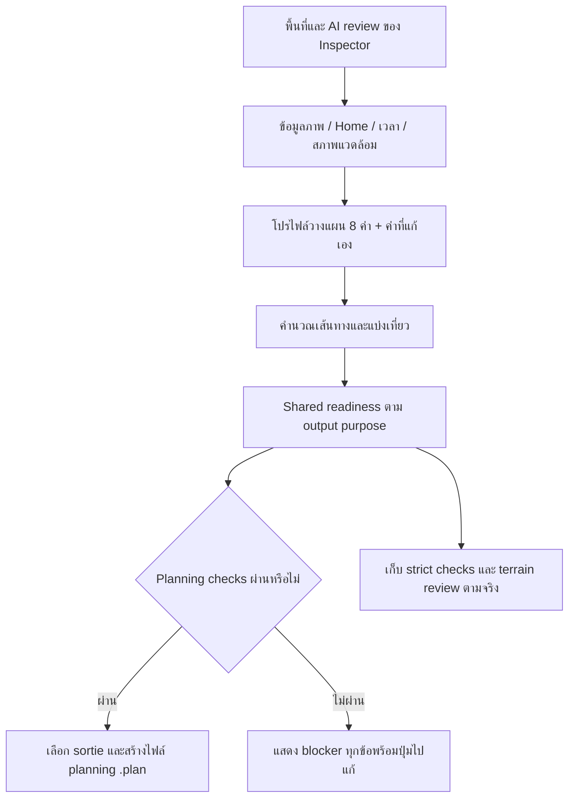

# แผนแก้ Review needed และดาวน์โหลดไฟล์ .plan จากพื้นที่ที่เลือก

> สถานะ execution ล่าสุด: ผู้ใช้อนุมัติให้แก้/ทดสอบ/push/deployต่อแล้ว ดู [รายงานผล](PLAN_EXPORT_READINESS_REPAIR_REPORT_2026-10-31.md) และสอง canonical MD ข้อความแผนด้านล่างเป็นบันทึกของรอบวางแผนก่อน implementation

## 1. หัวข้อ

- วันที่: **31 ตุลาคม 2026 — Asia/Bangkok**
- สถานะ: **แผนงานเท่านั้น ยังไม่แก้ application code และยังไม่เผยแพร่**
- คำสั่งผู้ใช้: วิเคราะห์ภาพที่ค่าฟอร์มครบแต่ Surface model ยัง Review needed และ Download mission file ถูกล็อก แล้วเขียนแผนแก้ละเอียดเป็น Markdown ก่อนลงมือ
- Active checkout: `C:/mega/codex/iENA/github-publish/XEDO-hardware-release`
- Source ที่อ่าน: `1b498ac5296217d4cc05c2f1d28e2479e0b2f16e`
- หลักฐานรอบนี้: ภาพผู้ใช้ 2 ภาพ + อ่าน source/config/contract/tests ที่เกี่ยวข้อง ไม่ได้ replay ภารกิจของผู้ใช้หรือเรียก GEE/AI ใหม่
- คงระบบ 3 ขั้นตอน ตัวคำนวณ 4 ส่วน บัญชี Inspector และภารกิจส่วนตัว ไม่เปิด Billing/subscription ไม่ push/deploy ในรอบวางแผนนี้
- เอกสารนี้เป็นแผนซ่อมเฉพาะเรื่อง ใช้คู่กับบันทึกกลาง `docs/XEDO_WORK_LOG.md` และ `docs/WEBSITE_DETAILS.md`

## 2. สรุป

**สิ่งที่ยังขาดคือ readiness และ export ทั้งเส้นทางการใช้งาน ไม่ใช่เฉพาะค่าฟอร์ม 5 ช่อง** การเติม Home และค่า export 4 ช่องที่เผยแพร่แล้วทำงานในขอบเขตนั้น แต่ยังไม่ได้เติมสมรรถนะโดรน/แบตเตอรี่ 8 ค่า และไม่ได้เปลี่ยนเกณฑ์ terrain ของการส่งออกเดิม

จากภาพยืนยันได้ว่า:

1. ฟอร์มมี Home `1.5 m`, ceiling `60 m`, corridor `5 m`, เวลา validity และ source ของโปรไฟล์แล้ว มีการเลือก ArduPilot
2. **Route & airspace เป็น Ready และ checkbox ถูกเลือกแล้ว** จึงไม่ควรแนะนำให้ติ๊กข้อนี้ซ้ำเป็นวิธีแก้หลัก
3. **Surface model ยัง Review needed** ส่วนนี้ใช้ผลตรวจความสูงของพื้นที่/เส้นทาง/Home ทั้งชุด
4. ขาด `windLimitMps`, `maxAirspeedMps`, `usableWh`, `reserveWh`, `powerW`, `takeoffS`, `landingS`, `turnS` จึงทำให้ Wind และ Battery calculation ไม่ครบ
5. ยังมีข้อความ **3 more checks** ซึ่งภาพไม่ได้เปิดรายละเอียด จึงยังระบุ ID/สาเหตุของทั้งสามข้อไม่ได้ ต้องเก็บรายงานเต็มก่อนแก้

**แนวทางแนะนำสำหรับ prototype:** ให้ Inspector ใช้พื้นที่และข้อมูลจริงที่เลือกอยู่ คำนวณด้วยโปรไฟล์วางแผนที่ระบุที่มา แล้วดาวน์โหลด `.plan` สำหรับอ้างอิงการวางแผนได้ แยกผลตรวจแบบ strict ของระบบเดิมไว้โดยไม่ทำให้ terrain ที่ต้อง review กลายเป็นผ่านอัตโนมัติ ไม่ต้องสลับไปใช้ขอบเขตตายตัวใน Estimated demo

การเริ่มแก้แนวทางนี้ต้องรอคำสั่งผู้ใช้รอบถัดไป แผนนี้ไม่ถือเป็นการอนุญาต implementation หรือ publication

## 3. รายละเอียด

### 3.1 ข้อเท็จจริงและสิ่งที่ยังต้องตรวจ

| ประเด็น | สิ่งที่ยืนยันแล้ว | สิ่งที่ยังห้ามสรุปจากภาพ |
|---|---|---|
| Home มีค่า | เห็น `1.5` ในช่อง AMSL | ยังไม่รู้ว่าเป็น GEE sample ปัจจุบันหรือค่า manual และ evidence ตรงหรือไม่ |
| Surface review | UI ระบุ GEE model needs review | ยังไม่รู้ terrain range, Home offset, tolerance ที่ใช้จริง และเหตุผลเต็มของภารกิจนี้ |
| Aircraft/battery | ภาพแจ้งขาด 8 key ชัดเจน | ยังไม่ใช่หลักฐานว่าลมแรงเกินหรือแบตเตอรี่ไม่พอ เพราะยังคำนวณส่วนนี้ไม่ครบ |
| Route & airspace | UI เป็น Ready และ checkbox เลือกแล้ว | ไม่ได้ทำให้ terrain, wind, battery หรือ no-go data ผ่านตามไปด้วย |
| 182.7 นาที | UI แสดงเป็น mission window | ยังใช้ยืนยันจำนวนเที่ยวบิน/แบตเตอรี่ไม่ได้ในขณะที่ battery assessment incomplete |
| 3 more checks | มีเงื่อนไขอื่นค้าง | ห้ามเดาว่าเป็น no-go, Home evidence หรือ validity ทั้งหมดโดยไม่มีรายงานจริง |

สถานะเก่าที่บอกว่าฟอร์ม 4 ช่องเสร็จยังคงเป็นผลของงานนั้น แต่ไม่ควรขยายคำว่าเสร็จไปหมายถึง normal-flow `.plan` ดาวน์โหลดได้ครบแล้ว

### 3.2 จุดในโค้ดที่ทำให้ปุ่มถูกล็อก

| จุดตรวจ | หน้าที่ปัจจุบัน | ผลต่อปัญหา |
|---|---|---|
| `src/planning-trial-client.js:169` — `readinessState()` | ต้องมี `result.exportCheck.pass` และ readiness ทั้ง 4 แถว Ready รวมถึง risk review | มีค่าฟอร์มครบยังไม่พอ |
| `src/planning-trial-client.js:193` — `renderReadiness()` | ปิดปุ่มเมื่อคำนวณอยู่/เปลี่ยนพื้นที่/ภาพยังไม่พร้อม/`canExport` false | การแก้ disabled ที่ DOM อย่างเดียวไม่แก้เงื่อนไข |
| `src/trial-flight.js:102` — `buildTrialFlight()` | ต้องมีลิมิตการบินและค่าพลังงานครบเพื่อประเมินลมและแบ่งเที่ยว | 8 key ที่ภาพแจ้งยังไม่มีในโปรไฟล์ normal flow |
| `src/planning-terrain.js:12` — `assessPlanningTerrain()` | ตรวจ sample/source/อายุ/พื้นที่/Home/เส้นทาง แล้วเปรียบเทียบ range และ Home offset กับ tolerance | ถ้า range หรือ offset เกิน tolerance จะเป็น review แม้รู้ Home elevation |
| `src/planning-geospatial-gate.js` | ตรวจ terrain assessment และ Home evidence ที่ตรง/สดอีกครั้ง | เปลี่ยนข้อความ UI เป็น Ready อย่างเดียวก็ยังส่งออกไม่ผ่าน |
| `src/trial-export.js:60` — `checkTrialExport()` | ตรวจ camera/wind/battery, Home, reference, เวลา, ceiling, corridor, no-go และ confirmations | อาจมี blocker อื่นนอกภาพ |
| `src/trial-export.js:195` — `buildQGCPlan()` | เรียก strict checks ซ้ำก่อน serialize `.plan` ของ sortie ที่เลือก | ห้ามแก้เฉพาะ summary หรือปุ่ม |

ใน Automatic mode ตัว client ยังกำหนด `flatSurfaceConfirmed` ตาม terrain assessment ของแบบจำลอง จึงไม่ควรติ๊ก flat surface หรือเปลี่ยนเป็น manual เพียงเพื่อให้ปุ่มผ่านโดยไม่มีเหตุผลรองรับ

**สถาปัตยกรรมสำคัญ:** Vercel hosted build ใน `scripts/hosted-build.mjs` กำหนด `__XEDO_STANDALONE__ = true` และ `__XEDO_GEE_HOSTED__ = true` การคำนวณ/สร้างไฟล์จึงวิ่งผ่าน `planning-runtime.js` ไปยัง `planning-file-api.js` ใน browser ขณะที่ GEE/สภาพแวดล้อม/บัญชียังใช้บริการที่เชื่อมไว้ ส่วน workspace build มี `__XEDO_STANDALONE__ = false` และใช้ `planningTrialAPI` ผ่าน `/api/v2/planning-trial`

ดังนั้นต้องแก้ logic ร่วมให้ทั้ง browser และ workspace ให้ผลเหมือนกัน ไม่จำเป็นต้องเพิ่ม cloud CPU/GPU หรือสร้าง Vercel API ใหม่เพื่อแก้การดาวน์โหลดนี้

### 3.3 เป้าหมายเมื่อแก้เสร็จ

1. ใช้ขอบเขตที่ Inspector เลือก/แก้จาก AI อยู่จริง รวม Home เวลา ภาพ และข้อมูลสภาพแวดล้อมเดิม
2. มีโปรไฟล์สมรรถนะวางแผนพร้อมใช้ โดยไม่อ้างว่าเป็นผลวัดของโดรนจริง
3. คำนวณลม พลังงาน เที่ยวบิน และช่วงเวลาภารกิจอย่างสอดคล้องกัน
4. มีเกณฑ์ **planningReady** สำหรับไฟล์อ้างอิงการวางแผน และเก็บ **strictExportReady** ตาม checks เดิมแยกกัน
5. Surface ที่ต้อง review ยังคงแสดงเหตุผลจริง ไม่เปลี่ยน tolerance เพื่อบังคับให้ผ่าน
6. ผู้ใช้รู้จากรายการเช็คที่เข้าถึงได้ครบว่าปุ่มที่เลือกยังติดอะไร และกดไปแก้ที่ช่องนั้นได้
7. ดาวน์โหลด `.plan` ของเที่ยวที่เลือกได้จาก normal flow เมื่อผ่านเงื่อนไขของ planning purpose โดยไม่เปลี่ยนพื้นที่เป็น demo
8. Save/History/เปิดกลับรักษาค่ากับแหล่งที่มา และไม่มีผลคำนวณเก่าหรือไฟล์เก่าทับภารกิจที่เปลี่ยนแล้ว

### 3.4 ระยะที่ 1 — เก็บรายงานเต็มของภารกิจที่มีปัญหา

ยังไม่แก้ตัวประเมินจนทำขั้นนี้ครบ:

1. บันทึก source/build/URL และเวลาตรวจ แยกจากภาพที่ผู้ใช้ส่งมา
2. อ่าน `Calculation details` ทั้ง Flight planning และ Export checks รวมรายการที่ซ่อนหลัง 3 more checks
3. เก็บค่าจาก payload/result ที่จำเป็น: geometry/Home ที่ตรงกัน, Home altitude/evidence, terrain reasons/range/offset/coverage/tolerance, 8 flight keys, wind/battery states, sortie count, takeoff/end/validity, no-go state, `checks[]`, `missing[]`, `errors[]`
4. อ่าน `Sources & calculations` ของ GEE (`trial-geospatial-details-body`) เพื่อแยกว่า review เพราะ range หรือ Home offset และมี Home manual mismatch เพิ่มหรือไม่
5. เก็บ snapshot ภารกิจทดสอบโดยไม่มี session/token/credentials; ไม่เผยแพร่พิกัดภารกิจส่วนตัวเข้า Git
6. ทำรายการแยก known failure / missing input / stale input / numerical infeasibility / review โดยใช้ check ID ไม่ใช้การเดาจากข้อความสั้น

**จบระยะนี้เมื่อ:** แจกแจงทุก blocker ในภารกิจตัวอย่างได้ ไม่มีรายการที่รู้เพียงว่า “3 more checks” และแยกได้ว่าข้อไหนเป็นต้นเหตุ ข้อไหนเป็นผลต่อเนื่องจากการคำนวณไม่ครบ

### 3.5 ระยะที่ 2 — นำโปรไฟล์วางแผน 8 ค่ามาใช้กับพื้นที่เดิม

ค่าต่อไปนี้มีอยู่แล้วใน `ESTIMATED_DEMO_PROFILE.flight` ของ `src/planning-estimated-demo.js` เป็น **ค่าจำลองที่เสนอให้นำมาใช้ซ้ำ** ไม่ใช่ข้อมูลยืนยันจากฮาร์ดแวร์:

| Key | ชื่อที่ควรแสดง | ค่าเริ่มต้นที่เสนอ | หน่วย |
|---|---|---:|---|
| `windLimitMps` | ลิมิตลมของโปรไฟล์ | 8 | m/s |
| `maxAirspeedMps` | ความเร็วอากาศสูงสุดของโปรไฟล์ | 12 | m/s |
| `usableWh` | พลังงานเริ่มต้นที่ใช้ได้ | 177.6 | Wh |
| `reserveWh` | พลังงานสำรองเมื่อลงจอด | 44.4 | Wh |
| `powerW` | กำลังไฟเฉลี่ยที่สมมติ | 600 | W |
| `takeoffS` | เผื่อขึ้นบินและไต่ระดับ | 30 | s |
| `landingS` | เผื่อลงจอด | 30 | s |
| `turnS` | เผื่อต่อหนึ่งการเลี้ยว | 5 | s |

- แยกข้อมูล 8 ค่านี้เป็นโปรไฟล์ shared ที่ใช้ทั้ง normal flow และ Estimated demo ได้
- **ห้ามเรียก `createEstimatedDemoInputs()` เพื่อเติมทั้งภารกิจ** เพราะฟังก์ชันนั้นใส่ขอบเขต Home ลม และตัวอย่างอื่นมาด้วย จะทำให้พื้นที่จริงของผู้ใช้หาย
- เติมเฉพาะค่าที่ยังไม่มี/ยังเป็น auto-owned รักษา manual รวมถึงค่าศูนย์ที่มีความหมาย และแจ้งค่าไม่ถูกช่วงแทนการเปลี่ยนค่าเอง
- ไม่ใช้ `applyFixedPlanningSettings()` ล็อก 8 ค่านี้แบบซ่อนช่องจนแก้ไม่ได้ ต้องมี ownership/provenance แบบ editable
- ไม่เติมลมจริงให้เป็นศูนย์เมื่อ GEE/ข้อมูลสภาพแวดล้อมขาด ลิมิตลมของโปรไฟล์กับเวกเตอร์ลมที่สังเกต/พยากรณ์เป็นคนละข้อมูล
- บันทึก profile ID/version, ค่าที่ใช้, source ของแต่ละค่า และส่วนที่ Inspector แก้เองใน mission/snapshot
- ปุ่ม `Use planning defaults` ปัจจุบันคืนค่า export 4 ช่องเท่านั้น หากเพิ่มการคืนค่าฝั่ง flight ต้องใช้ control ที่บอกขอบเขตชัด ไม่เปลี่ยนความหมายปุ่มเดิมเงียบ ๆ

**ตรวจหน่วยและพลังงาน:** โค้ดปัจจุบันคำนวณ budget = usableWh − reserveWh ดังนั้นค่าชุดนี้ได้ `177.6 − 44.4 = 133.2 Wh` ที่สมมติกำลังไฟ 600 W เท่ากับประมาณ 13.32 นาทีของพลังงานก่อนพิจารณาการแบ่งเส้นทางและ overhead ห้ามอธิบายว่า 182.7 นาทีในภาพคือเวลาบินหนึ่งแบตเตอรี่

คำนวณจำนวน sortie จากระยะจริงทั้งขาออก/สำรวจ/กลับและ overhead จากนั้นค่อยรวมช่วงเปลี่ยนแบตเตอรี่ใน mission window ไม่อนุมานจำนวนแบตจากตัวเลข 182.7 เพียงค่าเดียว

**จบระยะนี้เมื่อ:** 8 key ไม่ missing, wind/battery ได้ผลคำนวณจริงตามโมเดล และรายงาน pass หรือ infeasible ตามตัวเลขจริง โดย geometry/Home/AI review/ข้อมูลลมเดิมไม่ถูกแทนด้วย demo

### 3.6 ระยะที่ 3 — แยก planning readiness จาก strict checks

**แนวทางแนะนำ:** ทำ output purpose `planning_reference` สำหรับ prototype โดยเก็บ strict result เดิมไว้ ให้ปุ่มหลักสื่อว่าเป็นการดาวน์โหลดไฟล์แผน เช่น `Download planning file` ไม่ต้องเพิ่มป้าย Prototype หรือ note ซ้ำทั่วหน้า

| สภาพข้อมูล | ไฟล์ planning reference ที่เสนอ | Strict checks เดิม |
|---|---|---|
| ข้อมูลครบ/คำนวณได้/terrain ใน tolerance | Ready ตาม planning checks | ประเมินต่อด้วยเงื่อนไขเดิม |
| terrain สด ตรงพื้นที่/Home/route และ sample ครบ แต่ range/offset เกิน tolerance | อาจ Ready สำหรับแผนอ้างอิงเมื่อผ่านข้อบังคับอื่น เก็บ terrain review ไว้ในรายละเอียด/metadata | ยัง Review/Blocked ตามเดิม |
| terrain ขาด/masked/หมดอายุ/ไม่ตรงพื้นที่ หรือ Home ไม่มีแหล่งที่มาเข้ากันได้ | ค้างจนได้ข้อมูลปัจจุบันหรือเลือก manual reference ที่ตรวจยืนยันอย่างชัดเจน | ค้างตามเดิม |
| ลมจริงขาด/ข้อมูลอัตโนมัติหมดอายุหรือไม่ครอบคลุมเวลาที่ใช้ | ค้างหรือให้ผู้ใช้เลือกข้อมูลสมมติแยกอย่างชัดเจนใน scope ที่อนุมัติ ห้ามแทนด้วยศูนย์ | ค้างตามเดิม |
| route invalid, ข้อมูลไม่ finite, known no-go conflict, energy ไม่พอแม้หนึ่งเที่ยว | Blocked | Blocked |
| มีข้อมูล no-go ที่ใส่ไว้และเส้นทางชน | Blocked ทั้ง planning และ strict | Blocked |
| ยังไม่ได้ใส่ no-go data | เก็บเป็น not assessed ของ planning purpose หากใช้ policy นี้ ไม่สร้าง empty collection หรืออ้างว่าตรวจแล้ว | ยังขาดข้อมูลตาม strict policy เดิม |

รายละเอียดที่ต้องทำ:

1. เพิ่มผล `planningCheck` หรือชื่อเทียบเท่าที่ได้จาก shared pure validator ขณะที่ `exportCheck` เดิมยังอยู่
2. หน้าเว็บเลือกเกณฑ์ตาม purpose ของปุ่ม ไม่ทำให้ `exportCheck.pass = true` เพื่อผ่านทางลัด
3. Surface model แสดง reasons พร้อม range/offset/tolerance และที่มาข้อมูล ส่วนสรุปความพร้อมไฟล์บอกความพร้อมของ planning purpose
4. ไม่เพิ่ม tolerance จาก 2 m เป็นค่ามาก ๆ เพื่อซ่อน review และไม่บังคับ `flatSurfaceConfirmed = true`
5. Relative-home height ใน `.plan` ต้องอธิบายตรงกับ frame ที่ serialize ไม่อ้างว่าเป็น terrain following หรือ AGL เท่ากันตลอดเมื่อพื้นต่างระดับ
6. ถ้า Home AMSL + relative height อยู่ต่ำกว่าหรือเท่า DSM route sample ที่รู้ค่า ต้องแสดงเป็นข้อขัดแย้งและไม่ส่งออกเส้นทางนั้น จนปรับแผน ไม่ใช้การแยก purpose ซ่อนความขัดแย้งที่คำนวณพบ
7. ถ้า Home `1.5` ถูกแก้เองใน Automatic mode ต้องตรวจ model/evidence mismatch และให้เลือกแหล่งอ้างอิงอย่างชัดเจน ไม่เติมทับค่า manual หรือยอมรับเพียงเพราะเป็นตัวเลข

### 3.7 ระยะที่ 4 — ทำตัวดาวน์โหลดและขอบเขตตรวจให้ตรงกัน

- รักษา `/export` เดิมและ `buildQGCPlan()` ที่ต้องผ่าน strict checks ไม่เปลี่ยนเป็นตัว serialize ที่ข้ามเกณฑ์โดยไม่มีขอบเขต
- แยก pure serializer ที่ใช้ร่วมกันได้ แต่ public builder ของ planning purpose ต้องตรวจ `planningCheck` เองก่อนเรียก serializer
- เสนอเพิ่ม internal operation `/planning-export` ใน `fileTrialAPI`; ฝั่ง workspace ต้องรองรับ `/api/v2/planning-trial/planning-export` ด้วย policy เดียวกัน ไม่จำเป็นต้องเพิ่ม Vercel Function สำหรับ hosted calculator
- Backend/workspace/local API ต้องคำนวณ checks ใหม่จาก input ไม่เชื่อ boolean `planningReady` ที่ client ส่งมา
- ไม่เพิ่ม top-level request field โดยไม่ปรับ allowlist/contract ปัจจุบันที่ reject unknown top-level fields; purpose ใช้ path หรือ nested export enum ที่ validate ชัดเจน
- เก็บ guards ของ session/account context, revision, input hash, AbortController และการเปลี่ยนพื้นที่ระหว่างรอ เพื่อกันดาวน์โหลดผลของภารกิจเก่า
- ในกรณีหลายเที่ยว ให้ดาวน์โหลดหนึ่ง `.plan` ต่อ sortie ที่เลือก พร้อมชื่อไฟล์และหมายเลขเที่ยว ไม่เอาภารกิจหลายแบตมารวมเป็นการบินเที่ยวเดียว
- ตรวจขีดจำกัดปัจจุบัน 40 sorties, 500 waypoints ต่อ sortie และ 5,000 รวมตามที่ adapter รองรับ หากเกินให้แนะนำแบ่งพื้นที่/ภารกิจ ไม่ตัด waypoint หรือเวลาทิ้งเงียบ ๆ
- คง `.plan` เป็นรูปแบบ QGroundControl Plan และ `firmwareType = 3` เมื่อเลือก ArduPilot การเลือก ArduPilot ไม่ใช่หลักฐานว่า native importer ทุกโปรแกรมผ่านแล้ว
- เก็บ purpose/profile/source/terrain review/strict-check summary/geometry hash ใน API report และ mission snapshot ไม่ใส่ property แปลกลง `.plan` จนกว่าจะตรวจความเข้ากันได้
- ไม่สร้างคำสั่ง arm/start/servo/ปล่อยวัสดุหรืออัปโหลดไป flight controller จากปุ่มดาวน์โหลด

### 3.8 ระยะที่ 5 — เก็บ UX ของ Before download ให้จบ

1. ใช้ structured check IDs และ severity จาก shared result แทน regex ตัดข้อความที่มีคำว่า GEE/surface จนรายละเอียดสำคัญหาย
2. แสดงกลุ่มที่ติดจริง เช่น Aircraft profile, Battery, Terrain, Time, Export geometry พร้อมจำนวนข้อ
3. แทน raw keys บนหน้าหลักด้วยชื่ออ่านเข้าใจและหน่วย เช่น `windLimitMps` → Aircraft wind limit (m/s)
4. เปลี่ยน “3 more checks” เป็นปุ่ม `View all checks` ที่เปิดรายละเอียดได้จริง และแต่ละข้อพาไปยังช่องที่เกี่ยวข้อง
5. ใต้ปุ่มที่ disabled ต้องบอกข้อที่ทำให้ค้างได้ครบ ไม่ให้ผู้ใช้ตีความว่าค่าฟอร์มครบแล้วต้องโหลดได้เสมอ
6. แสดง loading ตาม phase คำนวณ/review refresh/เตรียมไฟล์ และกันกดซ้ำ ไม่ทำให้ scroll/render หนักขึ้นด้วย full rerender ทุกครั้ง
7. เมื่อพารามิเตอร์/พื้นที่/Home/เวลาเปลี่ยน ให้ revoke ผล/confirmation ที่เกี่ยวข้องครั้งเดียว และคำนวณจน converged ไม่วนเปลี่ยนเวลา/refresh จนปุ่มไม่พร้อมตลอด
8. เก็บ 3 ขั้นตอนกับ 4 ตัวคำนวณไว้ ใช้ข้อมูลส่วนตัวของ Inspector ตามเดิม ไม่มี role ใหม่ และไม่มีป้าย Prototype ซ้ำที่ผู้ใช้สั่งเอาออก

### 3.9 รายการไฟล์ที่คาดว่าจะเกี่ยวข้องเมื่อได้รับคำสั่งให้แก้

| ไฟล์/กลุ่ม | งานที่เสนอ |
|---|---|
| `src/planning-estimated-demo.js` / `src/planning-hardware-profile.js` | แยก 8 assumptions ที่ใช้ซ้ำ และไม่เอา geometry/weather จาก demo มาแทนพื้นที่ผู้ใช้ |
| โมดูลใหม่เช่น `src/planning-flight-profile.js` | Editable profile ownership/provenance/restore ตามรูปแบบ 4 export defaults ที่มีอยู่ |
| โมดูลใหม่เช่น `src/planning-export-readiness.js` | Pure planning validator และ structured check result ที่ UI กับทั้งสอง runtime ใช้ร่วมกัน |
| `src/planning-trial-client.js` / `src/planning-readiness.js` | ผูก profile, purpose, ปุ่ม/สถานะ/Before download และ async guards |
| `src/planning-geospatial-ui.js` | แสดงเหตุ terrain review ที่ลงรายละเอียดได้ โดยคงข้อมูลจริง |
| `src/planning-geospatial-gate.js` | เก็บ strict policy; แยก routing/purpose ของผลตรวจ ไม่ลด modelGate เงียบ ๆ |
| `src/trial-flight.js` | ใช้ค่าที่ explicit เท่านั้น ตรวจ energy/partition; เปลี่ยนอัลกอริทึมเฉพาะเมื่อ diagnostics พบข้อผิดพลาด |
| `src/trial-export.js` / `src/trial-api.js` / `src/planning-file-api.js` | Planning builder/serializer, operation ใหม่ และ parity ของ checks |
| `contracts/*` / tests / help content | Contract ของ metadata/purpose, regression และคำอธิบายที่ตรงกับการทำงาน |
| `vercel.json` | Regenerate exact asset inventory หลัง build เปลี่ยน ไม่เปลี่ยนบริการหรือ Billing |
| สอง canonical MD และ queue | ผลจริง ขอบเขตที่ผ่าน/ยังไม่ผ่าน และสถานะเผยแพร่ |

ทั้งหมดในตารางเป็นขอบเขตที่เสนอ ยังไม่มีการแก้ไฟล์ product เหล่านี้ในรอบวางแผน

### 3.10 แผนทดสอบก่อนถือว่าปิดปัญหา

ทุกรายการด้านล่างเป็น **designed_not_run** ในรอบนี้ Actual result = `null`:

| ID | กรณี | Expected result |
|---|---|---|
| P01 | พื้นที่เดียวกับผู้ใช้ ขาด 8 ค่า | ใช้ planning profile แล้วคำนวณครบ geometry/Home ไม่เปลี่ยน |
| P02 | มี manual profile ก่อนเลือก preset | ค่าที่ผู้ใช้แก้ไม่ถูกทับ มีแหล่งที่มาราย field |
| P03 | Manual zero ที่ถูกช่วง เช่น turnS/landingS = 0 | รักษาค่า ไม่ตีความเป็น missing |
| P04 | power/usable energy/airspeed เป็น 0 หรือ invalid | Block ด้วยหน่วยและเหตุผล ไม่แก้เป็นตัวเลขอื่นเอง |
| P05 | terrain เกิน 2 m แต่สด/ตรง/ครบ และ reference path ไม่ชนพื้น | Planning purpose ประเมินตาม policy ใหม่ ขณะ terrain/strict result ยัง review |
| P06 | terrain missing/masked/stale หรือ geometry/Home เปลี่ยน | ไม่ยกผลเก่ามาให้ผ่าน ไม่แทน missing ด้วย 0 |
| P07 | Home manual 1.5 ไม่ตรงกับ GEE evidence | แสดง mismatch/ทางเลือก reference ชัดเจน ไม่ overwrite หรืออนุมัติเอง |
| P08 | Wind จริงไม่ครบหรือเกินลิมิต | ไม่แทน calm wind; block หรือขอ explicit assumption ตาม scope |
| P09 | Battery แบ่งได้หลายเที่ยว | Energy/return/phase ถูกนับและเลือกดาวน์โหลดได้แต่ละ sortie |
| P10 | เส้นทางหนึ่งช่วงใช้พลังงานมากกว่างบเที่ยว | Block และแนะนำแบ่งพื้นที่ ไม่สร้าง sortie ปลอม |
| P11 | Mission window/validity ไม่ครอบคลุมหลังคำนวณเที่ยวใหม่ | Auto validity ตาม end เมื่อยัง auto-owned; manual expiry ไม่ถูกทับและแจ้งถ้าสั้นไป |
| P12 | Window เกิน 24h/forecast horizon หรือเริ่มหมดอายุ | บอกให้แก้เวลา/แบ่งภารกิจ ไม่ตัด end เพื่อให้ผ่าน |
| P13 | No-go ที่มีอยู่ชน corridor หรือ route | Block ทั้งสอง purpose; null ไม่ถูกเปลี่ยนเป็น reviewed empty |
| P14 | รีเฟรชข้อมูล/route/time หลายครั้ง | Converge จน ready ตาม inputs ไม่มี self-replanning loop |
| P15 | “3 more checks” | เปิดดูครบทุก check มีชื่อ/หน่วย/action และไม่มีข้อความสำคัญถูก regex ซ่อน |
| P16 | กด download ซ้ำ/แก้พื้นที่ระหว่างรอ/บัญชีหรือrevisionเปลี่ยน | มีไฟล์จากงานปัจจุบันครั้งเดียว ผลช้าไม่ทับ/ไม่หลุดบัญชี |
| P17 | Save/History/เปิดกลับ + snapshot เก่า/ใหม่ | Profile/purpose/geometry/manual ownership คงเดิม; reset reviews ที่จำเป็น |
| P18 | เข้า–ออก Estimated demo | ภารกิจจริงกลับมาครบ ไม่ปน geometry/ลม/แบตเตอรี่ของ demo |
| P19 | Hosted browser, workspace API, portable | Shared checks และไฟล์ตรงกันตามขอบเขตข้อมูลของแต่ละ runtime |
| P20 | Browser ดาวน์โหลด `.plan` จริง | พบไฟล์ใหม่จริง parseได้ Plan/version1/firmware3/Homelatlonถูก/itemsfinite/เที่ยวตรง |
| P21 | ไฟล์ `.plan` ของ planning purpose | มี report/snapshot ที่ติดตาม assumptions/terrain review ได้ ไม่อ้าง terrain following หรือ physical approval |
| P22 | UI มือถือ/scroll/loading | ปุ่ม/เหตุผลอ่านได้ ไม่เพิ่มการคำนวณหรือ render ที่ค้างขณะเลื่อน |
| P23 | หลัง deploy | Exact commit/CI/alias/asset hashes ตรง และ replay พื้นที่เดิมจนได้ไฟล์จริง |

Browser acceptance ต้องไปถึง **ดาวน์โหลดไฟล์จริง** และตรวจเนื้อหา ไม่ถือว่าปุ่ม enabled หรือ input มีตัวเลขเป็นผลจบงาน หาก tool รับไฟล์มีข้อจำกัดต้องแยกสิ่งที่รันจริงออกจาก VM/unit และให้ผู้ใช้ทำ native import เมื่อจำเป็น

### 3.11 ลำดับส่งมอบและเกณฑ์ปิดงาน

1. รับรายงานเต็มและยืนยัน hidden blockers ก่อน
2. ผูก 8 planning assumptions กับพื้นที่เดิมโดยรักษา manual/data provenance
3. สร้าง shared planning readiness/purpose พร้อมคง strict checks เดิม
4. ผูกปุ่ม/ตัวสร้างไฟล์ทั้ง hosted browser และ workspace และแก้ Before download ให้ครบ
5. ทดสอบ unit/integration/browser จนได้ `.plan` จริงสำหรับพื้นที่ตัวอย่าง และคืน Save/History ได้
6. บันทึกสอง MD/queue พร้อม build/hash/test receipt
7. **push/deploy เมื่อมีคำสั่งเผยแพร่สำหรับงานนี้** แล้วตรวจ `.plan` บน Production ซ้ำ

เกณฑ์จบที่เสนอ: Inspector ใช้พื้นที่ของตนเอง เลือก Home/ภาพ คำนวณโปรไฟล์ แก้ review ตามเหตุจริง แล้วโหลด `.plan` อ้างอิงการวางแผนของ sortie ที่เลือกได้ โดยไม่มีการหลอกผล strict checks ข้อมูล manual ไม่หาย และไม่มี blocker ที่ซ่อนอ่านไม่ครบ

Native QGroundControl/Mission Planner compatibility, SITL และการบินจริงยังเป็น qualification แยก การสร้างไฟล์ผ่านไม่ใช่ผลทดสอบเหล่านั้น

### 3.12 ขอบเขตการอนุมัติและสถานะรอบนี้

- ข้อเดิม 3 ที่เคยตัดจาก closeout มีเรื่องนำ aircraft/battery assumptions เข้า normal flow อยู่ด้วย แผนฉบับนี้เสนอเปิดกลับเฉพาะส่วนที่จำเป็นต่อปัญหา 8 ค่าและการดาวน์โหลดพื้นที่เดิม ไม่เริ่ม rewrite ระบบเลือกเวลา/โดรนจริงทั้งหมด
- ยังไม่เปลี่ยนเกณฑ์ terrain จริง ไม่ปรับ tolerance ไม่กรอกข้อมูลในภารกิจ ไม่เพิ่ม profile หรือปุ่มจริง ไม่สร้างไฟล์บินใหม่ให้ภารกิจผู้ใช้
- ไม่มีคำถามที่จำเป็นต้องตอบก่อนส่งแผนนี้ ขั้นต่อไปคือผู้ใช้พิจารณาแนวทางและสั่งเริ่ม implementation เมื่อพร้อม
- ถ้าใช้แชทผู้ช่วยเมื่อได้รับคำสั่ง ให้ช่วยอ่าน shared policy/ตรวจ test matrix และตรวจหลักฐานแบบ read-only แชทหลักเป็นผู้แก้ website/API/config/Git/deploy เพียงแชทเดียว
- ผล runtime/tests/build/CI ใหม่รอบนี้: **ไม่ได้รัน** ตรวจเฉพาะ source เอกสาร และ Git เพื่อทำแผน
- ไม่มี commit/push/deploy, accounts/schema/env change, Billing หรือ subscription ในรอบนี้
