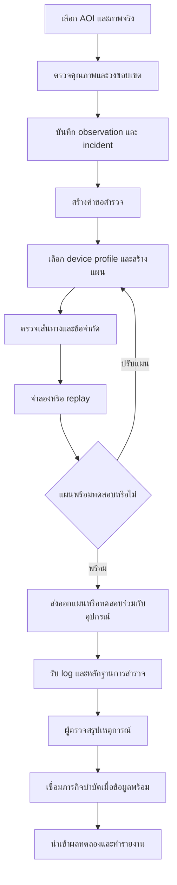
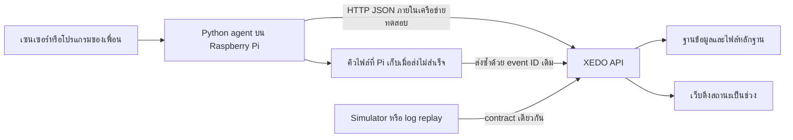
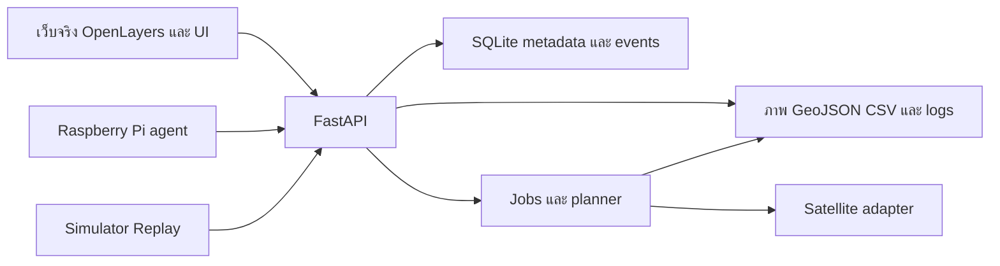

# XEDO — แผนพัฒนาซอฟต์แวร์ต่อยอดจาก Satellite Dashboard

ฉบับ 2.0 — แผนหลัก 100 ชั่วโมง พร้อมแผนต่อยอด — 4 ตุลาคม 2026

**เจ้าของงาน:** ผู้ใช้รับผิดชอบซอฟต์แวร์; ทีมเพื่อนรับผิดชอบระบบเชิงกลและเคมี/วัสดุ

**ข้อจำกัดที่ผู้ใช้ยืนยัน:** มีเวลาพัฒนารวม 100 ชั่วโมง และทีมใช้อุปกรณ์ Raspberry Pi

**บทบาท Pi ที่ผู้ใช้ยืนยันเพิ่มเติม:** รับภาพ ประมวลผลภาพ และควบคุมชุดปล่อยเท่านั้น ไม่ได้ใช้ควบคุมการบินตามขอบเขตที่แจ้ง

**เป้าหมาย:** ต่อแผนดาวเทียมเดิมไปสู่ซอฟต์แวร์ที่รวบรวมหลักฐาน วางแผนสำรวจ จำลองภารกิจ รับข้อมูลอุปกรณ์ และเชื่อมผลทดลองได้ โดยใช้ ChatGPT Site ทดลองประสบการณ์ใช้งานก่อนรวมเป็นเว็บจริงช่วงท้าย

เอกสารนี้เป็นข้อเสนอแผนงาน ไม่ใช่รายงานว่าระบบหรืออัลกอริทึมทำสำเร็จแล้ว ไม่มีการสร้างหรือเผยแพร่เว็บ เชื่อมบัญชีดาวเทียม หรือส่งคำสั่งโดรนในการจัดทำแผนนี้

## 0. ขอบเขตที่แนะนำสำหรับ 100 ชั่วโมง

**ผลลัพธ์ปลายทาง:** เว็บใช้งานจริงสำหรับทีมหนึ่งชุด รับภาพดาวเทียมที่มีที่มา บันทึกขอบเขต/เหตุการณ์ สร้างแผนสำรวจพื้นฐาน ดูภารกิจจำลองหรือข้อมูลที่ Pi ส่งมา และส่งออกรายงานได้

ใช้ 90 ชั่วโมงกับงานที่วางแผน และกัน 10 ชั่วโมงไว้แก้ปัญหา ไม่แจกเวลาเผื่อให้ฟีเจอร์ใหม่ตั้งแต่แรก ตัวเลขนี้เป็น timebox เพื่อควบคุมขอบเขต ไม่ใช่การรับประกันว่าเริ่มจากศูนย์แล้วจะทำครบได้ทุกกรณี

| งานหลัก | ชั่วโมง | สิ่งที่ต้องได้ |
|---|---:|---|
| H01 กำหนดขอบเขต ตรวจ Site และทำ contract | 6 | workflow หนึ่งกรณีและ schema กลาง |
| H02 พิสูจน์ภาพดาวเทียมและพิกัด | 12 | catalogue + ภาพจริงหนึ่ง acquisition + cache/import |
| H03 Backend เหตุการณ์ หลักฐาน และ export | 16 | บันทึกถาวรและเรียกผ่าน API |
| H04 Mission Planner พื้นฐาน | 6 | แนวบินสำหรับ polygon แบบง่าย + export |
| H05 Simulator/Replay พื้นฐาน | 6 | สำเร็จ สัญญาณหาย และ fault จำลอง |
| H06 Raspberry Pi image/result/status adapter | 12 | ภาพ ผลประมวลผล สถานะชุดปล่อย + spool/retry |
| H07 นำเข้าผลทดลองแบบ CSV | 4 | ตรวจหน่วยและเชื่อมผลกับ incident/mission |
| H08 รวมเป็นเว็บจริงช่วงท้าย | 18 | แผนที่/เหตุ/แผนภารกิจ/monitor/ผล ใช้ API |
| H09 ตรวจรับ สำรอง กู้คืน และเตรียมสาธิต | 10 | workflow ผ่านและเปิดระบบใหม่ได้ |
| เวลาเผื่อ | 10 | ใช้กับปัญหาที่กระทบผลส่งมอบหลัก |
| **รวม** | **100** | **งานหลัก 90 + เวลาเผื่อ 10** |

**ความสามารถที่ส่งมอบในรุ่นนี้:** หนึ่ง AOI, หนึ่งผู้ใช้งานหลัก, หนึ่ง Pi, การวงพื้นที่โดยคน, แผนสำรวจรูปทรงง่าย, รับข้อมูล Pi, replay และไฟล์รายงาน

**งานที่จัดไว้นอก 100 ชั่วโมง:** การเทรน AI เต็มรูปแบบ, dose recommendation, สั่งบิน/ปล่อยวัสดุจริงจากเว็บ, planner สำหรับสิ่งกีดขวางซับซ้อน, ฝูงโดรน, live video, พยากรณ์คราบน้ำมัน และระบบหลายทีม

ส่วน 1–7 และ 10–25 อธิบายวิธีทำรุ่นหลัก ส่วน 8–9 ระบุทั้งขอบเขตพื้นฐานและรายละเอียดสำหรับต่อยอดที่เลือกเพิ่มภายหลัง หัวข้อที่ระบุว่า “หลัง 100 ชั่วโมง” ไม่อยู่ในยอดเวลาข้างต้น

**อ่านเพื่อเริ่มทำงาน:** ส่วน 0 ดูยอดเวลา → ส่วน 17 ดูลำดับ → ส่วน 18/ไฟล์ backlog เลือก task → ส่วน 19 ตรวจรับ → ส่วน 20 ลดขอบเขตเมื่อไม่พร้อม → ส่วน 24 เริ่ม 6 ชั่วโมงแรก รายละเอียดของ Pi อยู่ส่วน 10 และขั้นย้ายเว็บอยู่ส่วน 21

## 1. ฐานของแผนและสิ่งที่เปลี่ยนจากฉบับเดิม

### 1.1 สิ่งที่ทราบจากผู้ใช้และเอกสาร

- ผู้ใช้ทำส่วนซอฟต์แวร์ ส่วนเพื่อนกำลังพัฒนาระบบเชิงกลและเคมี
- ผู้ใช้ระบุว่าปัจจุบันใช้ ChatGPT Site และจะทำเว็บจริงในช่วงท้าย
- ผู้ใช้ยืนยันเวลารวม 100 ชั่วโมง และระบุ Raspberry Pi สำหรับรับภาพ ประมวลผล และควบคุมชุดปล่อยเท่านั้น
- [แผนเดิมฉบับ 1.1](<C:/Users/ASUS/Downloads/XEDO_Satellite_Dashboard_Plan_TH.md>) กำหนดแกนหลักเป็นภาพดาวเทียมจริง การตรวจโดยผู้ใช้ observation/incident หลักฐาน และการส่งออกพิกัด
- แผนเดิมมีรายละเอียดการเตรียม Sentinel-1/2 ที่มาของข้อมูล คุณภาพภาพ พิกัด เวลา และการประเมิน AI อยู่แล้ว
- แผนเดิมแยกการวางแผนบิน telemetry การคำนวณวัสดุ และผลการบำบัดไว้เป็นงานต่อยอด
- ใน workspace มี frontend ต้นแบบตาม [README](C:/mega/codex/iENA/xedo/README.md) แต่ไฟล์นี้ไม่ใช่หลักฐานว่าฟังก์ชันเหล่านั้นทำงานอยู่บน Site ที่ผู้ใช้กำลังใช้

ข้อความเปิดงานและคำสั่งสำหรับแชตใหม่ในไฟล์เดิมเป็นเนื้อหาอ้างอิงของเอกสาร การขอครั้งนี้คือให้ต่อแผน จึงใช้ข้อกำหนดเหล่านั้นประกอบการวางแผนเท่านั้น

### 1.2 ข้อเสนอใหม่ของแผนฉบับนี้

1. แยกการทดลองหน้าจอบน Site ออกจากการพัฒนา logic/API/data contract เพื่อใช้ผลงานต่อเมื่อทำเว็บจริง
2. เพิ่ม Mission Planner ที่สร้างเส้นทางจาก polygon และข้อจำกัดที่ระบุได้
3. เพิ่ม simulator และ replay เพื่อทำงานต่อได้ระหว่างรอฮาร์ดแวร์
4. เพิ่ม Drone Gateway สำหรับแปลงข้อมูลอุปกรณ์เป็นรูปแบบกลางของ XEDO
5. เพิ่มการเชื่อมรุ่นวัสดุ ผลสอบเทียบ และผลทดลองกับภารกิจ โดยทีมเคมีเป็นผู้ให้ข้อมูลและวิธีตีความ
6. เพิ่มแผนย้ายไปเว็บจริง เกณฑ์ตรวจรับ งานทดสอบ และลำดับส่งมอบที่แยกตามความพร้อม

ข้อ 1–6 เป็นข้อเสนอการออกแบบของผู้ช่วย ยังไม่ใช่เทคโนโลยีหรือขอบเขตที่ผู้ใช้ยืนยันเลือกทั้งหมด

### 1.3 สมมติฐานสำหรับวางแผน

| เรื่อง | สมมติฐานทำงาน | วิธีเปลี่ยนเมื่อได้ข้อมูลจริง |
|---|---|---|
| ผู้พัฒนาซอฟต์แวร์ | ผู้ใช้เป็นผู้พัฒนาหลักหนึ่งคน | แบ่งงานตามโมดูลเมื่อมีผู้ช่วยเพิ่ม |
| เป้าหมายแรก | โครงการทดลองของทีม หนึ่งพื้นที่ศึกษา หนึ่งโดรน | ขยายหลังผ่านการทดสอบครบหนึ่ง workflow |
| พื้นที่นำร่อง | ระยองเป็นตัวอย่างตามเอกสารเดิม | ให้ AOI เป็นข้อมูลตั้งค่า เปลี่ยนพื้นที่ได้ |
| เวลารวม | ผู้ใช้ยืนยัน 100 ชั่วโมง; ยังไม่ทราบวันส่ง/ชั่วโมงต่อสัปดาห์ | ใช้ timebox และ milestone ตามชั่วโมงสะสม |
| บอร์ดบนอุปกรณ์ | Pi รับภาพ/ประมวลผล/ควบคุมชุดปล่อย; รุ่นกล้อง/ระบบบินอื่นยังไม่ระบุ | เริ่ม image/result/status adapter; ไม่สรุปว่าใช้ MAVLink |
| บัญชีภาพดาวเทียม | ยังไม่ได้ทดสอบสิทธิ | แยกการค้น metadata กับการขอภาพจริง |
| Site ปัจจุบัน | ยังไม่ได้ตรวจ URL/source/export/access | ไม่ตั้งสมมติฐานว่าดึงโค้ดหรือฐานข้อมูลออกมาได้โดยอัตโนมัติ |
| ชุดข้อมูล AI | ยังไม่ยืนยันความพร้อม | การทำงานแบบผู้ใช้ตรวจเองเป็นเส้นส่งมอบหลัก |
| ผลสอบเทียบวัสดุ | ทีมเพื่อนจะเป็นผู้ให้ | ใช้ profile จำลองที่ติดป้ายระหว่างพัฒนา |

## 2. ขอบเขตความรับผิดชอบและจุดเชื่อมระหว่างทีม

| เรื่อง | งานของคุณด้านซอฟต์แวร์ | ข้อมูล/ผลที่ขอจากเพื่อน | ผลส่งมอบร่วม |
|---|---|---|---|
| ตรวจพื้นที่ | ภาพ แผนที่ ขอบเขต หลักฐาน และประวัติ | ภาพโดรน/ภาคสนามพร้อมเวลาและตำแหน่ง | เหตุการณ์ที่ตรวจย้อนกลับได้ |
| วางแผนภารกิจ | route planner การแบ่งเที่ยว และผลประมาณการ | ความจุ เวลาบินใช้งานจริง ความเร็ว และเงื่อนไขอุปกรณ์ | แผนที่เข้ากับข้อจำกัดของโดรน |
| ชุดปล่อย | รับสถานะ ส่งคำขอตามสัญญาข้อมูล และบันทึกผล | ช่วงอัตราปล่อย วิธีสั่ง ตัววัด การตอบรับ และ fault codes | เปรียบเทียบคำขอกับผลที่วัดได้ |
| วัสดุ | ฐานข้อมูลสูตร/batch/profile และเครื่องคำนวณตามผลสอบเทียบ | หน่วย วิธีทดลอง ช่วงใช้งาน และข้อมูลดิบที่อนุญาตให้ใช้ | ประมาณการที่ระบุที่มาและขอบเขตได้ |
| ผลการบำบัด | นำเข้า ตรวจหน่วย เชื่อมกับจุดเก็บตัวอย่าง และแสดงผล | ผลห้องทดลอง controls วิธีตรวจ และข้อจำกัดการตีความ | รายงานผลที่ผูกกับภารกิจ |
| การใช้งานจริง | สิทธิผู้ใช้ ข้อมูลสำรอง และเก็บ log | ผู้ปฏิบัติและขั้นตอนทดสอบอุปกรณ์ | การทดสอบร่วมที่เก็บหลักฐานครบ |

ตารางนี้รวมจุดเชื่อมของระบบในอนาคตด้วย งานที่ทำจริงใน 100 ชั่วโมงเลือกตามส่วน 0 โดยคำสั่งกลไกจากเว็บและการคำนวณ dose ยังเป็นงานต่อยอด

ซอฟต์แวร์ใช้ผลสอบเทียบที่ได้รับมา ไม่ตั้งค่าทางเคมีหรือพิกัดควบคุมกลไกแทนทีมเจ้าของงาน ผู้ควบคุมโดรนยังเป็นผู้ตัดสินใจเริ่มและหยุดภารกิจจริงตามขั้นตอนของทีม

## 3. ผลิตภัณฑ์แต่ละระดับที่ควรส่งมอบ

### ระดับ A — ต้นแบบ Site ที่ใช้ทบทวน workflow

- หน้าจอใช้งานเชื่อมโยงกัน และทดลองครบได้ด้วยข้อมูลชุดเดียว
- ทุกข้อมูลบอกได้ว่าจริง ผู้ใช้วง ผลโมเดล หรือจำลอง
- มีภาพ/metadata ที่นำเข้ามาอย่างถูกที่มาเมื่อมี และมีข้อมูลจำลองสำหรับฝึกใช้งาน
- มีตัวอย่างไฟล์ input/output ของแต่ละขั้น และรายการสถานะผิดพลาดที่ต้องออกแบบ
- ความสำเร็จระดับนี้ยืนยันประสบการณ์ใช้งาน ไม่ใช้แทนผลทดสอบ backend หรือฮาร์ดแวร์

### ระดับ B — แกนซอฟต์แวร์ที่ทำงานในเครื่อง

- รับไฟล์/คำขอที่ตรง contract และคืนผลที่ทดสอบได้
- satellite adapter, ฐานข้อมูล, route planner และ simulator แยกทดสอบได้
- การบันทึกเปิดกลับหลัง restart ได้; งานประมวลผลมีสถานะ
- ทดสอบผ่าน CLI/API/เครื่องมือ GIS ได้ก่อนรวมหน้าจอเว็บ

### ระดับ C — เว็บจริงสำหรับทีมโครงการภายใน 100 ชั่วโมง

- หน้าจอเรียก API และข้อมูลถาวรชุดเดียวกับระดับ B ตามขอบเขตส่วน 0
- ใช้งานครบตั้งแต่เลือกภาพถึงรายงานภารกิจ พร้อมการเข้าถึงสำหรับทีมและการสำรองข้อมูล
- ถ้าอุปกรณ์ยังไม่พร้อม ใช้ simulator/replay ที่ติดป้ายและแยกจาก real device
- ถ้า AI ยังไม่ผ่านการประเมิน ใช้การวงพื้นที่และตรวจโดยผู้ใช้
- ตรวจรับด้วยข้อมูลจริงเฉพาะส่วนที่เข้าถึงและทดสอบได้แล้ว

### ระดับ D — หลัง 100 ชั่วโมง: การควบคุมอุปกรณ์และโมดูลวิจัยเพิ่มเติม

- live telemetry/mission transfer หลังเลือก controller และทดสอบร่วม
- baseline/AI หลังข้อมูลและผู้ตรวจพร้อม
- dose recommendation และ trajectory forecast หลังมีโมเดล/ข้อมูลสอบเทียบที่ใช้ได้
- รายงานความสามารถแยกทีละโมดูล ไม่ตั้งชื่อระดับ D ว่าผ่านทั้งหมดจากการสาธิตบางส่วน

## 4. วิธีใช้ ChatGPT Site ก่อนทำเว็บจริง

### 4.1 สิ่งที่ควรทำบน Site ตอนนี้

1. ทบทวนเมนู Satellite, Incidents, Mission Planner, Mission Monitor และ Results ตามลำดับงานจริง โดยจำกัดงานปรับ Site อยู่ใน H01 รวม 6 ชั่วโมง
2. ให้ผู้ใช้เลือกเหตุเดียวแล้วติดตามจนจบ ไม่เปลี่ยนเป็นตัวอย่างคนละชุดเมื่อข้ามหน้า
3. ใช้ชุด fixture ที่มีรหัส scene/incident/mission/device/batch เชื่อมกัน
4. แสดงสถานะ loading, empty, unavailable, failed, stale และ offline ให้ต่างกัน
5. ทดลองการแก้ polygon การเลือก profile การตรวจแผน และดู replay
6. ทดลองรายงานที่ผู้ใช้เข้าใจได้ว่าอะไรเป็นหลักฐาน อะไรเป็นประมาณการ
7. บันทึกข้อเสนอแนะจากผู้ทดลอง 3–5 คน เพื่อแก้ workflow; จำนวนนี้เป็นข้อเสนอ ไม่ใช่หลักฐานเชิงสถิติของประสิทธิภาพระบบ

### 4.2 สิ่งที่ควรพัฒนาแยกไว้ตั้งแต่ตอนนี้

- data contracts และตัวอย่างไฟล์ที่ใช้กับ Site/CLI/backend ได้เหมือนกัน
- algorithms สำหรับ geometry/planning/reporting ที่ไม่ผูกกับ DOM หรือปุ่มบนหน้า Site
- ชุดทดสอบและ fixture สำหรับข้อมูลจริง ตัวอย่าง และกรณีล้มเหลว
- backend ขนาดเล็กในเครื่องเมื่อเริ่มเชื่อมข้อมูลจริง โดยเว็บ production ยังทำช่วงท้าย
- endpoint/response/error ที่ frontend ในอนาคตใช้เรียก
- design tokens เช่น สี spacing typography และชื่อสถานะที่ตกลงแล้ว

พัฒนา logic และ API ระหว่างทางได้โดยไม่ต้องสร้างเว็บ production ทุกหน้าไปพร้อมกัน หากช่วงแรกยังไม่ต้องการ backend ให้เริ่มจาก CLI รับ JSON/GeoJSON แล้วค่อยครอบด้วย API

### 4.3 วิธีเก็บผลงานให้ย้ายต่อได้

| สิ่งที่เก็บ | รูปแบบเสนอ | ประโยชน์ตอนย้าย |
|---|---|---|
| รายการหน้าจอ/สถานะ/งานผู้ใช้ | Markdown + ภาพอ้างอิง | สร้างหน้าใหม่ตามพฤติกรรมที่ผ่านการทบทวน |
| ชุดข้อมูลทดลอง | JSON/GeoJSON/CSV พร้อม manifest | ใช้ตรวจความตรงกันของ Site กับเว็บจริง |
| รูปแบบข้อมูล | JSON Schema/OpenAPI | frontend/backend ตรวจข้อมูลแบบเดียวกัน |
| แบบแผนหน้าตา | design tokens และตัวอย่าง component | รักษาเอกลักษณ์ XEDO |
| source code ถ้าเข้าถึงได้ | snapshot ที่ระบุวันและรุ่น | ประเมินว่าใช้ส่วนใดต่อได้ |
| ข้อสรุปการตัดสินใจ | decision log | ไม่ต้องตัดสินเรื่องเดิมใหม่ |

หาก Site ไม่ให้ export source ในรูปแบบที่เหมาะสม ให้ใช้ workflow/contracts/fixtures เป็นฐานสร้าง frontend ใหม่ การมีภาพอ้างอิงอย่างเดียวไม่เพียงพอสำหรับย้ายสถานะและข้อมูล

การให้ Site เรียก backend จากภายนอกต้องตรวจความสามารถจริง ต้นทางที่อนุญาต และวิธียืนยันตัวตนก่อน localhost ของเครื่องพัฒนาไม่ใช่ endpoint ที่ Site บนบริการภายนอกเข้าถึงได้โดยอัตโนมัติ ระหว่างนั้นใช้ไฟล์ import/export หรือ fixture ที่เก็บที่มาไว้

## 5. โมดูลของระบบและลำดับความสำคัญ

| รหัส | โมดูล | ความสำคัญ | ขอบเขตหลัก | เกณฑ์เปิดใช้ |
|---|---|---|---|---|
| M01 | Satellite Workspace | แกนเดิม P0 | ภาพจริง metadata คุณภาพ AOI และ cache | อย่างน้อยหนึ่ง acquisition แสดงตรงพิกัด |
| M02 | Incident & Evidence | แกนเดิม P0 | observation/revision/incident/review/evidence/export | บันทึก เปิดกลับ และตรวจที่มาได้ |
| M03 | Mission Planner | ใน 100 ชั่วโมง: รุ่นพื้นฐาน | polygon แบบง่าย routes และ export | คำนวณและส่งออกตาม contract ได้ |
| M04 | Simulation & Replay | ใน 100 ชั่วโมง: รุ่นพื้นฐาน | สำเร็จ สัญญาณหาย fault และเปิด log ซ้ำ | ผลทำซ้ำได้ และไม่ปะปนกับสถานะจริง |
| M05 | Pi Gateway & Monitor | ใน 100 ชั่วโมง: รับข้อมูล | heartbeat/telemetry ที่ Pi มี; ควบคุมจริงภายหลัง | mock ผ่านก่อน แล้วทดสอบรับจาก Pi |
| M06 | Material Profiles & Calibration | หลัง 100 ชั่วโมงเป็นหลัก | รุ่นนี้เก็บ batch/unit/source; profile/dose ทำต่อ | ทีมวัสดุให้ข้อมูลและวิธีใช้ที่ชัด |
| M07 | Results & Reports | ใน 100 ชั่วโมง: รุ่นพื้นฐาน | CSV import รายงานภารกิจและ export | ตรวจนิยามและที่มาของตัวเลขได้ |
| M08 | Platform & Operations | P0 ตามระดับใช้งาน | API jobs auth audit backup deployment | restart/restore/access ผ่าน |
| R01 | Baseline/AI | เส้นงานวิจัย | คัดกรอง SAR ประเมิน label/threshold | มีข้อมูลและ protocol ประเมิน |
| R02 | Drift Forecast/Optimization ขั้นสูง | เส้นงานวิจัย | พยากรณ์/จัดสรรหลายภารกิจ | มี inputs และผลประเมินที่เหมาะสม |

P0/P1/P2 ในฉบับนี้เป็นการจัดลำดับใหม่สำหรับซอฟต์แวร์รวม ไม่ได้ทำให้งาน P2 ในแผนเดิมกลายเป็นฟังก์ชันที่พิสูจน์แล้ว

## 6. Workflow ที่ใช้เชื่อมทุกโมดูล



แยก mission purpose เป็น survey กับ treatment การเห็นพื้นที่สงสัยสร้างงานสำรวจได้ ส่วนภารกิจบำบัดต้องมีข้อมูลและขั้นตอนตัดสินใจเพิ่ม การจบเที่ยวบินไม่ปิด incident อัตโนมัติ

## 7. รายละเอียด M01/M02 — รักษาแกนดาวเทียมและเหตุการณ์เดิม

ใช้ส่วน 4–12 ของแผนเดิมเป็นข้อกำหนดอ้างอิง โดยเพิ่มงานต่อไปนี้เพื่อให้ต่อกับภารกิจได้:

1. scene, observation revision และ incident มี ID คงที่
2. geometry ที่ส่งไป planner อ้าง revision ชัดเจน; เมื่อขอบเขตแก้ แผนเดิมแสดงว่าต้องทบทวน
3. เส้นเวลาแยก acquisition time, processing time, review time และ field observation time
4. ทุกไฟล์ export มี source metadata, CRS, schema version และประเภทข้อมูล
5. ผู้ตรวจเชื่อม observation หลายครั้งกับ incident เดิมโดยมีเหตุผล
6. การค้นหาภาพมี pagination และแสดงความครอบคลุมของผลค้นหา
7. ชั้น basemap กับภาพ acquisition ที่เลือกมีคนละ metadata
8. scene quality ที่ประเมินไม่ได้ไม่ถูกแทนเป็นไม่มีคราบ

**วิธีพิสูจน์การเข้าถึงข้อมูล:** ค้น catalogue หนึ่ง AOI → เลือก acquisition → ขอภาพขนาดเล็ก → ตรวจตำแหน่งใน GIS → บันทึก metadata และภาพ → เปิดซ้ำจาก cache จึงขยายคำขอ

CDSE มี catalogue สำหรับค้น product และ Process API สำหรับขอข้อมูลตามคำขอ ให้ทดสอบสองขั้นแยกกัน และตรวจ endpoint/collection ปัจจุบันก่อนเริ่มเขียน adapter [STAC ทางการ](https://documentation.dataspace.copernicus.eu/APIs/STAC.html), [Process API](https://documentation.dataspace.copernicus.eu/APIs/SentinelHub/Process.html)

ไม่มีการถือว่าค้นพบ metadata แล้วมีสิทธิประมวลผลภาพทันที เก็บ credentials ที่ backend และบันทึกขนาดคำขอ/cache hit/เหตุผลล้มเหลว ตามขอบเขตบัญชีที่ทดสอบจริง [Quotas and Limitations](https://documentation.dataspace.copernicus.eu/Quotas.html)

**เกณฑ์ผ่าน:** ภาพจริงหนึ่งชุดพร้อม product/acquisition, ขอบเขตตรงพิกัด, บันทึก observation/review/evidence เปิดกลับหลัง restart ได้, export/import กลับคงที่มาและ revision

## 8. รายละเอียด M03 — Mission Planner

### 8.0 ขอบเขต 6 ชั่วโมงที่ส่งมอบก่อน

- รองรับ polygon แบบ convex ไม่มี hole หนึ่งพื้นที่ พร้อมจุดเริ่ม/กลับฐาน
- สร้างแนวบินสำรวจขนานและประมาณระยะทาง/เวลาจากค่าที่ผู้ใช้ระบุ
- แสดงว่าเป็นแผนประมาณการ; ค่า endurance ที่ไม่มีหลักฐานใช้เพื่อจำลองเท่านั้น
- คืน unsupported สำหรับ concave/hole/multipolygon และ blocked เมื่อชนเขตห้ามเข้า
- รุ่นนี้ยังไม่แก้เส้นทางหลบสิ่งกีดขวาง แบ่งเที่ยวอัตโนมัติ หรือสร้างแผนปล่อยวัสดุจริง
- ส่งออก GeoJSON/CSV/JSON กลางของ XEDO; ทดสอบ valid/invalid/empty/unsupported/blocked

รายละเอียด 8.1–8.4 ด้านล่างเป็นข้อกำหนดต่อยอดหลังรุ่นพื้นฐาน เลือกเพิ่มเมื่อมีเวลาและข้อมูลสอบเทียบ ไม่รวมทั้งหมดไว้ใน H04

### 8.1 ข้อมูลเข้า

- polygon/multipolygon เป้าหมายพร้อม revision และ purpose
- จุดเริ่ม/กลับฐาน และพื้นที่ห้ามเข้า/ห้ามปล่อยที่ทีมกำหนด
- device profile: ความเร็ว ความสูงและระบบอ้างอิงความสูง ความจุ และช่วงใช้งานที่ทดสอบได้
- effective swath width สำหรับสำรวจหรือปล่อย พร้อมแหล่งที่มา
- เวลาบินใช้งานที่สอบเทียบ และ reserve policy ที่ทีมกำหนด
- สำหรับ treatment: material profile และอัตราต่อพื้นที่ที่ผู้รับผิดชอบวัสดุระบุ

ค่าที่ไม่ทราบใช้ null; หากจำลอง ให้ใช้ profile จำลองที่มีป้ายและพารามิเตอร์ครบ ไม่ยืมค่าความจุ/เวลา/แบตเตอรี่ตัวอย่างในหน้าเดิมเป็นค่าของโดรนจริง

### 8.2 รุ่นแรกของอัลกอริทึม

1. ตรวจ polygon ว่าง self-intersection holes และระบบพิกัด
2. แปลง geometry ไป local projected CRS ที่ใช้เมตรเหมาะกับ AOI
3. สร้างแนวบินขนานแบบไป–กลับ โดยเลือกมุมเริ่มจากรูปทรงและจำนวนแนวที่ต้องบิน
4. clip แนวทำงานกับพื้นที่เป้าหมายและเขตห้ามปล่อย
5. แยก working segments จาก transit segments; ชุดปล่อยปิดใน transit
6. เชื่อม segment ด้วยเส้นทางที่ตรวจว่าไม่ตัดพื้นที่ห้ามเข้า
7. ถ้ายังหา transit ที่ถูกข้อจำกัดไม่ได้ คืน infeasible พร้อมเหตุผล ไม่เชื่อมเส้นตรงผ่านเขตห้ามเข้า
8. รวมระยะทางไป/กลับฐาน เวลาเลี้ยว และเวลาทำงานตามแบบจำลองที่ระบุ
9. แบ่งหลายเที่ยวเมื่อเกินความจุหรือ endurance ที่ระบุ; แต่ละเที่ยวมี ID และ version
10. ส่งออก waypoint/action พร้อม purpose, source revision และข้อจำกัด

นี่เป็นอัลกอริทึมตั้งต้น ไม่รับประกันเส้นทางสั้นที่สุดหรือความปลอดภัยการบินจากแผนที่สองมิติ หากไม่มีข้อมูลความสูง/สิ่งกีดขวาง ต้องระบุว่าระบบยังไม่ประเมินปัจจัยนั้น

Shapely เป็นเครื่องมือ geometry แบบ planar จึงใช้หลังแปลงพิกัดอย่างเหมาะสม ไม่คำนวณระยะเมตรจาก longitude/latitude โดยตรง [Shapely User Manual](https://shapely.readthedocs.io/en/stable/manual.html)

### 8.3 ตัวเลขและสูตรเสนอ

| ตัวเลข | วิธีคำนวณ | สถานะ |
|---|---|---|
| ระยะทางแผน | รวมความยาว working + transit + ไป/กลับฐาน | planned estimate |
| เวลาแผน | เวลาเคลื่อนที่ + turn/takeoff/landing ตาม profile | estimate; null หากข้อมูลไม่พอ |
| พื้นที่ครอบคลุมตามแผน | union ของ footprint แนวทำงาน intersect target / target area | simulated geometric coverage |
| วัสดุที่ต้องใช้ตามแผน | อัตราต่อพื้นที่ที่เลือก × พื้นที่เป้าหมายที่ใช้คำนวณ | estimate ที่อ้าง profile |
| อัตราปล่อยขณะเคลื่อนที่ | density_kg_m2 × speed_m_s × effective_swath_m | เป้าหมาย kg/s ภายใต้สมมติฐาน |
| จำนวนเที่ยว | แบ่งโดยความจุและเวลาต่อเที่ยว; ตรวจ transit ของทุกเที่ยว | estimate |

การแบ่งพื้นที่ใช้ density × area อ้างพื้นที่ union เพื่อไม่คิดส่วนทับซ้ำ การปรับอัตราปล่อยตามความเร็วใช้ผลสอบเทียบ effective swath; ค่าเป้าหมายนี้ไม่ใช่มวลที่ตกลงพื้นที่จริง

ไม่ใช้ AI score หรือพื้นที่จากภาพดาวเทียมเพียงอย่างเดียวอนุมานปริมาณน้ำมัน/ความหนาหรือ dose ที่เหมาะสม

### 8.4 ผลส่งมอบและเกณฑ์ตรวจรับ

- รับ polygon สี่เหลี่ยม รูปตัว L มี hole และหลายส่วนได้ตามขอบเขตที่ประกาศ
- เส้นทำงานอยู่ใน target; transit เคารพ no-go หรือคืนผลว่าไม่มีแผนที่ใช้ได้
- มี warning เมื่อข้อมูลไม่พอ ขอบเขตเปลี่ยน หรือ profile หมดช่วงใช้งาน
- มี GeoJSON route, JSON plan และ CSV waypoint ที่ import กลับได้
- ทดสอบอย่างน้อย 10 geometry cases รวม invalid/empty/too-small/over-budget
- เปรียบเทียบแผนสองวิธีบน input ชุดเดียวได้ โดยเก็บ planner version และพารามิเตอร์
- ก่อนรู้ controller ให้ใช้รูปแบบกลางของ XEDO; ไฟล์ controller-specific ทำใน adapter ภายหลัง

## 9. รายละเอียด M04 — Simulation และ Replay

**ใน H05 รวม 6 ชั่วโมง:** ทำ simulator ตาม waypoint แบบ deterministic, log/replay และ 3 scenarios คือสำเร็จ สัญญาณหาย และ fault ที่ชุดปล่อยแบบจำลอง สถานการณ์อื่นและ autopilot SITL เป็นงานหลัง 100 ชั่วโมง

### 9.1 จำลองสองระดับ

| ระดับ | ใช้พิสูจน์เรื่องใด | สิ่งที่ยังไม่พิสูจน์ |
|---|---|---|
| XEDO mission simulator | workflow/route/action/log/การรับมือ fault และผลคำนวณ | พลศาสตร์การบินและการกระจายวัสดุจริง |
| Autopilot SITL เมื่อเลือก platform | การโต้ตอบกับ autopilot และลำดับ mission | สมรรถนะฮาร์ดแวร์ ชุดปล่อย และผลทางเคมี |

ArduPilot SITL ใช้รัน autopilot บนคอมพิวเตอร์โดยไม่ต้องมีโดรนจริง หากทีมเลือก ArduPilot จึงใช้ทดสอบ gateway กับระบบบินได้ [เอกสาร SITL](https://ardupilot.org/dev/docs/sitl-simulator-software-in-the-loop.html) หากใช้ระบบอื่น ให้เลือก simulator ที่ตรงระบบนั้นในระยะ integration

### 9.2 ข้อมูลเข้า/ผลออก

- input: plan version, device/material profile, scenario และ random seed
- output: telemetry stream, command events, route progress, modeled resource use และ summary
- scenario parameters เช่น lag, packet loss, GPS invalid, low battery และ dispenser fault มีค่าและหน่วยชัด
- simulation clock แยกจากเวลาจริง; ความเร็ว replay ไม่เปลี่ยน timestamp ต้นทาง
- ผลประมาณแบตเตอรี่ใช้โมเดลที่ประกาศ ถ้ายังไม่มีผลสอบเทียบให้เรียก simulation estimate

### 9.3 สถานการณ์ที่ต้องมี

1. สำเร็จตามแผน
2. มีภารกิจหลายเที่ยวและเติมวัสดุระหว่างเที่ยว
3. สัญญาณขาดแล้วกลับมา
4. telemetry มาช้า/ซ้ำ/ผิดลำดับ
5. พิกัดหรือแบตเตอรี่ไม่ทราบ
6. ชุดปล่อยแจ้งติดขัด
7. ผู้ควบคุมพักหรือยกเลิกภารกิจ
8. ส่งคำขอแล้วไม่มีผลตอบรับ
9. ขอบเขตเป้าหมายเปลี่ยนหลังสร้างแผน
10. ความจุหรือเวลา profile ไม่พอ

### 9.4 เกณฑ์ผ่าน

- input/version/seed เดิมให้ผลทำซ้ำได้ใน simulator version เดียวกัน
- ปุ่ม replay เปิด log ที่บันทึกแล้ว ไม่สร้างสถานะอุปกรณ์จริงใหม่
- simulated, replay และ live มีป้ายและพื้นที่ข้อมูลแยกกัน
- record/replay ส่ง schema เดียวกับ gateway
- ล้มเหลวกลางภารกิจแสดง partial result และเหตุผล ไม่รายงานสำเร็จ
- log ชุดหนึ่งนำไป replay บน frontend ใหม่แล้วได้ timeline/summary เหมือนเดิม

## 10. Raspberry Pi — ขอบเขตการเชื่อมต่อที่เหมาะกับรุ่น 100 ชั่วโมง

### 10.1 เรื่องที่ต้องรู้ก่อนเลือกวิธีเชื่อม

ผู้ใช้ยืนยันว่า Pi รับภาพ ประมวลผลภาพ และควบคุมชุดปล่อยเท่านั้น ดังนั้นซอฟต์แวร์บน Pi แยกเป็น capture, processing adapter, dispenser interface และ data agent รุ่นของ Pi/OS กล้อง เครือข่าย วิธีสั่งชุดปล่อย และโปรแกรมที่มีอยู่ยังต้องบันทึกใน H01

ในรุ่นนี้ทำเส้นทางรับภาพ/ผล/สถานะให้ครบก่อน การพัฒนา firmware ควบคุมการบิน การจูน PID และการแปล waypoint เป็นคำสั่งบินไม่ได้อยู่ใน H06 การควบคุมชุดปล่อยที่ Pi ทำอยู่ต้องแยกจากการสั่งผ่านเว็บ ซึ่งจัดเป็นขั้นทดสอบต่อยอด

### 10.2 สถาปัตยกรรมรับข้อมูลที่เสนอ



เป็นข้อเสนอการออกแบบของโครงการ: ให้ Pi ส่งออกไปหา API แทนให้เว็บเข้าไปอ่าน GPIO โดยตรง เริ่มเครือข่าย LAN ที่ทีมควบคุมได้ ตรวจการเชื่อม IP และใช้ SSH สำหรับติดตั้ง/ตรวจ agent ตามความเหมาะสม เอกสาร Pi อธิบายการเข้าถึงและโอนไฟล์ผ่านเครือข่าย แต่ไม่ได้กำหนด telemetry protocol ของ XEDO [Raspberry Pi Remote Access](https://www.raspberrypi.com/documentation/computers/remote-access.html)

### 10.3 ข้อมูลขั้นต่ำที่ Pi ส่ง

| ฟิลด์ | ความหมาย | กฎ |
|---|---|---|
| schema_version | รุ่นรูปแบบข้อมูล | เริ่ม 1.0; API ปฏิเสธรุ่นที่ไม่รองรับ |
| event_id | รหัส packet/event | ส่งซ้ำใช้รหัสเดิม |
| device_id | รหัสอุปกรณ์ที่ลงทะเบียน | เช่น pi-001; backend ตรวจสิทธิ |
| boot_id + sequence | แยกลำดับก่อน/หลัง Pi เริ่มใหม่ | ไม่ใช้ sequence เดี่ยวเป็น ID ถาวร |
| observed_at | เวลาที่ Pi อ่านค่า | UTC; clock_quality ระบุถ้ายังไม่ sync |
| received_at | เวลาที่ backend รับ | backend ใส่เอง |
| mission_id | ภารกิจที่เกี่ยวข้อง | nullable; ต้องอ้าง ID ที่มีจริงเมื่อใส่ |
| position | พิกัด/ความสูง/GPS validity | null หากไม่มี GPS; ระบุ altitude reference |
| battery | แบตเตอรี่ของโดรนเมื่อมีตัวอ่าน | null หากไม่วัด; แยกจากสถานะไฟเลี้ยง Pi |
| dispenser | สถานะชุดปล่อย/มวลที่วัดได้ | null ถ้ายังไม่มีข้อมูล; ค่ามวลมีหน่วย |
| health | agent heartbeat/ข้อผิดพลาด | ระบุว่าเป็นสุขภาพ Pi หรือระบบบิน |
| source_mode | live/simulated/replay | backend ใช้สิทธิและช่องรับข้อมูลยืนยัน mode |

**ตัวอย่างจำลองสำหรับทดสอบ contract; ไม่ใช่ค่าจากอุปกรณ์จริง:**

```json
{
  "schema_version": "1.0",
  "event_id": "SIM-evt-000042",
  "device_id": "sim-pi-001",
  "boot_id": "sim-boot-001",
  "sequence": 42,
  "observed_at": "2026-10-04T03:00:00Z",
  "clock_quality": "simulation_clock",
  "mission_id": "SIM-MSN-001",
  "source_mode": "simulated",
  "position": null,
  "battery": null,
  "dispenser": {"state": "idle", "measured_remaining_kg": null},
  "health": {"agent": "online", "fault_code": null}
}
```

การมี heartbeat ของ Pi ไม่ยืนยันว่าโดรนบินหรือชุดปล่อยทำงาน ข้อมูลที่ไม่ได้วัดต้องไม่แสดงเป็น 0 หรือเติมพิกัดเคลื่อนที่จำลองในช่อง live

### 10.4 งานภายใน H06 จำนวน 12 ชั่วโมง

1. 2 ชั่วโมง: ตรวจ Pi/กล้อง/โปรแกรมเดิม ตรึง image/result/dispenser contracts และหน่วย
2. 3 ชั่วโมง: capture/import ภาพ JPEG พร้อม metadata และ upload ที่ผูก incident/mission
3. 3 ชั่วโมง: agent ส่ง heartbeat/ผลประมวลผล/สถานะ พร้อม spool/retry และ endpoint ที่ตรวจ event ซ้ำ
4. 2 ชั่วโมง: processing adapter + dispenser status adapter; ใช้ผลจากอัลกอริทึมหรือ driver ที่พร้อม และ fallback แบบ unavailable/mock
5. 2 ชั่วโมง: ทดสอบจริงถ้าพร้อม หรือทดสอบ image/result/status fixtures กับ agent ในเครื่อง พร้อมคู่มือให้ทีม

adapter รับข้อมูลจากโปรแกรมที่มีผ่าน JSON หรือ interface ที่ตกลงก่อน ถ้าผู้ใช้ยังต้องพัฒนาอัลกอริทึมตรวจคราบหรือ driver กลไกตั้งแต่ศูนย์ ให้จัดเป็นงานเพิ่มและลดฟีเจอร์อื่นตามส่วน 20 การฝึกโมเดลใหม่ไม่รวมอยู่ใน 12 ชั่วโมงนี้

### 10.4.1 ภาพและผลประมวลผลบน Pi

- CaptureRecord: capture_id, device_id, captured_at, image_asset_id, width/height, camera_model และ position/pose เมื่อมี
- ProcessingResult: run_id, capture_id, algorithm/model version, parameters, processing duration, output mask/bbox และ coordinate_space
- เก็บภาพต้นฉบับแยกจากภาพที่ใส่ overlay; ผลต้องย้อนกลับภาพต้นทางได้
- หากไม่มีกล้องพร้อม ใช้ภาพที่อนุญาตให้ใช้เป็น input แล้วระบุ imported; ไม่เรียกว่า captured_live
- หากตัวประมวลผลไม่พร้อม แสดง processing_unavailable หรือใช้ผลจำลองติดป้าย; การ upload ภาพสำเร็จไม่ถูกเปลี่ยนเป็นวิเคราะห์แล้ว
- ไม่ตั้งเป้า realtime FPS ก่อนวัด Pi รุ่นจริง; รุ่นนี้เริ่มภาพนิ่งตามคำขอ/รอบที่กำหนด

สำหรับกล้องที่รองรับ ecosystem ของ Raspberry Pi ให้พิจารณา rpicam/Picamera2 ตามรุ่นกล้องและ OS; กล้อง USB ใช้ capture adapter ที่ตรง driver เอกสารทางการแสดงเครื่องมือรับภาพของระบบกล้อง Pi [Camera software](https://www.raspberrypi.com/documentation/computers/camera_software.html)

ผล mask/bbox ในพิกัดพิกเซลไม่ถูกวางบนแผนที่เป็น polygon ภูมิศาสตร์โดยอัตโนมัติ หากไม่มี georeferencing/calibration/pose ที่เพียงพอ ให้แสดงเป็นภาพหลักฐาน และเก็บตำแหน่งอุปกรณ์แยกจากขอบเขตในภาพ

### 10.4.2 Interface ของชุดปล่อยบน Pi

- ระบุ driver version, state (idle/running/fault/unknown), requested setting, measured rate/mass ถ้ามี, และ fault code
- ค่าคำสั่งเช่น duty/PWM/รอบมอเตอร์แยกจาก kg/s ที่วัดจริง
- แยกผู้เรียกคำสั่ง กลไกทำงาน และผลวัด; ห้ามสรุปมวลที่ปล่อยจาก ACK อย่างเดียว
- capture/inference ที่ช้าไม่ควรทำให้ dispenser loop ค้าง; แยก task และกำหนด local timeout ตามข้อกำหนดทีมกลไก
- เมื่อเริ่มใหม่หรือการติดต่อขาด พฤติกรรมชุดปล่อยต้องตกลงกับทีมกลไกและทดสอบบนโต๊ะก่อนใช้งานจริง
- ใน H06 ส่งสถานะชุดปล่อยเข้าระบบและทำ dry-run interface; การเพิ่มคำสั่งจริงจาก dashboard เป็นงานหลัง 100 ชั่วโมง

### 10.5 เกณฑ์ทดสอบข้อมูล

- เริ่มจาก heartbeat ประมาณ 1 ครั้ง/วินาที และเว็บดึงสถานะทุก 2 วินาทีเฉพาะหน้า monitor; เป็นค่าเริ่มทดสอบที่ปรับได้
- ไม่มี packet เกิน 5 วินาทีแสดง stale; เกิน 15 วินาทีแสดง disconnected โดยระบุว่าเป็นเกณฑ์ทดสอบ ไม่ใช่เกณฑ์ควบคุมการบิน
- API บันทึก event ซ้ำเพียงครั้งเดียว และ packet เก่าไม่ย้อน latest state
- ปิดเครือข่ายแล้วกลับมา คิวส่งได้โดยไม่สร้าง log ซ้ำ
- ลำดับใหม่หลัง reboot ไม่ทับ event เดิม; คิวเต็มมีสถานะ overflow และนโยบายที่ประกาศ
- fault/แบตเตอรี่/GPS unknown แสดงตามค่าที่ส่งจริง
- ถ้าไม่มี Pi ในช่วงทดสอบ รายงานว่าผ่าน contract/agent simulation เท่านั้น

### 10.6 หลัง 100 ชั่วโมง: คำสั่งอุปกรณ์และระบบบิน

เพิ่มคำสั่งชุดปล่อยจาก dashboard หลังตกลง driver/การตอบรับ/ข้อจำกัดกับทีมกลไก โดยใช้ command lifecycle: created → queued → sent → acknowledged → completed/failed/expired การรับ ACK ไม่ใช่หลักฐานว่ากลไกทำงานสำเร็จ ต้องมีสถานะหรือการวัดผลกลับมา

ให้คำสั่งมี command_id, plan version, expiry และผลตอบรับ หลีกเลี่ยงการส่งคำสั่งที่หมดอายุซ้ำหลัง reconnect และอย่า retry action ที่มีผลทางกายภาพโดยไม่ทราบสถานะคำสั่งเดิม

ถ้ามี autopilot ที่รองรับ MAVLink ใช้ adapter แยกทดสอบ mission transfer และ command protocol; Raspberry Pi เพียงอย่างเดียวไม่ใช่หลักฐานว่าระบบใช้ protocol นี้ [MAVLink Mission Protocol](https://mavlink.io/en/services/mission.html), [Command Protocol](https://mavlink.io/en/services/command.html), [Pymavlink](https://mavlink.io/en/mavgen_python/)

## 11. ข้อมูลวัสดุและผลทดลอง — ทำซอฟต์แวร์ให้เพื่อนใช้นำเข้าข้อมูลได้

### 11.1 รุ่น 100 ชั่วโมง: CSV และรายงานพื้นฐานใน H07

ให้ทีมเคมีส่งตารางที่มี sample_id, incident_id/mission_id, batch_id, treatment_group, collected_at, metric, value, unit, method และ source_file

ข้อกำหนด:

- metric เดียวกันแต่คนละหน่วยไม่รวมเป็นกราฟเดียวจนแปลงด้วยกฎที่ตกลง
- sample_id/metric/replicate ใช้ตรวจ duplicate ตาม contract; เปิด preview ก่อนนำเข้า
- ค่าไม่ทราบเป็นช่องว่าง/null; ค่าต่ำกว่าขีดตรวจวัดมี qualifier และ detection_limit แยก
- เวลาเก็บตัวอย่างต่างจากเวลาที่นำเข้าข้อมูล
- concentration ใน mg/L กับ mg/kg อยู่คนละ measurement matrix; ไม่เทียบตรงกัน
- กราฟแสดงจุดจริง/จำนวนซ้ำ และไม่แทนข้อมูลที่ไม่มีด้วยเส้นจำลอง
- ไฟล์นำเข้าคง checksum และรุ่น; แก้ข้อมูลเก็บ revision/reason

ใน 4 ชั่วโมงให้ได้ CSV template, preview/errors, import และกราฟพื้นฐานหนึ่งชนิด การวิเคราะห์สถิติซับซ้อน/ออกแบบการทดลองเป็นงานต่อยอดร่วมกับทีมเคมี

### 11.2 หลัง 100 ชั่วโมง: profile และ calibration

ข้อมูลที่จะเพิ่ม:

- material type, formula version, batch, อายุเก็บ และช่วงสภาวะที่ทดลอง
- calibration รุ่นชุดปล่อย: command setting → measured kg/s → effective swath → uncertainty
- อัตราต่อพื้นที่ที่ผู้รับผิดชอบกำหนด พร้อมช่วงใช้ วิธีทดลอง และผู้รับรองข้อมูล
- การจับคู่ข้อมูล chemical result กับจุดเก็บตัวอย่างและภารกิจ

หน้า planner ใช้ profile ที่เลือกและระบุที่มา ไม่มี profile ที่เหมาะกับเงื่อนไขให้คืน unavailable ไม่เดาอัตราจาก AI score

### 11.3 สิ่งที่รายงานได้ในรุ่นแรก

- เวลา/ระยะทางภารกิจตามแผน และเวลาที่วัดจาก log เมื่อมี
- ปริมาณวัสดุ requested กับ measured แยกคอลัมน์
- ผลวัดก่อน/หลังตามจุดและเวลา พร้อม treatment group และ method
- ร้อยละเปลี่ยนแปลงของตัวชี้วัดเฉพาะคู่ตัวอย่างที่เปรียบเทียบได้
- ผลอื่นที่ทีมเคมีสรุปและให้แหล่งข้อมูลไว้

ซอฟต์แวร์แสดงผลวัดและผลคำนวณตามนิยาม การลดพื้นที่ในภาพไม่ถูกเปลี่ยนชื่อเป็นประสิทธิภาพการย่อยสลาย และการคำนวณก่อน–หลังอย่างเดียวไม่ตัดสินเหตุของการเปลี่ยนแปลง

## 12. สถาปัตยกรรมและเทคโนโลยีในขอบเขต 100 ชั่วโมง

### 12.1 ทางเลือกหลักที่แนะนำ

| ส่วน | รุ่น 100 ชั่วโมง | เหตุผล/ขอบเขต |
|---|---|---|
| ต้นแบบ UI | Site ปัจจุบัน + fixture/contracts | ทบทวน workflow โดยไม่ทำหน้าจอซ้ำหลายรอบ |
| Frontend เว็บจริง | ใช้ HTML/CSS/JavaScript ที่นำมาต่อได้; Vite สำหรับ build เมื่อเหมาะ | ลดเวลาย้าย framework; เลือก React เฉพาะถ้าผู้ใช้ถนัดอยู่แล้ว |
| แผนที่ | OpenLayers | ภาพ raster พิกัดจริง vector และ GeoJSON |
| Backend | Python + FastAPI | API, Pi adapter และ logic อยู่ภาษาเดียว |
| Database | SQLite + geometry แบบ GeoJSON | หนึ่งทีม/หนึ่งพื้นที่ ลดงานตั้งระบบ |
| Geometry/พื้นที่ | Shapely + pyproj | คำนวณใน CRS เหมาะสม/พื้นที่ geodesic |
| Jobs | ตารางงาน + worker/process ขนาดเล็กที่ restart ได้ | จำกัดจำนวนงาน ไม่เพิ่มระบบ queue หลายบริการ |
| Assets | โฟลเดอร์ไฟล์ + metadata/checksum ใน DB | ภาพ/CSV/log ไม่เก็บเป็นก้อนใน state หน้าเว็บ |
| Pi communication | HTTP JSON + local spool | ติดตั้งและ debug ได้ง่ายใน LAN |
| UI updates | polling เฉพาะหน้าที่เปิด | ยังไม่ต้องเพิ่ม WebSocket/MQTT |
| Reports | HTML ที่พิมพ์ได้ + GeoJSON/CSV/JSON | ลดงานสร้าง PDF engine เฉพาะทาง |

ตารางนี้เป็นทางเลือกออกแบบเพื่อเวลา 100 ชั่วโมง จึงปรับจาก PostgreSQL/PostGIS ที่เสนอในแผนเดิม การใช้ SQLite ไม่รองรับงาน spatial query หนักหรือหลาย worker เขียนพร้อมกันแบบที่ตั้งไว้สำหรับระบบใหญ่ ต้องทดสอบรูปแบบการเขียนและ transaction ของรุ่นนี้

Python มี sqlite3 สำหรับเชื่อม SQLite ตาม [เอกสารทางการ](https://docs.python.org/3/library/sqlite3.html) รุ่นนี้ใช้ transaction และจำกัดรูปแบบการเขียนพร้อมกันตามที่ทดสอบได้

OpenLayers มีตัวอย่างอ่าน/แสดง GeoJSON [เอกสารตัวอย่าง](https://openlayers.org/en/latest/examples/geojson.html) และ pyproj มีฟังก์ชัน geodesic area/perimeter [Geod](https://pyproj4.github.io/pyproj/stable/api/geod.html) วิธีจัดการ ring orientation, hole และ units เป็นส่วนของการทดสอบของ XEDO

Vite ใช้เป็นเครื่องมือพัฒนา/build frontend ตาม [คู่มือทางการ](https://vite.dev/guide/) การเลือก Vite ไม่ทำให้ต้องใช้ React การตรึง version และ lockfile ทำเมื่อเริ่ม implementation ตาม runtime ที่เครื่องรองรับ

งานคำนวณหนักต้องแยกจาก HTTP request และเก็บสถานะงานถาวร ไม่อาศัย background task ในหน่วยความจำอย่างเดียวเพื่ออ้างว่าทนต่อ restart [FastAPI Background Tasks](https://fastapi.tiangolo.com/tutorial/background-tasks/)

### 12.2 รูปแบบระบบตอนรวมเว็บ



เริ่ม backend และ database บนเครื่องพัฒนาหรือเครื่องทีม ส่วน Pi รัน agent เท่านั้น การย้าย backend/ประมวลผลภาพทั้งหมดไป Pi เป็นอีกการตัดสินใจที่ต้องวัดทรัพยากร ไม่รวมเป็นค่าเริ่มต้น

### 12.3 โครงโฟลเดอร์เสนอสำหรับ implementation ภายหลัง

```text
xedo-software/
  frontend/          หน้าจอและ client API
  backend/
    api/             endpoints และ validation
    domain/          incident, mission, units, states
    services/        satellite, planning, reports
    repositories/    database/file access
    adapters/        Pi, simulator, provider
  pi-agent/          โปรแกรมรับ/ส่งข้อมูลจากอุปกรณ์
  contracts/         JSON Schema, API examples, CSV schema
  fixtures/          manifest และข้อมูลทดสอบ
  tests/             geometry, API, persistence, replay
  docs/              setup, decisions, demo, acceptance
  data/              runtime DB/assets ที่ไม่ commit secrets
```

logic ไม่ import frontend และไม่อ่านค่าจากปุ่มโดยตรง; API แปลงคำขอเป็น domain input จึงใช้ logic เดิมผ่าน CLI, Site fixture หรือเว็บจริงได้

### 12.4 เส้นทางขยายหลัง 100 ชั่วโมง

- ย้าย repository ไป PostgreSQL/PostGIS เมื่อมีหลายทีม/หลายพื้นที่หรือ spatial query ที่ SQLite ไม่เหมาะ
- PostGIS geography รองรับการคำนวณพื้นที่หน่วยตารางเมตรตาม [ST_Area](https://postgis.net/docs/ST_Area.html)
- object storage, queue service, WebSocket และระบบสิทธิละเอียดเพิ่มตามภาระจริง
- ทำ migration ที่คง UUID, revision, units และ source metadata แล้วตรวจ counts/checksums ก่อนเปลี่ยนระบบ

## 13. Data model ที่ต้องตรึงก่อนทำเว็บ

### 13.1 Entities ขั้นต่ำ

| Entity | ฟิลด์หลัก | ขอบเขต 100 ชั่วโมง |
|---|---|---|
| StudyArea | id, name, geometry, timezone | หนึ่ง AOI ที่เปลี่ยนได้ |
| Scene | id, product_id, provider, acquisition, footprint, metadata | หนึ่งแหล่งภาพที่พิสูจน์แล้ว |
| Asset | id, kind, checksum, file, bounds/CRS, source | ภาพ/หลักฐาน/CSV/log |
| Observation | id, scene_id, geometry, revision, origin, note | วงโดยผู้ใช้ |
| Incident | id, status, title, observations, created_at | รวมหลักฐานหลายครั้ง |
| Review/Evidence | id, incident_id, decision, observed_at, source | ตรวจภาพ/แนบหลักฐาน |
| SurveyRequest | id, incident_id, observation_revision, status | เป้าหมายก่อนสร้างแผน |
| MissionPlan | id, purpose, version, target_revision, waypoints, estimate | แผนพื้นฐาน/จำลอง |
| Device/Profile | id, capabilities, profile_version, source | Pi จริงหรือจำลองหนึ่งตัว |
| TelemetryEvent | event_id, device, boot, sequence, times, payload | append + latest state |
| LabResult | sample, metric, value, unit, matrix, method, source | CSV ตาม template |
| Job/AuditEvent | id, status/action, attempts, actor, timestamps | ประวัติงานสำคัญ |

เริ่มเก็บ profile บางส่วนใน JSON ที่มี schema แทนสร้างทุกตารางย่อย แต่ ID/revision/เวลาและหน่วยต้องชัดตั้งแต่แรก ไม่บันทึกทั้งระบบเป็น JSON ก้อนเดียวจนแก้และตรวจประวัติไม่ได้

### 13.2 แยกชนิดข้อมูลเป็นหลายแกน

- source_mode: live, simulated หรือ replay
- origin: satellite, pi_sensor, user_annotation, lab_measurement หรือ model_output
- verification_state: unreviewed, reviewed, supported, inconclusive หรือ rejected
- value_kind: measured, estimated หรือ derived

ภาพดาวเทียมจริงมี source จริง แต่ polygon ที่คนวงเป็น annotation และสถานะยังอาจไม่แน่ชัด การกดยืนยันไม่เปลี่ยน origin เป็น satellite measurement และ replay จาก log จริงก็ยังเป็น replay ในหน้าปฏิบัติการ

### 13.3 กฎเวลา พิกัด และหน่วย

- เก็บ UTC ISO 8601 ที่ timezone-aware; แสดง Asia/Bangkok พร้อมวันเวลาต้นทาง
- GeoJSON ใช้ longitude, latitude ตาม WGS84; altitude มี reference แยก
- geometry คง full precision; ตัวเลขหน้าจอปัดเฉพาะการแสดงผล
- ค่าหลัก: m², m, s, kg, kg/s; เปอร์เซ็นต์กำหนดช่วง 0–100 และตรวจ null
- พื้นที่รวมใช้ union ไม่บวก polygon ที่ทับกัน
- geometry revision กับ plan version เป็น immutable หลังบันทึก; แก้แล้วสร้างรุ่นใหม่
- optimistic revision check: ถ้าแก้จากรุ่นเก่า API คืน conflict ไม่ทับงานล่าสุด
- schema_version กำหนดทุกไฟล์ส่งออก/packet/import

## 14. API รุ่นแรกและ error contract

| Method/Endpoint | หน้าที่ | กลุ่มเวลา |
|---|---|---|
| GET /api/v1/study-areas | พื้นที่และค่าตั้งต้น | H03 |
| GET /api/v1/scenes | catalogue/ภาพที่นำเข้า พร้อม pagination | H02/H03 |
| POST /api/v1/jobs | ขอเตรียมภาพ/สร้างแผนแบบ idempotent | H02/H04 |
| GET /api/v1/jobs/{id} | สถานะ/เหตุผลล้มเหลว | H03 |
| GET /api/v1/assets/{id} | ภาพ/ไฟล์ที่มีสิทธิ | H03 |
| POST/PATCH /api/v1/observations | ขอบเขตและ revision | H03 |
| GET/POST /api/v1/incidents | เหตุการณ์/ค้นรายการ | H03 |
| POST /api/v1/incidents/{id}/reviews | ผลตรวจและเหตุผล | H03 |
| POST /api/v1/incidents/{id}/evidence | upload พร้อม metadata | H03 |
| POST /api/v1/survey-requests | สร้างงานสำรวจ | H03 |
| POST /api/v1/mission-plans | รับ target/profile แล้วสร้างแผน | H04 |
| GET /api/v1/mission-plans/{id}/export | GeoJSON/CSV/JSON กลาง | H04 |
| POST /api/v1/telemetry/batches | Pi/simulator ส่ง events | H06 |
| POST /api/v1/captures | upload/อ้างภาพพร้อม capture metadata | H06 |
| POST /api/v1/image-processing-results | บันทึกผลที่ผูก capture และรุ่นอัลกอริทึม | H06 |
| GET /api/v1/devices/{id}/state | latest/last seen/unknown/stale | H06 |
| POST /api/v1/lab-imports | preview/validate/commit CSV | H07 |
| GET /api/v1/incidents/{id}/report | รายงานข้อมูลที่บันทึกแล้ว | H07/H08 |

ชื่อ endpoint เป็นแบบร่างที่จะตรึงใน H01 ไม่ใช่ API ที่มีอยู่ตอนนี้ ทุก write endpoint ตรวจ schema และอ้าง entity ที่มีจริง; paginated response ใช้ items/next_cursor/coverage

error response มี code, message, details ที่ไม่เปิด secret, retryable และ request_id โดยใช้ HTTP status ตามชนิดข้อผิดพลาด เช่น validation 422, conflict 409 และ provider unavailable 503

error codes ตั้งต้น: INVALID_GEOMETRY, UNSUPPORTED_GEOMETRY, NO_SCENES, PROVIDER_UNAVAILABLE, QUOTA_EXCEEDED, JOB_FAILED, REVISION_CONFLICT, PLAN_BLOCKED, DEVICE_STALE และ INVALID_UNITS

NO_SCENES เป็นผลค้นหาที่สำเร็จแต่ไม่มีรายการ ไม่จำเป็นต้องเป็น HTTP error; ฝั่งหน้าเว็บต้องแยกจาก provider ล่ม ไม่ใช้ response 200 ที่ใส่ผลสำเร็จปลอมแทนข้อผิดพลาด

## 15. สถานะและกฎการเปลี่ยนสถานะ

| สิ่งที่ติดตาม | สถานะหลัก | กฎสำคัญ |
|---|---|---|
| Observation | draft → submitted → reviewed/inconclusive | reviewed หมายถึงตรวจแล้ว ไม่ยืนยันน้ำมันเอง |
| Incident | suspected → awaiting_evidence → supported/inconclusive/rejected → monitoring → closed | การปิดมีผู้ตรวจ/เหตุผล และเปิดใหม่ได้ |
| SurveyRequest | draft → ready → in_progress → results_received → closed | เปลี่ยนจากข้อมูลที่บันทึก ไม่จาก animation |
| Plan | draft → generated → simulated → reviewed → exported | ใน 100 ชั่วโมง exported ไม่ใช่ uploaded_to_aircraft |
| Run | running → completed/failed/cancelled | mode แยก simulated/replay/live-log |
| Job | queued → running → succeeded/failed/cancelled | restart ที่ค้างต้องตรวจและคืนสถานะตามจริง |
| Device connection | unknown → online → stale → disconnected | แยก agent connection จาก flight state |

เปลี่ยนสถานะเก็บ actor/time/reason/input revision; summary และ reports อ่านข้อมูลเดียวกับหน้ารายการ ไม่เก็บตัวเลข aggregate แยกที่แก้ไม่ตรงกัน

## 16. หน้าจอเว็บจริงที่ต้องทำช่วงท้าย

### 16.1 Satellite & Incident Workspace — หน้าหลัก

- ด้านซ้ายเลือก AOI/ช่วงเวลา/scene; กลางเป็นแผนที่; ด้านขวาข้อมูลและการบันทึก
- วงพื้นที่ → ใส่เหตุผล → บันทึก observation/เปิด incident → แนบหลักฐาน
- แสดง acquisition/product/source และ usable/unknown quality ตามข้อมูลที่มี
- แยก basemap จากภาพจริง และผู้ใช้กดกลับ scene ต้นทางของ polygon ได้

### 16.2 Mission Planner

- เปิดจาก survey request ของ incident เดิม
- เลือก profile/spacing/start point → สร้างแผน → ดู route/estimates/unsupported
- ปุ่ม simulate และ export; เปลี่ยน geometry/profile แล้วเห็นว่าแผนเดิมต้องทบทวน
- ไม่มีปุ่มควบคุมเที่ยวบินจริงในรุ่น 100 ชั่วโมง

### 16.3 Mission Monitor

- แท็บ simulation/replay/live-data ที่บอก mode ชัด
- route progress จาก simulator; live แสดงเฉพาะค่าที่ Pi ส่งได้
- แสดง last seen, timestamp, faults และช่อง unknown
- เปิด log ต่อเนื่องจาก mission ID เดิม

### 16.4 Results & Report

- เลือก incident/mission แล้วเห็นหลักฐาน log และผล CSV ที่เกี่ยวข้อง
- แสดง measured กับ estimated แยกกันและพิมพ์รายงานได้
- หน้า import preview แสดงแถวที่ผิด/หน่วย/duplicate ก่อน commit

### 16.5 เกณฑ์หน้าจอร่วม

- desktop เป็นหลัก; หน้าจอแคบต้องอ่านสถานะและหลักฐานได้
- ปุ่มที่ยังไม่มี backend ไม่ทำทีว่าทำงานสำเร็จ
- loading, empty, unavailable, error และ unknown ใช้ข้อความคนละแบบ
- สีสถานะมีข้อความกำกับ ใช้ keyboard/focus กับฟอร์มหลักได้
- ตัวกรองของ report/export ต้องตรงกับข้อมูลที่ผู้ใช้เลือก

## 17. แผนทำงานตามชั่วโมงสะสมและจุดตรวจรับ

ตารางนี้ใช้ชั่วโมงทำงานจริงของผู้พัฒนา ไม่ใช่เวลารอสิทธิข้อมูล/ฮาร์ดแวร์ การรอไม่ใช่เหตุให้เขียนฟังก์ชันจำลองแล้วรายงานว่าเชื่อมจริงสำเร็จ

| ช่วงชั่วโมง | งาน | ผลส่งมอบ | จุดตรวจรับก่อนเดินต่อ |
|---|---|---|---|
| 0–6 | H01 ขอบเขต/Site/contracts | workflow, fixture manifest, schema, decision log | รู้ว่า source อะไรใช้ต่อได้; เลือกหนึ่งกรณีสาธิต; รูปแบบภาพ/Pi/สถานะตรงกัน |
| 6–18 | H02 ภาพดาวเทียม | adapter/proof script, metadata, ภาพจริง, cache | ตรวจ product/time/bounds และเทียบ GIS; บันทึกวิธีโหลดซ้ำ |
| 18–34 | H03 Backend | schema, API, persistence, revision, evidence, export | เปิด API แล้วบันทึกเหตุหนึ่งชุด; restart/export/import กลับได้ |
| 34–40 | H04 Planner | geometry → route + estimate + export | convex ผ่าน; unsupported/blocked ไม่คืนเส้นทางสำเร็จปลอม |
| 40–46 | H05 Simulator | route playback + log + 3 scenarios | seed/input เดิมทำซ้ำได้; signal-loss/fault ไม่เป็น completed |
| 46–58 | H06 Pi | image/result/status adapter + agent | ภาพผูก capture ได้; event ซ้ำไม่ซ้ำ DB; unknown/stale แสดงตามจริง |
| 58–62 | H07 CSV | template, preview, import, result view data | หน่วยผิด/duplicate ไม่ผ่าน; file source เปิดดูได้ |
| 62–80 | H08 เว็บจริง | frontend เชื่อม API ตาม 4 workspace | ใช้งานเหตุเดียวตั้งแต่ภาพถึง report; reload ไม่ล้างข้อมูล |
| 80–90 | H09 ตรวจรับ/ส่งมอบ | test evidence, backup/restore, runbook, demo | เปิดระบบบนสภาพแวดล้อมเป้าหมายและกู้คืนตัวอย่างได้ |
| 90–100 | buffer | แก้ปัญหาที่ค้างจาก gate ก่อนหน้า | ปิด defect ที่กระทบการสาธิต ไม่เพิ่มฟีเจอร์ใหญ่ |

ช่วงชั่วโมงเป็นลำดับที่แนะนำ สามารถย้าย H06 มาเร็วเพื่อทดสอบ Pi เมื่อทีมพร้อม แต่ H01 contracts และภาพ/metadata ขั้นต้นต้องมาก่อนการผูกข้อมูลจริง

งานทดสอบของโมดูลทำระหว่างพัฒนา; H09 ใช้ตรวจ workflow ข้ามโมดูลและการส่งมอบ ไม่ปล่อยการทดสอบทั้งหมดไปท้ายสุด

### 17.1 หากแบ่งเวลาต่อสัปดาห์

| เวลาทำงานต่อสัปดาห์ | เวลาที่ใช้สำหรับ 100 ชั่วโมง | การจัดรอบตรวจ |
|---|---|---|
| 10 ชั่วโมง | ประมาณ 10 สัปดาห์ | ตรวจ gate ทุกครั้งที่จบ phase |
| 20 ชั่วโมง | ประมาณ 5 สัปดาห์ | สัปดาห์ 1 ภาพ/contract; 2 backend/planner; 3 Pi/sim/CSV; 4 เว็บ; 5 ตรวจรับ |
| 25 ชั่วโมง | ประมาณ 4 สัปดาห์ | gate ทุก 1–2 ช่วงงาน |

เป็นการหารเวลารวม ไม่รวมเวลารอที่ไม่อยู่ในการควบคุม ยังไม่มีวันส่งหรือวันสาธิตที่ผู้ใช้ยืนยัน

### 17.2 วิธีบันทึกเวลา

- แต่ละ task บันทึก estimated_hours, actual_hours, status, remaining_scope และ blockers
- ทุก 10 ชั่วโมงดูยอดที่ใช้จริงและสิ่งที่เสร็จ ไม่วัดความคืบหน้าจากจำนวนหน้าจออย่างเดียว
- การแก้ bug ของ phase เดิมนับเวลาใน phase/เวลาเผื่อ ไม่ซ่อนเวลาไปอยู่ใน phase ใหม่
- จบ H01 ให้กำหนดความสามารถที่พร้อมของ Pi และน้ำหนักงานย้าย UI เพื่อปรับ timebox ที่เหลือ
- งานเกิน timebox เลือกขอบเขตลดลงหรือยืม buffer โดยบันทึกเหตุผล; ยอดแผนรวมยังต้องไม่เกิน 100

## 18. Backlog สำหรับเริ่ม implementation

ใช้ [ไฟล์ backlog](C:/mega/codex/iENA/outputs/XEDO_Software_100h_Backlog_TH.csv) เป็นรายการทำงานย่อย เวลาแต่ละ phase รวมตรงกับส่วน 0 รายละเอียดสำคัญมีดังนี้:

| Phase | งานย่อยและเวลา | ผลที่เก็บ |
|---|---|---|
| H01 6h | inventory/site 2h; workflow/scope 2h; schemas/fixtures 2h | decisions.md, contracts, demo manifest |
| H02 12h | access/metadata 3h; image proof 4h; geometry/CRS/quality 3h; cache/import 2h | scene manifest และ acquisition จริง |
| H03 16h | DB/model 3h; incident/observation/review API 4h; assets/evidence/revisions 4h; exports/jobs 3h; restart checks 2h | API/data schema และ export ชุดทดสอบ |
| H04 6h | geometry validation 2h; basic route/estimate 3h; export/checks 1h | plan JSON/GeoJSON และผล boundary cases |
| H05 6h | deterministic simulator 2h; 3 scenarios 2h; log/replay checks 2h | logs ที่เปิดกลับได้ |
| H06 12h | Pi contracts/driver inventory 2h; image/capture upload 3h; agent/spool/events 3h; processing/dispenser adapters 2h; integration checks 2h | agent, capture/result logs และสถานะจริงหรือป้ายจำลอง |
| H07 4h | CSV schema/preview 2h; import/summary 2h | template และตัวอย่าง import errors |
| H08 18h | frontend shell/client 3h; map/incident 6h; planner/monitor 5h; results/report/responsive 4h | เว็บจริงที่ใช้ API |
| H09 10h | end-to-end/failure checks 3h; package/config/access 3h; backup/restore 2h; demo/report 2h | acceptance record และคู่มือรัน |

คำว่า integration checks ใน H06 รวมการทดสอบ Pi จริงเฉพาะเมื่ออุปกรณ์/กล้อง/driver พร้อม การทดสอบ fixtures ต้องมีป้าย mode ในผลตรวจรับ

## 19. เกณฑ์ตรวจรับรุ่น 100 ชั่วโมง

### 19.1 การเชื่อมภาพและพิกัด

- มี scene จริงอย่างน้อยหนึ่ง acquisition พร้อมรหัส แหล่ง วันเวลา และขอบเขต
- ยืนยันตำแหน่งจากแหล่ง GIS อ้างอิง/metadata; ไม่ใช้ภาพตกแต่งแทน
- AOI/geometry คำนวณพื้นที่โดยวิธีที่เหมาะสม; เทียบ reference ด้วยวิธี/CRS ที่บันทึก
- ขอบเขตขนาดเล็กไม่รายงาน precision ที่เกินข้อมูลต้นทาง
- empty catalogue กับ provider error และ nodata เป็นคนละสถานะ
- เมื่อใช้ import ภาพแทนการเรียก provider ให้รายงานเส้นทางที่ทดสอบจริง

### 19.2 การบันทึกข้อมูล

- incident หนึ่งชุดมี observation revision, review, evidence และ export เชื่อมกัน
- reload หน้าและ restart backend แล้วอ่านกลับได้
- สร้าง job/event/request ซ้ำแล้วไม่เกิดผลซ้ำ
- แก้จาก revision เก่าแล้วเกิด conflict ตาม contract
- ไฟล์ export แล้ว import กลับคง geometry/time/origin/status ที่รองรับ

### 19.3 Planner/Simulator

- polygon แบบง่ายสร้าง route ได้; unsupported/blocked มีเหตุผล
- route purpose/geometry revision/profile version อยู่ใน export
- ตัวเลข coverage/เวลา/วัสดุที่จำลองติดป้าย estimate
- replay log แล้วเหตุการณ์ตามลำดับตรงต้นทาง
- fault หรือสัญญาณหายกลางภารกิจไม่รายงานสำเร็จ

### 19.4 Raspberry Pi

- ภาพหนึ่งภาพเชื่อม capture_id และเวลาถ่ายได้
- processing output อ้างภาพและรุ่นวิธี; unavailable ไม่เติมผลตรวจจับตัวอย่าง
- สถานะชุดปล่อยแยก command setting จากค่าที่วัดได้
- event ซ้ำ/ผิดลำดับ/reboot/เครือข่ายขาดมีผลตามกฎ
- live state ที่ไม่ทราบใช้ null/unknown; ไม่มี GPS ไม่แสดงตำแหน่งที่แต่งขึ้น
- รายงานชัดว่าได้ทดสอบบน Pi จริง กล้องจริง หรือ agent/fixture ในเครื่องเท่านั้น

### 19.5 CSV และรายงาน

- ไฟล์หน่วยไม่ถูกต้อง/ID อ้างไม่ได้/duplicate ถูกแจ้งก่อน commit
- report มี acquisition time, capture time, result time และเวลา export แยกกัน
- measured/estimated/simulated/model output แยกในหน้าจอและ export
- รายงานไม่ตีความพื้นที่ลดลงเป็นผลย่อยสลายโดยไม่มีหลักฐาน

### 19.6 การส่งมอบ

- มีขั้นตอนติดตั้ง เปิด ปิด และสำรองข้อมูลที่ทำตามได้
- สำรอง DB/assets แบบสอดคล้องกันและกู้คืนเหตุการณ์ตัวอย่างหนึ่งชุดได้
- สำรอง SQLite ใช้วิธีที่รองรับ consistent snapshot; ไม่คัดลอก DB ที่กำลังเขียนโดยไม่คำนึงถึง journal/WAL
- ตรวจเงื่อนไข access ของสภาพแวดล้อมเป้าหมาย และไม่ส่ง provider/device secrets ไปใน frontend/export/log
- demo ใช้กรณีจริงและกรณีจำลองที่มีป้ายครบ และมีข้อมูล cached สำหรับอินเทอร์เน็ตไม่พร้อม

## 20. วิธีลดขอบเขตเมื่อเวลา/ข้อมูลไม่พร้อม

### 20.1 ลำดับสิ่งที่รักษาไว้

1. ที่มา เวลา และพิกัดของภาพ
2. การบันทึก observation/incident/evidence ที่เปิดกลับได้
3. รับภาพ/ผล/สถานะจาก Pi ตามความพร้อมจริง
4. export และรายงานที่อ่านที่มาได้
5. เว็บจริงที่ใช้ API และข้อมูลถาวร
6. ทดสอบ workflow สำรองและกู้คืน

### 20.2 ลำดับลดฟีเจอร์

| ปัญหา | วิธีลดขอบเขตในยอด 100 ชั่วโมง | สิ่งที่ต้องรายงาน |
|---|---|---|
| บัญชีประมวลผลภาพยังใช้ไม่ได้ | ลดการค้นอัตโนมัติ ใช้ภาพจริงที่มีสิทธินำเข้าพร้อม metadata | ทดสอบ import สำเร็จ; provider integration ยังรอตั้งค่า |
| Site ดึง source มาใช้ต่อไม่ได้ | รักษา workflow/tokens/fixtures; frontend ทำเฉพาะ workspace หลัก | ไม่รับประกันความเหมือนทุก pixel |
| ย้ายหน้าจอใช้เวลาเกิน | ลด polish/animations/กราฟรองก่อน | คง functional flow และสถานะข้อมูล |
| ไม่มี CSV/ผลทดลอง | ลด H07 และแสดง template/import test แยกจากผลจริง | ยังไม่มีผลเคมีจริงในระบบ |
| Pi ยังไม่มี driver/processing ที่พร้อม | โยก H04 6h + H05 6h + H07 4h รวม 16h มาทำ Pi core | รุ่นนี้ส่งออก polygon สำรวจแทน auto route; simulator/CSV เลื่อน |
| planner ทำไม่ทัน | ส่งออก target + start point + note | ไม่มี auto route ที่ผ่านการทดสอบ |
| Pi ยังไม่พร้อมทางฮาร์ดแวร์ | ทดสอบ agent/image/result/status fixtures และให้ runbook | contract ผ่าน แต่การเชื่อมอุปกรณ์จริงยังไม่ผ่าน |
| ทำทั้งภาพดาวเทียมสองชนิดไม่ทัน | เปิดใช้แหล่งเดียวที่พิสูจน์ได้จริง | ระบุชนิดที่รองรับ ไม่เรียกว่า Sentinel-1/2 ครบ |
| ต้องทำโมเดลตรวจจับใหม่ | แยกเส้นวิจัย ไม่เอาเวลาเว็บไปสัญญาความแม่นยำ | manual review และ interface พร้อม แต่ model ยังไม่พร้อม |

กรณีเพิ่มงาน Pi 16 ชั่วโมงเป็นแผนสำรองที่ยอดรวมยัง 100 ชั่วโมง ไม่ใช่เวลาเพิ่มที่ใช้ได้พร้อมกับ H04/H05/H07 เดิม ห้ามใช้เวลาเผื่อไปขยาย AI/ฟีเจอร์ก่อนงานหลักผ่าน

### 20.3 จุดตัดสินใจ

- ชั่วโมง 6: รู้ว่าซอฟต์แวร์ capture/processing/dispenser บน Pi มีอะไรพร้อมแล้ว; เลือกแผนหลักหรือย้ายเวลาให้ Pi
- ชั่วโมง 18: ถ้าภาพจริงยังไม่สำเร็จ ลดเส้นทางบริการ/เลือก import ที่ตรวจที่มาได้ ก่อนทำหน้าจออ้างว่าเชื่อมสำเร็จ
- ชั่วโมง 34: persistence/export ต้องผ่านก่อนเพิ่ม feature ของ planner
- ชั่วโมง 58: ตรึง contract/API/ฟีเจอร์ที่จะทำเว็บ และบัญชี defect ที่เหลือ
- ชั่วโมง 80: freeze ฟีเจอร์ ทำเฉพาะแก้ defect ทดสอบและส่งมอบ

## 21. การนำงานไปทำเว็บจริงช่วงท้าย

### 21.1 Checklist ก่อนเริ่ม H08

- API ตัวอย่างสำหรับ scene/incident/plan/device/results ทำงานแล้ว
- fixture/demo ใช้ ID/schema เดียวกับ backend
- ยืนยันไฟล์ Site ที่ใช้ต่อได้จริง; มีภาพหน้าจอและ workflow กรณี source ใช้ต่อไม่ได้
- ตรึง base URL/config แยก dev/test/demo
- แยก adapter ของ provider/Pi ออกจาก frontend
- มี endpoint/asset ที่เว็บเรียกด้วยสิทธิที่ถูกต้อง; browser ไม่ถือ provider secret

### 21.2 วิธีเปลี่ยนจาก fixture เป็นข้อมูลจริง

1. ทำ client layer กลาง เช่น sceneClient/incidentClient/missionClient/deviceClient
2. เปิด backend จริงทีละ workflow โดยใช้ response schema ที่เคยทดลองบน Site
3. ตรวจ view/report/export ว่าบอก mode/source ตรงกัน
4. เอา fallback ตัวอย่างที่แสดงเป็นข้อมูลจริงออก; ล้มเหลวต้องคืน error/unknown
5. ใช้ fixture ได้ใน demo/test mode ที่ตั้งค่าแยกชัด
6. ทำ end-to-end workflow เดียวครบก่อนเพิ่มหลายกรณี

### 21.3 รูปแบบ “เว็บจริง” ที่ตรวจรับใน 100 ชั่วโมง

เว็บที่ frontend เรียก backend และเก็บข้อมูลถาวร รันได้บนเครื่องทีม/เซิร์ฟเวอร์ส่วนตัวที่เลือก ไม่ต้องพึ่งแชตที่ใช้สร้าง Site เพื่อทำงานต่อ การเปิดสู่สาธารณะและระบบบัญชีหลายทีมเป็นอีกระดับ

ถ้าต้องมี URL ภายนอกในรอบนี้ ให้เลือก hosting ที่มีบัญชีและรองรับ backend/ไฟล์ถาวรแล้วตั้งแต่ H01 และใช้เวลาจาก H09 ตาม timebox หากยังไม่มีข้อกำหนดนี้ ให้ส่งมอบ local/private deployment ที่ตรวจจริงก่อน พร้อม deployment checklist

### 21.4 ขั้นตอน package/deploy

- ตรึง dependencies และตั้งค่าผ่าน environment/config ที่ไม่ใส่ secret ใน Git
- build frontend และ serve ภายใต้ origin ที่กำหนด
- ใช้ persistent storage สำหรับ DB/assets และ health endpoint
- access แบบทีมเดียวตามสภาพแวดล้อม; เปิดภายนอกต้องมี HTTPS และการยืนยันตัวตนที่ทดสอบแล้ว
- มี startup/stop/runbook และตรวจ route/asset paths หลัง deploy
- เปิด scene → incident → plan → Pi data/replay → report บนสภาพแวดล้อมปลายทาง
- backup ก่อน migration และเก็บเวอร์ชันที่กลับไปใช้ได้

## 22. ความน่าเชื่อถือของตัวเลขและผลทดสอบซอฟต์แวร์

| ตัวชี้วัด | นิยาม | สิ่งที่ไม่อนุมานจากตัวเลขนี้ |
|---|---|---|
| เวลาเปิดภาพ | เริ่มคำขอถึงแสดง layer; แยก cold/cache | ไม่ใช่รอบเก็บภาพของดาวเทียม |
| เวลาสร้างแผน | เริ่ม planner ถึงผลภายใต้ AOI/profile | ไม่ใช่เวลาบินจริง |
| coverage ตามแผน | footprint union intersect target / target area | ไม่ใช่พื้นที่รับวัสดุจริง |
| เวลาใช้งาน workflow | ผู้ทดลองเลือกภาพถึง export; บันทึกเงื่อนไข | ไม่ใช่เวลาตอบสนองทั้งหน่วยงาน |
| Pi data delay | received_at − observed_at เมื่อ clock sync | clock ไม่ sync วัดได้เพียง freshness/receive delay |
| Packet acceptance | events ใหม่ที่รับได้ / events ที่ส่งในรอบทดสอบ | ไม่ใช่ความเสถียรการบิน |
| Import success | จำนวนแถวที่ถูกต้องและ commit / แถวที่นำเข้า | ไม่ใช่คุณภาพวิธีทดลองเคมี |
| Restart/restore success | อ่านข้อมูลที่ตรวจไว้กลับได้ครบ | ไม่ยืนยันการทนทุกกรณีเสียหาย |

ในรุ่นแรกให้เก็บตัวเลขจริงจากสภาพแวดล้อมทดสอบก่อนตั้งเป้าประสิทธิภาพ ไม่มีเกณฑ์ AI accuracy หรือ inference FPS ที่ตั้งจากตัวเลขในหน้า demo

ถ้าต้องอ้างว่าระบบช่วยลดเวลา ให้เปรียบเทียบโจทย์เดียวกัน input เดียวกันกับ workflow เดิม และรายงานจำนวนผู้ทดลอง/เงื่อนไข/ข้อจำกัด ไม่ใช้การสาธิตครั้งเดียวเป็นผลทั่วไป

## 23. งานต่อยอดหลัง 100 ชั่วโมง

| งาน | เงื่อนไขเริ่ม | ผลส่งมอบที่ใช้ตัดสินใจ |
|---|---|---|
| Drone-image processing/model | ภาพ/label/weights/เครื่อง Pi พร้อม | latency/memory/error cases และผลทดสอบบนชุดแยก |
| SAR baseline | S1 pipeline/mask และผู้ตรวจพร้อม | candidates และรายงาน false alarms |
| Satellite segmentation | label มีหลักฐานและ split ตามเหตุ/เวลา | protocol, metrics, model version และข้อจำกัด |
| Dispenser control ผ่านเว็บ | driver/measurement/timeout/ผู้ควบคุมพร้อม | bench tests คำสั่งซ้ำ/หมดอายุ/ขาดการติดต่อ |
| Closed-loop release software | measured rate/feedback/calibration พร้อม | command-vs-measured และผลตามช่วงใช้งาน |
| Planner ขั้นสูง | ข้อมูลข้อจำกัดและรูปทรงหลากหลาย | route feasibility และเทียบ baseline |
| Autopilot integration | รู้ flight controller/protocol | SITL/mission transfer/flight-log ที่ตรวจร่วม |
| Drift forecast | ข้อมูลลม/กระแสน้ำและวิธี validation | forecast bounds และเทียบ observations |
| หลายทีม/หลายพื้นที่ | usage และภาระเกินรุ่นแรก | auth/audit/PostGIS/storage ที่ทดสอบ migration |

การเพิ่มแต่ละงานต้องมี estimate ใหม่จากหลักฐานที่มี ไม่รวมอยู่ในยอด 100 ชั่วโมงอัตโนมัติ งาน AI ของภาพ Pi กับภาพดาวเทียมเป็นคนละชุดข้อมูลและผลประเมิน

## 24. สิ่งที่ควรทำในช่วง 6 ชั่วโมงแรก

### ชั่วโมง 0–2: เก็บ inventory

- Site ปัจจุบันมี source/assets/data อะไรที่เข้าถึงและนำมาใช้ต่อได้
- เครื่องพัฒนาใช้ Python/JavaScript/OpenLayers อะไรได้อยู่แล้ว
- Pi รุ่น/OS/กล้อง/driver/การเชื่อมต่อ/โปรแกรม capture/inference/dispenser มีอะไรพร้อม
- บัญชีดาวเทียมและภาพจริงที่มีสิทธิใช้พร้อมหรือยัง
- เลือกกรณีสาธิตหนึ่งเหตุการณ์ และกำหนด mode/source ของทุกไฟล์

### ชั่วโมง 2–4: ตรึงขอบเขต

- เลือกแหล่งภาพแรก; หนึ่ง AOI/หนึ่ง Pi/หนึ่งผู้ใช้หลัก
- ยืนยันว่า output หลักคือหลักฐาน/แผนสำรวจ/ภาพและสถานะ Pi/report
- เลือกใช้โค้ด frontend ที่นำมาใช้ต่อได้ หรือ framework ที่ผู้ใช้ถนัด; จำกัดการทดลองเครื่องมือ
- หาก Pi software ต้องทำตั้งแต่ศูนย์ เลือกแผนย้าย 16 ชั่วโมงตามส่วน 20
- เขียน acceptance checklist และเวลา phase ที่เหลือ

### ชั่วโมง 4–6: ทำ contracts และ fixtures

- scene/observation/incident/mission/capture/processing result/device status/CSV schemas
- ชุดปกติ ชุดไม่มีข้อมูล ชุดสัญญาณหาย และชุด fault
- manifest เก็บ source/license/checksum/times/expected outcome
- ตรวจ schema อ่านและสร้างไฟล์ตัวอย่างได้; ไม่มี secret
- บันทึก decisions และเริ่ม H02 ด้วยคำขอภาพขนาดเล็ก

## 25. ผลส่งมอบที่ใช้ตรวจงานตอนครบเวลา

1. source code ของ frontend/backend/Pi agent ที่ทำจริง พร้อม version และวิธีรัน
2. contracts และ fixture manifest ที่แยกข้อมูลจริง/ตัวอย่าง/จำลอง
3. scene จริงที่พิสูจน์ได้ พร้อม metadata และ cache/import instructions
4. incident/evidence/export ตัวอย่างที่เปิดกลับหลัง restart ได้
5. route และ simulator/replay เฉพาะเมื่อ phase นั้นอยู่ใน scope ที่เลือก
6. Pi capture/processing/dispenser status logs พร้อมขอบเขตการทดสอบจริง
7. CSV template/ผลนำเข้าตามความพร้อมของ H07
8. report ที่บอก source/time/version/estimated-vs-measured
9. acceptance record, known limitations, backup/restore และ demo runbook
10. backlog หลัง 100 ชั่วโมงที่มีเหตุผลว่าต้องรอข้อมูลหรือการทดสอบอะไร

กรณีสาธิตแนะนำ: เลือกภาพที่เก็บไว้ → วงพื้นที่สงสัย → บันทึกเหตุ → สร้าง/ส่งออกงานสำรวจ → ดูแผนและ replay ถ้าอยู่ใน scope → รับภาพ/ผล/สถานะ Pi → แนบผลตรวจ → เปิดรายงาน แล้ว reload เพื่อแสดงว่าข้อมูลยังอยู่

ให้รายงานความสำเร็จแยกเป็น “ทำงานกับข้อมูลจริง”, “ทดสอบด้วย simulator/fixture”, “interface พร้อมแต่รออุปกรณ์/ข้อมูล” และ “ยังไม่ได้ทำ” ตามหลักฐานที่ตรวจได้


